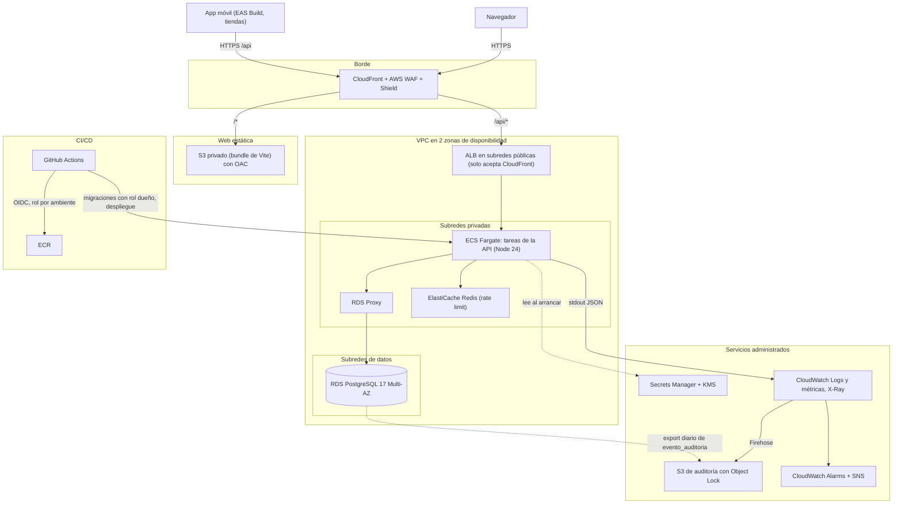

# Propuesta de despliegue en AWS

Propuesta de producción para una empresa regulada (RNF-30). **No se despliega nada**: el documento describe la arquitectura, por qué se eligió cada servicio y qué cambia frente al entorno local. Cubre los puntos que `specs/design.md` §15.3 dejó para este documento.

## Índice

1. [Diagrama](#1-diagrama)
2. [Cómputo de la API](#2-cómputo-de-la-api)
3. [Base de datos](#3-base-de-datos)
4. [Red, IP real y rate limit](#4-red-ip-real-y-rate-limit)
5. [Web](#5-web)
6. [App móvil](#6-app-móvil)
7. [Secretos y migraciones](#7-secretos-y-migraciones)
8. [Observabilidad y auditoría](#8-observabilidad-y-auditoría)
9. [CI/CD con OIDC y tres ambientes](#9-cicd-con-oidc-y-tres-ambientes)
10. [Preguntas](#10-preguntas)
11. [Puntos de `design.md` §15.3](#11-puntos-de-designmd-153)
12. [Lista de RNF-30](#12-lista-de-rnf-30)

## 1. Diagrama

Una cuenta de AWS por ambiente (dev, staging y prod). El diagrama muestra prod, en dos zonas de disponibilidad.

## 2. Cómputo de la API

**Elegido: ECS sobre Fargate**, detrás de un Application Load Balancer, con al menos 2 tareas en zonas distintas y autoescalado por CPU y por solicitudes por destino.

- La API es un proceso Express de larga vida con un pool de conexiones (`DB_POOL_MAX`) y transacciones con `SELECT … FOR UPDATE`. Un contenedor encaja con ese modelo sin cambiar código.
- No hay servidores que parchear, y cada tarea tiene su propio rol de IAM, que limita qué secretos puede leer.
- Los despliegues son *rolling* con *health check* sobre `GET /api/health`, que ya responde `503` si la base no contesta (design.md §10.3), y con *circuit breaker* que revierte un despliegue fallido.

**Descartados**

| Opción | Por qué no |
|---|---|
| Lambda | Cada invocación concurrente abre su propia conexión a PostgreSQL: el modelo de pool por proceso se pierde y obliga a RDS Proxy aun con poca carga. El arranque en frío se suma a la latencia de una transferencia, y el rate limit en memoria y el pool tendrían que rediseñarse para invocaciones efímeras |
| EKS | Kubernetes da control fino, pero agrega un plano de control, actualizaciones de versión y una superficie de seguridad que un solo servicio no justifica |
| EC2 con Auto Scaling | Hay que parchear y endurecer el sistema operativo, algo que un regulador revisa y que Fargate quita del alcance |
| App Runner | Más simple, pero con menos control de red (subredes, grupos de seguridad, conexión privada a RDS Proxy) y de despliegue del que pide una empresa regulada |
| Elastic Beanstalk | Abstrae lo mismo que ECS con menos control y sin ventaja real |

## 3. Base de datos

**Elegido: Amazon RDS for PostgreSQL 17, Multi-AZ** con dos réplicas en espera (*Multi-AZ DB cluster*), cifrado con una llave de KMS propia y `rds.force_ssl = 1`.

- **Por qué RDS y no Aurora:** el modelo de datos y los triggers (`aplicar_asiento`, suma cero al confirmar, auditoría de solo inserción) son PostgreSQL estándar y se probaron contra PostgreSQL 17. RDS corre el mismo motor, con un costo predecible. Aurora PostgreSQL sería la opción con 100 veces el volumen (§10.2) por sus réplicas de lectura con poco retraso y su almacenamiento distribuido; la migración es directa porque no se usa nada propio de RDS.
- **Multi-AZ:** la conmutación por error a una réplica en espera tarda menos de un minuto en un Multi-AZ DB cluster. Las réplicas en espera también sirven lecturas, aunque esta entrega no las usa.
- **Recuperación a un punto en el tiempo (PITR):** respaldos automáticos con retención de **35 días** (el máximo), más copias con AWS Backup a otra región y a otra cuenta, con *vault lock* para que nadie pueda borrarlas.
- **RPO objetivo: 0 ante la caída de una zona** (la réplica en espera confirma la escritura antes de responder) y **≤ 5 minutos ante corrupción lógica** (PITR con los logs de transacciones).
- **RTO objetivo: ≤ 2 minutos ante la caída de una zona** (conmutación automática) y **≤ 1 hora** para una restauración PITR a una instancia nueva, ensayada cada trimestre.
- **Roles:** se conservan los dos roles de design.md §3.4. La API se conecta como `billetera_app`, sin permisos de DDL ni de `UPDATE`/`DELETE` sobre la auditoría. Las migraciones corren como `billetera_owner` solo desde el pipeline (§7).
- **Parámetros:** `lock_timeout` y `statement_timeout` siguen en la transacción (D-12); en el grupo de parámetros se agregan `log_min_duration_statement = 500ms` y `pg_stat_statements` para encontrar consultas lentas.

## 4. Red, IP real y rate limit

**Red**

- CloudFront es la única entrada pública. El grupo de seguridad del ALB solo admite la *managed prefix list* de CloudFront, y CloudFront agrega un header secreto que el ALB exige con una regla de *listener*. Nadie puede saltarse CloudFront para llegar al ALB.
- Las tareas de la API, RDS Proxy, ElastiCache y RDS están en subredes privadas sin IP pública. La salida a internet no hace falta: Secrets Manager, ECR, CloudWatch y S3 se alcanzan con *VPC endpoints*.
- AWS WAF en CloudFront: reglas administradas de AWS (OWASP comunes, IPs con mala reputación) y una regla de tasa por IP como primera barrera, antes del rate limit de la aplicación.

**`TRUST_PROXY=2`, con el número exacto de proxies, nunca `true`** (design.md §11, DD-41)

Hay dos proxies propios entre el cliente y la API: CloudFront y el ALB.

1. CloudFront agrega la IP del cliente a `X-Forwarded-For`.
2. El ALB agrega la IP del nodo de CloudFront.
3. La tarea recibe la conexión desde el ALB.

Con `TRUST_PROXY=2`, Express confía en la conexión del ALB y en la última entrada (CloudFront), y toma como IP del cliente la entrada que agregó CloudFront. Lo que el cliente escriba a la izquierda en su propio `X-Forwarded-For` se ignora.

- **Nunca `true`:** Express confiaría en toda la cadena y tomaría la entrada de más a la izquierda, que escribe el cliente. Cualquiera podría falsificar su IP y esquivar los límites de login y registro.
- **Nunca un número mayor que el real:** con `3`, la entrada falsificada por el cliente volvería a contar como IP real.
- **Si la arquitectura cambia** (por ejemplo, se quita CloudFront para la API), el valor cambia en el mismo cambio de infraestructura, y una prueba de humo en staging verifica que un `X-Forwarded-For` inventado no altera la IP registrada.

**Rate limit compartido entre instancias: Redis (ElastiCache)**

En local, el almacén del rate limit está en la memoria del proceso (DD-41). Con N tareas detrás del ALB, cada una tendría su propio contador y el límite real sería N veces el configurado. En producción:

- `express-rate-limit` usa `rate-limit-redis` contra **ElastiCache for Redis** (o Valkey) en modo clúster, Multi-AZ, con cifrado en tránsito y en reposo y AUTH por un secreto de Secrets Manager.
- Mismo esquema de llaves que en local: IP (con `ipKeyGenerator`, subred `/56` en IPv6), correo normalizado para el login y `usuarioId` para el alta de beneficiarios. Mismos umbrales que en la tabla de design.md §11.
- Si Redis no responde, el limitador **falla cerrado** en login y registro (`503 retryable`): es preferible a dejar la adivinación de contraseñas sin límite. El alta de beneficiarios sigue el mismo criterio.

## 5. Web

- El bundle de Vite (`npm run build -w web`) se sube a un **bucket S3 privado** con versionado, al que solo CloudFront accede (*Origin Access Control*).
- **Misma distribución, mismo dominio:** `/api/*` va al ALB y todo lo demás a S3. Así la web y la API comparten origen, como con el proxy de Vite en local (D-06): la cookie del refresh (`HttpOnly; Secure; SameSite=Strict; Path=/api/auth`) funciona sin cambios y CORS solo actúa ante orígenes ajenos. `WEB_ORIGIN` es ese dominio con `https:`.
- Certificado de ACM, HTTPS obligatorio (redirección de HTTP), HSTS con `includeSubDomains` y `preload`, y una política de headers de seguridad en CloudFront (CSP, `X-Content-Type-Options`, `Referrer-Policy`, `frame-ancestors 'none'`).
- `index.html` sin caché y los archivos con hash en el nombre con caché larga; un despliegue invalida solo `index.html`.

## 6. App móvil

**Distribución**

- **EAS Build** genera los binarios firmados (AAB para Google Play, IPA para App Store). Las credenciales de firma se guardan en EAS o, si la política lo exige, en Secrets Manager y se pasan al build.
- Canales: *internal testing* en Play y TestFlight para staging, y producción por las tiendas con despliegue gradual.
- Las actualizaciones *over-the-air* (EAS Update) se limitan a correcciones de JavaScript, firmadas con *code signing*, y se publican por canal por ambiente.

**Conexión segura a la API**

- `EXPO_PUBLIC_API_URL=https://<dominio>/api`, el mismo dominio de CloudFront que la web. Android bloquea HTTP sin cifrar por defecto y iOS exige HTTPS con App Transport Security.
- **`EXPO_PUBLIC_BLOQUEAR_CAPTURAS` siempre en `true`** (o ausente) en los perfiles de staging y prod de `eas.json`: el valor `false` solo existe en local para grabar el video (DD-44).
- La app ya guarda el refresh y el intento solo en `expo-secure-store` (Keychain y Keystore) y el access solo en memoria (RNF-20). En producción se suma:
  - *Certificate pinning* con las llaves públicas de la cadena de ACM, con dos llaves de respaldo para rotar sin publicar una versión nueva.
  - Play Integrity y App Attest para que la API distinga la app legítima de un cliente modificado, verificado en una ruta de la API antes del login.
- El rate limit y el WAF aplican igual a la app: llega por CloudFront.

## 7. Secretos y migraciones

**Secretos en Secrets Manager**, cifrados con una llave de KMS por ambiente:

| Secreto | Uso | Rotación |
|---|---|---|
| `JWT_SECRETO` | Firma del access (HS256) | Manual, con ventana en que la API acepta la llave anterior; con firma asimétrica (README, "qué haría con más tiempo") se rota sin ventana |
| `OTP_HMAC_SECRETO` | HMAC del código de un solo uso | Manual; los códigos vigentes caducan en minutos |
| Credenciales de `billetera_app` | `DATABASE_URL` de la API | Automática cada 30 días con la función de rotación de RDS |
| Credenciales de `billetera_owner` | Solo migraciones | Automática; solo el rol del pipeline puede leerlas |
| AUTH de Redis | Rate limit | Automática |

- ECS inyecta los secretos como variables de entorno de la tarea al arrancar; nunca están en la imagen, en el repositorio ni en los logs. La API valida su configuración al arrancar (design.md §2.4) y no arranca si falta alguno.
- En prod, la configuración fija `NODE_ENV=production`, `OTP_SIMULADO=false`, `FONDEO_BIENVENIDA_CENTAVOS=0`, `DEMO_LATENCIA_MS=0` y `TRUST_PROXY=2`.

**Migraciones con el rol dueño desde el pipeline**

- Un paso del despliegue lanza una tarea de ECS de una sola ejecución (`npm run db:migrate`) con un rol de IAM que puede leer las credenciales de `billetera_owner`. Las tareas de la API nunca tienen ese permiso.
- Las migraciones corren **antes** de desplegar la versión nueva y deben ser compatibles hacia atrás (expandir y después contraer), para que la versión anterior siga funcionando durante el *rolling deploy*.
- `npm run db:seed` se niega a correr con `NODE_ENV=production` (design.md §3.7) y no forma parte del pipeline de prod.

## 8. Observabilidad y auditoría

**Logs**

- La API escribe JSON en `stdout` (pino, design.md §10.1), sin cuerpos de petición y con correo, CLABE, tokens y códigos censurados. ECS los manda a **CloudWatch Logs** con el driver `awslogs`, cifrados con KMS.
- Retención de los logs de aplicación: **90 días** en CloudWatch, y después, por una suscripción con Kinesis Data Firehose, en S3 con transición a Glacier hasta **5 años**.

**Auditoría**

- La fuente de verdad sigue siendo la tabla `evento_auditoria`, de solo inserción, escrita en la misma transacción que la operación (DD-40). Vive con la base: Multi-AZ, PITR de 35 días y copias entre regiones.
- Un job diario exporta los eventos del día a un **bucket S3 con Object Lock en modo *compliance*** en una cuenta separada de auditoría. En ese modo nadie, ni la cuenta raíz, puede borrar o modificar un objeto antes de que venza su retención.
- **Retención de la auditoría: 10 años**, en línea con la conservación de registros que exige la regulación financiera mexicana (el plazo exacto lo fija el área de cumplimiento). Después de 1 año en S3 Standard, pasa a Glacier Deep Archive.
- En la base, una partición mensual permite mover a S3 los eventos de más de 13 meses sin perder la consulta reciente.
- CloudTrail (organización, todas las regiones) registra las acciones sobre la infraestructura y va al mismo bucket de auditoría.

**Métricas, trazas y alarmas**

- **Métricas:** CloudWatch Container Insights para CPU y memoria de las tareas; métricas del ALB (latencia p95 y p99, `5xx`); métricas de RDS (conexiones, bloqueos, *replica lag*); métricas propias por EMF desde los logs: transferencias aplicadas, rechazadas por motivo, `codigo-incorrecto`, `refresh-reuse-detected`, `429` y deadlocks reintentados.
- **Trazas:** OpenTelemetry en la API con exportación a X-Ray, con el `reqId` (DD-09) como atributo para unir trazas, logs y eventos de auditoría.
- **Alarmas** (con SNS a la guardia):
  - `5xx` > 1 % en 5 minutos; latencia p99 de `POST /transferencias` > 2 s.
  - Cualquier deadlock: con el orden total de D-12 no debería ocurrir, así que uno solo es un bug.
  - Un `refresh-reuse-detected`, que indica posible robo de sesión.
  - Conexiones de RDS Proxy > 80 % de su máximo; espacio libre de RDS < 20 %.
  - Un job diario que verifica las invariantes de RNF-07 (`saldo = SUM(asientos)` por cuenta y `SUM(saldo) = 0`) en una réplica de lectura y alerta si alguna falla.

## 9. CI/CD con OIDC y tres ambientes

- **Sin llaves de AWS de larga vida:** GitHub Actions obtiene credenciales temporales con **OIDC**. Cada ambiente tiene un rol de IAM cuya política de confianza solo acepta el `sub` del repositorio con su *environment* de GitHub (`repo:<org>/billetera:environment:prod`).
- **Ambientes dev, staging y prod**, cada uno en su propia cuenta de AWS dentro de AWS Organizations, con *environments* de GitHub y sus reglas de protección:

| Ambiente | Cuándo se despliega | Aprobación | Datos |
|---|---|---|---|
| dev | Cada push a `main` con los 4 jobs de CI en verde (RNF-29) | Automático | Seed de demo |
| staging | Al crear un tag de versión | Automático, con pruebas de humo y la prueba de `X-Forwarded-For` (§4) | Copia anonimizada de prod |
| prod | La misma imagen de staging, promovida | Aprobación manual de dos personas | Reales |

- **Pipeline:** los 4 jobs actuales (`calidad`, `unitarias`, `integracion`, `movil`) → build de la imagen → escaneo (ECR *enhanced scanning* y `npm audit signatures`) → push a ECR con tag inmutable → migraciones (§7) → despliegue en ECS → pruebas de humo → subida de la web a S3 e invalidación.
- La imagen se construye una sola vez y se promueve por digest: prod corre exactamente lo que se probó en staging.
- La app móvil se construye con EAS Build en un job aparte, con el perfil del ambiente.

## 10. Preguntas

### 10.1 ¿Cómo se manejan las conexiones a PostgreSQL al escalar horizontalmente?

Cada tarea abre un pool de hasta `DB_POOL_MAX` conexiones (10 por defecto). Con autoescalado, `tareas × DB_POOL_MAX` puede superar el `max_connections` de la instancia, y cada conexión de PostgreSQL es un proceso que consume memoria.

1. **RDS Proxy** entre las tareas y la base. Multiplexa muchas conexiones de clientes en pocas conexiones a la base, absorbe las ráfagas al escalar y acorta la conmutación por error de Multi-AZ, porque las tareas no tienen que reconectarse. La autenticación del proxy usa IAM y Secrets Manager.
2. **Presupuesto de conexiones:** `DB_POOL_MAX × tareas máximas ≤ conexiones del proxy`, y las conexiones del proxy ≤ 80 % de `max_connections`. El autoescalado tiene un máximo de tareas que respeta ese presupuesto.
3. **Transacciones cortas:** la API ya toma la conexión solo durante la unidad de trabajo (design.md §2.3), con `lock_timeout = 5s` y `statement_timeout = 10s`. Una transacción no espera nada externo mientras tiene filas bloqueadas, así que el proxy puede reutilizar las conexiones rápido.
4. Se evita lo que "fija" una conexión del proxy a un cliente (*pinning*): `SET` de sesión fuera de la transacción y sentencias preparadas con nombre. Los `SET LOCAL` de los timeouts viven dentro de la transacción y no fijan la conexión.

### 10.2 ¿Qué cambiaría con 100 veces el volumen?

**Escritura y bloqueos**

- El orden de bloqueo usuario → transferencia → cuentas (D-12) serializa por usuario y por cuenta, no globalmente: 100 veces más usuarios no compiten entre sí. Lo que sí escala mal son las cuentas muy activas, y la principal es Fondeo.
- **Punto caliente de Fondeo (D-20):** todo registro y todo depósito bloquea la misma fila de Fondeo, así que con 100 veces más altas hacen fila en ella. La solución es **repartir Fondeo en N subcuentas** (por ejemplo, 16 o 32) y elegir una por el hash del usuario. Cada subcuenta conserva sus asientos y la suma cero global sigue igual, porque la invariante es sobre la suma de todos los saldos. La consulta del saldo total de Fondeo suma las subcuentas. Ya está en "qué haría con más tiempo" del README.
- La instancia de RDS sube de clase, o se migra a **Aurora PostgreSQL** por su almacenamiento distribuido y sus réplicas con poco retraso.

**Lectura**

- El historial ya pagina por cursor sobre un índice compuesto (RNF-13, design.md §8.5), así que su costo no crece con el total de movimientos de la cuenta. Con 100 veces el volumen, se mandan las lecturas del historial y del saldo a **réplicas de lectura**, aceptando unos milisegundos de retraso en el historial; la transferencia sigue leyendo saldo y límite en el primario, dentro de su transacción.
- **Particionar** `asiento` y `evento_auditoria` por mes, para que los índices calientes quepan en memoria y archivar sea quitar una partición.
- La tabla de llaves de idempotencia crece sin límite; se agrega su expiración a 24 h (fuera de alcance en esta entrega, D-03) con un job de limpieza por lotes.

**Plataforma**

- RDS Proxy pasa a ser indispensable (§10.1), y ElastiCache crece en nodos.
- Colas (SQS) para el trabajo que no tiene que ser síncrono: el envío del código por un proveedor real de OTP, los exports de auditoría y las notificaciones.
- Pruebas de carga en staging antes de cada cambio grande, midiendo p99 de `POST /transferencias` y la espera por bloqueos.

### 10.3 ¿Qué herramienta de infraestructura como código usaría?

**Terraform** (u OpenTofu), con módulos por componente (red, base, cómputo, web, observabilidad) y un *workspace* o directorio por ambiente.

- Es declarativo y el `terraform plan` sirve como evidencia de cambio para un regulador: se adjunta al pull request y se aprueba antes del `apply`.
- El estado vive en S3 con cifrado y bloqueo, en la cuenta de herramientas, y el pipeline lo aplica con el mismo rol de OIDC del ambiente.
- Revisión con `tflint` y `checkov` en CI para detectar recursos públicos, cifrado faltante o grupos de seguridad abiertos.
- **Alternativa:** AWS CDK en TypeScript, si el equipo prefiere el mismo lenguaje del monorepo. Terraform gana por su madurez, porque no depende de CloudFormation y porque el mismo flujo sirve para GitHub y otros proveedores.

## 11. Puntos de `design.md` §15.3

- [x] `TRUST_PROXY` con el número exacto de saltos detrás de CloudFront y el ALB (§11, DD-41) → §4: `TRUST_PROXY=2`, nunca `true`.
- [x] Redis (ElastiCache) como almacén del rate limit con varias instancias (DD-41) → §4.
- [x] Destino y retención de los logs y de la auditoría (§10) → §8.
- [x] Secretos en Secrets Manager, con migraciones ejecutadas por el rol dueño desde el pipeline (§2.4, §3.4) → §7.
- [x] Punto caliente de Fondeo en el escenario ×100 (§6.3, D-20) → §10.2.
- [x] Métricas, trazas y alarmas (§10.3) → §8.

## 12. Lista de RNF-30

- [x] Diagrama de arquitectura en Mermaid → §1.
- [x] Propuesta de producción para una empresa regulada, sin desplegar nada → todo el documento.
- [x] Cómputo de la API: servicio elegido y por qué se descartan los demás → §2.
- [x] Base de datos: RDS PostgreSQL o Aurora → §3 (RDS, con Aurora como paso para ×100).
- [x] Multi-AZ → §3.
- [x] Recuperación a un punto en el tiempo → §3.
- [x] RPO y RTO objetivo → §3.
- [x] Hosting de la web → §5.
- [x] Distribución de la app móvil → §6.
- [x] Conexión segura de la app móvil a la API → §6.
- [x] Observabilidad → §8.
- [x] Auditoría: dónde y cuánto tiempo se retienen sus logs → §8.
- [x] CI/CD con OIDC → §9.
- [x] Ambientes dev, staging y prod → §9.
- [x] Respuesta: manejo de conexiones a PostgreSQL al escalar horizontalmente → §10.1.
- [x] Respuesta: qué cambiaría con 100 veces el volumen, incluido el punto caliente de Fondeo → §10.2.
- [x] Respuesta: herramienta de infraestructura como código → §10.3.
