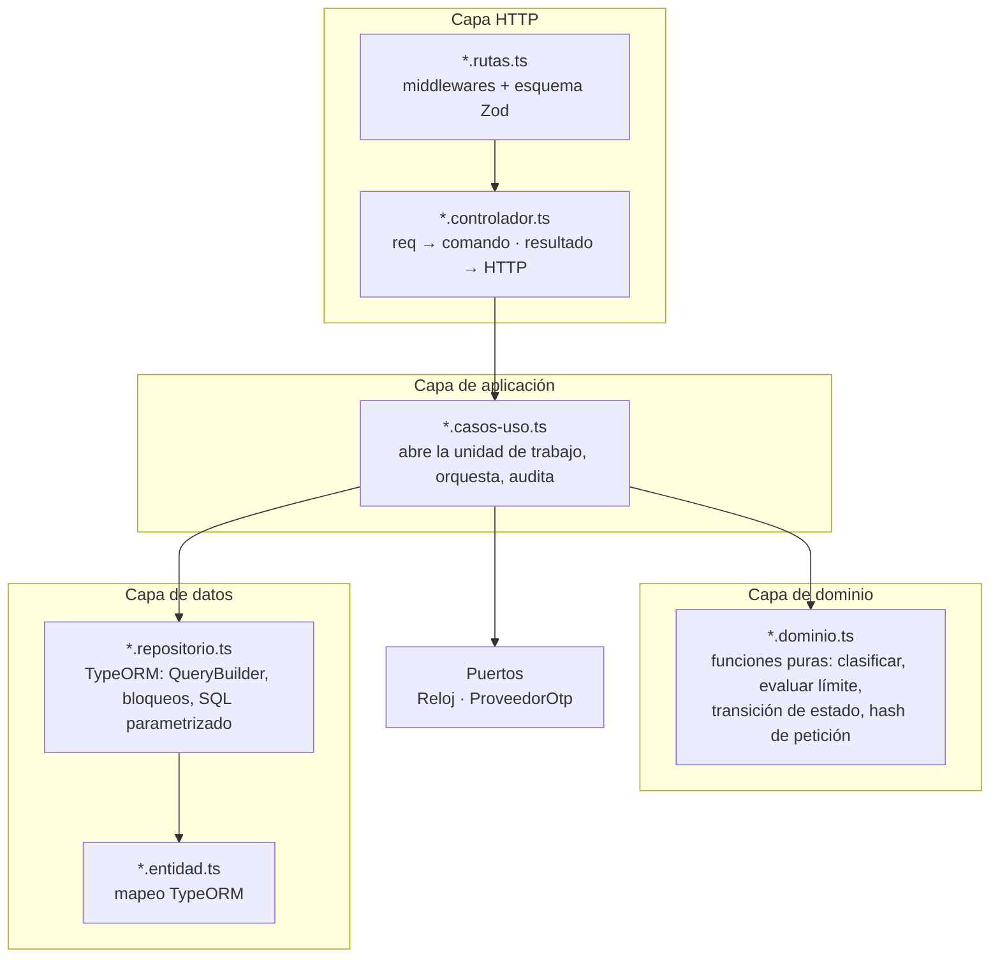
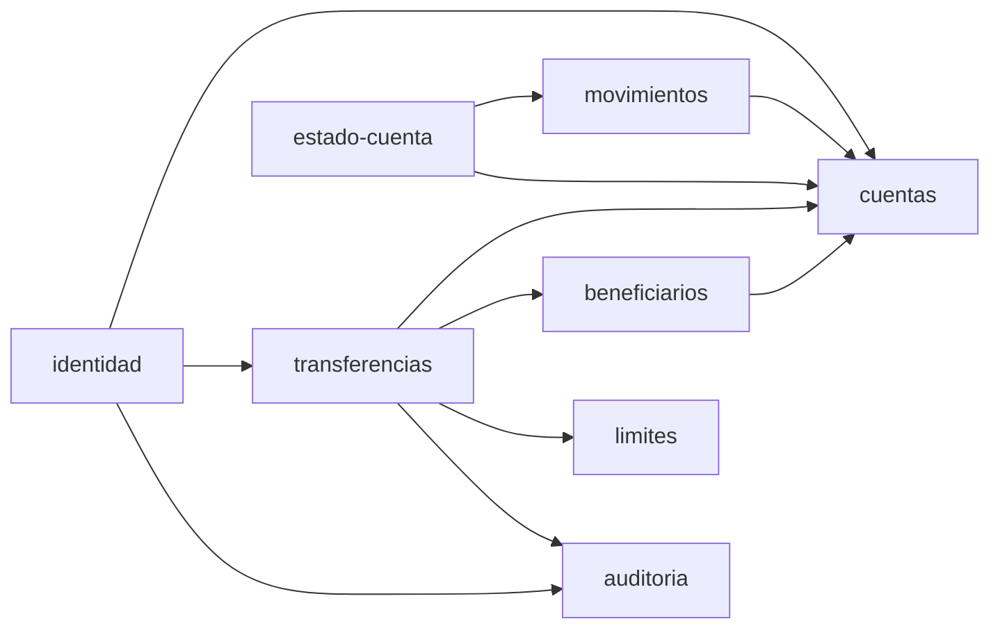

# Diseño — Billetera digital MXN

Fase 2 del flujo spec-driven (Requisitos → **Diseño** → Tareas). Insumos: `docs/enunciado.md`, `specs/requirements.md`, `specs/decisiones.md` (D-01 a D-20), `specs/esqueleto.md` y `GLOSSARY.md`.

Este documento dice **cómo** se cumplen los requisitos. El contrato HTTP completo vive en [`specs/openapi.yaml`](./openapi.yaml); aquí se resume y se justifica.

---

## 0. Convenciones

### 0.1 Identificadores

| Prefijo | Significado | Fuente |
|---|---|---|
| `R-x.y` | Criterio de aceptación | `requirements.md` |
| `RNF-nn` | Requisito no funcional | `requirements.md` |
| `CB-n` | Caso borde del enunciado | `requirements.md` §10 |
| `D-nn` | Decisión cerrada en el interrogatorio | `decisiones.md` |
| `DD-nn` | **Decisión de diseño nueva**, tomada en este documento | este documento, §16 |
| `§n.m` | Sección de este documento | — |

`tasks.md` y los mensajes de commit citan `R-`, `RNF-`, `D-` y `DD-`.

### 0.2 Decisiones nuevas

Toda decisión que no esté en `decisiones.md` se marca en el texto así:

> **DD-nn · Propuesta · Título**
> **Contexto:** … **Opciones:** … **Decisión:** … **Motivo:** …

Estados posibles: **Propuesta** (pendiente de aprobación), **Aprobada** o **Rechazada**. La §16 las consolida. Al aprobarse, cada una pasa a `decisiones.md` como `D-21` en adelante, y el `DD-nn` queda como alias.

Una precisión de una decisión existente que no cambia su sentido (por ejemplo, el nombre de una función) **no** se marca como `DD`; se cita la `D-nn` que precisa.

### 0.3 Reglas de redacción

- Todos los montos están en **centavos enteros** (D-18). Ningún ejemplo usa pesos con decimales, salvo la presentación.
- El vocabulario del dominio es el de `GLOSSARY.md`: _cuenta_, _saldo_, _asiento_, _movimiento_, _transferencia_, _traspaso_, _depósito_, _Fondeo_.
- Los identificadores de código (tablas, columnas, módulos, funciones) van en español, sin acentos ni `ñ` (`contrasena`, `codigo`). Los términos técnicos sin traducción natural se dejan en inglés (`middleware`, `request ID`, `hash`).
- Los diagramas usan Mermaid y deben dibujarse en GitHub.

---

## 1. Stack y estructura del monorepo

### 1.1 Stack

Las versiones mayores se fijan aquí; las exactas quedan en `package-lock.json`.

| Capa | Tecnología | Requisito | Notas |
|---|---|---|---|
| Runtime | Node.js **24 LTS** | RNF-16 (≥ 20) | Ver DD-01 |
| Lenguaje | TypeScript 5, `strict` + `noUncheckedIndexedAccess` | RNF-16 | `tsconfig.base.json` compartido |
| HTTP | Express **5** | RNF-16 | Propaga a `next` los errores de handlers `async` sin envoltorios |
| Base de datos | PostgreSQL **17** | RNF-16 (≥ 15) | En Docker Compose (§1.3) |
| Acceso a datos | TypeORM 0.3, driver `pg` | RNF-16 | `synchronize: false`, migraciones a mano (DD-05) |
| Validación | Zod 4 | RNF-01, RNF-18 | Esquemas en `packages/shared` |
| JWT | `jose` | RNF-02 | DD-02 |
| Contraseñas | `argon2` (argon2id) | RNF-03 | Parámetros en §5 |
| Logs | `pino` + `pino-http` | RNF-12 | DD-02 |
| Rate limit | `express-rate-limit` | RNF-04 | Store y umbrales en §11 |
| Seguridad HTTP | `helmet`, `cors`, `cookie-parser` | RNF-05 | |
| Docs OpenAPI | `swagger-ui-express` sirviendo `specs/openapi.yaml` | RNF-28 | §4.3 |
| Tipos del contrato | `openapi-typescript` | RNF-18 | §4.3 |
| Web | React **19** + Vite, React Router, TanStack Query 5, React Hook Form + `@hookform/resolvers/zod` | Enunciado Fase 3 | DD-03 |
| Móvil | Expo (SDK estable vigente, ≥ 54), React Navigation (native stack), `expo-secure-store`, `expo-crypto`, `@react-native-community/netinfo` | Enunciado Fase 3 | DD-03 |
| Pruebas | Vitest (`api`, `web`, `shared`), `jest-expo` (`mobile`), Supertest, Testing Library | RNF-22 a RNF-26 | DD-04 |
| Lint y formato | ESLint (flat config) + `typescript-eslint` + Prettier | RNF-09, RNF-29 | Reglas de dinero en §13.1 |
| CI | GitHub Actions | RNF-29 | §14 |

> **DD-01 · Aprobada · Versiones mayores del stack**
> **Contexto:** el enunciado fija mínimos (Node 20, PostgreSQL 15, React 18). Node 20 terminó su soporte en abril de 2026.
> **Opciones:** (1) los mínimos exactos; (2) las LTS y estables vigentes.
> **Decisión:** Node 24 LTS, PostgreSQL 17, Express 5, React 19. Web y móvil usan **la misma versión exacta de React** que fija Expo, para que npm workspaces no instale dos copias de React en la raíz.
> **Motivo:** cumplen los mínimos, tienen soporte durante la evaluación, y Express 5 elimina el envoltorio `asyncHandler`, que es una fuente común de errores no atrapados.

> **DD-02 · Aprobada · Librerías de la API**
> **Contexto:** el enunciado exige JWT, argon2 o bcrypt y logs JSON, pero no fija librerías.
> **Opciones:** `jsonwebtoken` o `jose` para JWT; `winston` o `pino` para logs; `bcrypt` o `argon2`.
> **Decisión:** `jose` (API basada en promesas, tipada, sin dependencias nativas), `pino` + `pino-http` (JSON nativo, `redact` por rutas para enmascarar, `genReqId` para el request ID) y `argon2` en modo argon2id (recomendación de OWASP).
> **Motivo:** cada una resuelve un requisito sin código adicional: `redact` cubre RNF-12 y `genReqId` el request ID.

> **DD-03 · Aprobada · Librerías de los clientes**
> **Contexto:** el enunciado fija React + Vite + TanStack Query y Expo, pero no el ruteo ni los formularios.
> **Opciones:** formularios con estado propio o con React Hook Form; en móvil, `expo-router` (rutas por archivos) o React Navigation.
> **Decisión:** React Hook Form con el resolver de Zod, para validar con **los mismos esquemas** de `packages/shared` (RNF-18). En móvil, React Navigation con *native stack* y stacks condicionales: el stack autenticado no se monta mientras haya un intento pendiente sin resolver (R-4.31).
> **Motivo:** el gating de R-4.31 se expresa directo como "qué stack se monta", sin redirecciones de rutas por archivo.

> **DD-04 · Aprobada · Ejecutores de pruebas**
> **Contexto:** hay que probar Node, React y React Native.
> **Opciones:** Jest en todo; Vitest en todo; mixto.
> **Decisión:** Vitest en `api`, `web` y `shared`; `jest-expo` en `mobile`.
> **Motivo:** Vitest comparte la configuración de Vite en web y corre TypeScript sin transpilación aparte. `jest-expo` es el preset que mantiene Expo; forzar Vitest sobre React Native añade riesgo sin beneficio.

### 1.2 Estructura del monorepo

npm workspaces con cuatro paquetes. `packages/shared` no depende de ningún otro; `api`, `web` y `mobile` dependen solo de `shared`.

```text
billetera/
├── package.json                # workspaces y scripts raíz (§1.3)
├── tsconfig.base.json          # strict, noUncheckedIndexedAccess
├── eslint.config.js            # reglas comunes y de dinero (§13.1)
├── docker-compose.yml          # PostgreSQL 17
├── docker/postgres/init.sql    # roles y base de pruebas (§3.4)
├── .github/workflows/ci.yml    # §14
├── GLOSSARY.md
├── README.md
├── docs/aws-deploy.md
├── specs/                      # requirements, design, tasks, ai-log, decisiones, esqueleto, openapi.yaml
├── packages/shared/
│   └── src/
│       ├── dinero/             # montoTextoACentavos, formatearMXN, centavosATextoDecimal
│       ├── clabe/              # validarClabe, digitoVerificador
│       ├── esquemas/           # Zod: auth, beneficiario, transferencia, historial
│       ├── api/openapi.ts      # tipos generados (§4.3), versionados
│       └── index.ts
├── api/
│   ├── src/
│   │   ├── main.ts             # config → base de datos → listen
│   │   ├── app.ts              # raíz de composición y middlewares (§2.2)
│   │   ├── config/             # esquema Zod del entorno (§2.4)
│   │   ├── plataforma/
│   │   │   ├── db/             # DataSource, parsers de pg, unidad de trabajo (§2.3)
│   │   │   ├── http/           # request ID, validar, autenticar, problem, rate limit
│   │   │   ├── logging/        # pino y enmascarado (§10)
│   │   │   ├── reloj/          # puerto Reloj (§2.1)
│   │   │   └── otp/            # puerto ProveedorOtp (§2.1)
│   │   ├── modulos/
│   │   │   ├── identidad/
│   │   │   ├── cuentas/
│   │   │   ├── beneficiarios/
│   │   │   ├── transferencias/
│   │   │   ├── limites/
│   │   │   ├── movimientos/
│   │   │   ├── estado-cuenta/
│   │   │   └── auditoria/
│   │   ├── migraciones/        # TypeORM, SQL a mano (§3.5)
│   │   └── scripts/            # migrar.ts, seed.ts
│   └── test/
│       ├── unit/
│       ├── integracion/
│       └── concurrencia/
├── web/
│   └── src/
│       ├── app/                # router, QueryClient, layout
│       ├── auth/               # access en memoria, refresh con Web Locks
│       ├── api/                # cliente fetch tipado
│       ├── transferencia/      # máquina del intento (§13.2)
│       ├── pantallas/
│       └── componentes/
└── mobile/
    └── src/
        ├── navegacion/
        ├── auth/               # SecureStore, una sola promesa de refresh
        ├── api/
        ├── transferencia/      # máquina del intento con reintentos (§13.3)
        ├── privacidad/         # ocultar en segundo plano (§13.3)
        └── pantallas/
```

> **DD-05 · Aprobada · Compilación del paquete compartido y ejecución de migraciones**
> **Contexto:** Vite, Metro y Node tienen que consumir `packages/shared`. Además, el CLI de TypeORM tiene fricciones conocidas con ESM y TypeScript, y `migration:generate` no produce triggers, funciones ni permisos.
> **Opciones:** (1) exportar el código TypeScript fuente de `shared` y que cada consumidor lo transpile; (2) compilar `shared` con `tsc` a `dist/` (ESM + `.d.ts`).
> **Decisión:**
> - `shared` se compila con `tsc -b` a `dist/`. Los scripts `predev`, `pretest` y `prebuild` de la raíz lo compilan primero.
> - Todo el monorepo es ESM.
> - Las migraciones **se escriben con TypeORM, a mano**: cada una es una clase que implementa `MigrationInterface` (`up` y `down` con `queryRunner.query(sql)`), sin `migration:generate`. Así se cumple "las migraciones se escriben con TypeORM" del enunciado.
> - El script propio `api/src/scripts/migrar.ts` **solo las ejecuta**: carga el `DataSource` con el rol dueño (§3.4) y llama a `dataSource.runMigrations({ transaction: 'each' })`. No sustituye a TypeORM, sustituye al CLI. El motivo (ESM) está en §3.5.
> **Motivo:** la API en producción corre JavaScript compilado y necesita `shared` compilado de todos modos. Un solo camino evita diferencias entre desarrollo y CI. Casi todo lo importante del esquema es SQL que TypeORM no genera (§3.5).

### 1.3 Entorno local

**Requisitos de la máquina:** Node 24, Docker y, para móvil, Expo Go en un teléfono de la misma red o un simulador.

**Servicios y puertos**

| Servicio | Cómo corre | Puerto |
|---|---|---|
| PostgreSQL 17 | `docker compose` | `5432` |
| API | `tsx watch` en el host | `3000`, rutas bajo `/api` |
| Web | Vite en el host; proxy de `/api` a `:3000` (D-06) | `5173` |
| Móvil | `expo start` | Metro en `8081` |

`docker/postgres/init.sql` se ejecuta una sola vez al crear el volumen. Crea las bases `billetera` y `billetera_test` y los roles de §3.4.

**Scripts de la raíz**

| Script | Qué hace |
|---|---|
| `npm run db:up` | `docker compose up -d --wait` |
| `npm run db:migrate` | Aplica las migraciones con el rol dueño (DD-05) |
| `npm run db:seed` | Seed de §3.7: usuarios demo y 100,000 movimientos o más |
| `npm run dev` | Compila `shared` y levanta API y web en paralelo (`concurrently`) |
| `npm run mobile` | `expo start` en `mobile` |
| `npm test` | Pruebas unitarias de los cuatro paquetes |
| `npm run test:integracion` | Integración y concurrencia contra `billetera_test` (§14) |
| `npm run lint` / `npm run typecheck` | En todos los workspaces |
| `npm run gen:tipos` | Regenera `packages/shared/src/api/openapi.ts` (§4.3) |
| `npm run docs` | Abre Swagger UI en `http://localhost:3000/api/docs` |

**Variables de entorno.** `api/.env.example` trae los valores de desarrollo de §2.4, incluido `FONDEO_BIENVENIDA_CENTAVOS=1000000` (D-20). La app móvil apunta a la API con `EXPO_PUBLIC_API_URL=http://<IP-de-la-LAN>:3000/api`. No usa el proxy de Vite ni cookies (D-06): manda el refresh en el cuerpo.

**Cookie `Secure` en local.** En desarrollo, la web se sirve en `http://localhost:5173`. Chrome, Edge y Firefox tratan `localhost` como contexto seguro y aceptan cookies `Secure` sin HTTPS. El README indica usar uno de esos navegadores. No se crea una bandera para desactivar `Secure`: sería un interruptor de seguridad que podría llegar a producción.

> **DD-06 · Aprobada · Base de datos local en Docker con base de pruebas separada**
> **Contexto:** RNF-23 exige integración contra un PostgreSQL real, y la prueba de concurrencia no debe ensuciar los datos demo.
> **Opciones:** (1) PostgreSQL instalado en el host; (2) Testcontainers; (3) Docker Compose con dos bases.
> **Decisión:** Docker Compose con las bases `billetera` (desarrollo y demo) y `billetera_test` (pruebas). Las pruebas de integración migran `billetera_test` al iniciar la suite y vacían las tablas entre archivos con el rol dueño. En CI se usa un *service container* de PostgreSQL 17 con el mismo `init.sql`.
> **Motivo:** el mismo `init.sql` crea los roles en local y en CI, de modo que las pruebas de permisos (RNF-11) se ejecutan igual en los dos lados. Testcontainers agrega arranque lento y una dependencia de Docker dentro de Node, sin beneficio sobre un service container.

---

## 2. Arquitectura de la API

### 2.1 Módulos y capas

La API es un **monolito modular**: un módulo por área del dominio (esqueleto §2), y cada módulo dividido en las mismas cuatro capas.



| Capa | Responsabilidad | No puede |
|---|---|---|
| Rutas | Declarar método y ruta, rate limit, `autenticar` y `validar(esquema)` | Contener lógica |
| Controlador | Convertir la petición validada en un comando; convertir el resultado en código HTTP y cuerpo | Importar repositorios, `EntityManager` ni `DataSource`; decidir reglas de negocio |
| Casos de uso | Abrir la unidad de trabajo (§2.3), tomar bloqueos en el orden de D-12, llamar al dominio, persistir y auditar | Importar `express` ni conocer códigos HTTP |
| Dominio | Reglas puras, sin E/S, con pruebas unitarias sin base de datos | Hacer E/S |
| Repositorio | Consultas con el `EntityManager` de la transacción que recibe | Abrir transacciones propias |

**La lógica financiera vive en casos de uso y dominio**, nunca en los handlers (RNF-16). Una regla de ESLint (`no-restricted-imports` por patrón de archivo) hace cumplir la columna "No puede".

**Módulos y dependencias**



| Módulo | Contenido | Requisitos |
|---|---|---|
| `identidad` | Registro (con cuentas y fondeo de bienvenida en la misma transacción), login, refresh, logout | HU-1 |
| `cuentas` | Consulta de cuentas propias, bloqueo de cuentas, generación de CLABE | HU-2, R-1.1 |
| `beneficiarios` | Alta y consulta, resolución de CLABE a cuenta | HU-3 |
| `transferencias` | Crear, confirmar y consultar; fondeo interno; respuesta reconstruida desde la fila | HU-4, HU-6 (código) |
| `limites` | Cálculo de lo consumido en el día y `GET /limites` | HU-6 (límite) |
| `movimientos` | Historial con cursor | HU-5 |
| `estado-cuenta` | CSV del mes | HU-B1 |
| `auditoria` | `registrarEvento(tx, evento)`, solo inserción | RNF-11 |

El grafo no tiene ciclos. El fondeo de bienvenida lo ejecuta `identidad` llamando a `transferencias.fondear(tx, …)` **dentro de su propia transacción** (R-1.2, R-1.3): las funciones de los casos de uso que se componen reciben la transacción abierta en vez de abrir otra.

**Rechazos de negocio como resultado, no como excepción.** `SALDO_INSUFICIENTE`, `LIMITE_DIARIO_EXCEDIDO`, `CODIGO_AGOTADO` y `CODIGO_EXPIRADO` no se lanzan como excepción: la transferencia se guarda `RECHAZADA` y la transacción **se confirma** (D-03). El caso de uso devuelve la fila. Una sola función pura, `respuestaDeTransferencia(fila)`, la traduce a `201`, `202` o `422`. La usa tanto la primera respuesta como la repetición con la misma llave, de modo que ambas son idénticas por construcción (R-4.14). Detalle en §6.2.

**Errores que sí son excepciones.** Las clases de `ErrorDominio` (`NoEncontrado`, `ValidacionFallida`, `LlaveReutilizada`, `Reintentable`, etc.) llevan su `type` del catálogo de §7. Solo el manejador central de errores las traduce a HTTP.

**Puertos**

```ts
// plataforma/reloj
interface Reloj {
  /** Instante actual como texto timestamptz en UTC, con microsegundos. Nunca Date. */
  ahora(tx: EntityManager): Promise<string>;
}
// RelojBaseDatos: SELECT now()   (inicio de la transacción, D-11/D-15)
// RelojFijo:      devuelve un valor fijado por la prueba (23:59:59.999999, 00:00:00)

// plataforma/otp
interface ProveedorOtp {
  enviar(usuarioId: string, codigo: string): Promise<{ codigoSimulado?: string }>;
}
// ProveedorOtpSimulado: solo se instancia con OTP_SIMULADO=true (D-07)
```

> **DD-07 · Aprobada · Las marcas de tiempo de negocio salen del Reloj y viajan como texto**
> **Contexto:** D-15 pide un reloj inyectable para probar la medianoche, y D-11 prohíbe pasar `creado_en` por `Date`, que solo tiene milisegundos. Si `aplicada_en` saliera del reloj y `creado_en` de `DEFAULT now()`, en las pruebas habría dos relojes distintos.
> **Decisión:**
> - Toda marca de negocio (`transferencia.creado_en`, `transferencia.aplicada_en`, `asiento.creado_en`, `codigo_confirmacion.expira_en`) se escribe con el valor de `Reloj.ahora(tx)`, leído una vez por transacción. Los `DEFAULT now()` quedan solo como red para tablas sin reglas de tiempo (sesión, auditoría).
> - La conexión fija `TimeZone=UTC`. Los parsers de `pg` devuelven `timestamptz` (OID 1184) como **texto**, nunca como `Date`; las columnas de las entidades se tipan como `string`.
> - El formato del texto en la API se define en §4.1.
> **Motivo:** un solo origen del tiempo por transacción. La prueba de medianoche controla `aplicada_en` y `creado_en` a la vez, y los microsegundos del cursor nunca se truncan.

> **DD-08 · Aprobada · Capas con regla de imports y composición manual**
> **Contexto:** el enunciado pide capas o módulos y la lógica financiera fuera de los handlers, pero no dice cómo hacerlo verificable.
> **Opciones:** contenedor de inyección de dependencias (`tsyringe`, `inversify`) o composición manual en `app.ts`.
> **Decisión:** composición manual. `crearApp(dependencias)` recibe `DataSource`, `Reloj`, `ProveedorOtp`, `Config` y `Logger`, y las pruebas pasan sus dobles. La separación de capas se verifica con `no-restricted-imports` en ESLint, que corre en CI.
> **Motivo:** son ocho módulos; un contenedor agrega decoradores y metadatos sin resolver nada que una función no resuelva. La regla de lint convierte "la lógica no vive en los handlers" en una verificación automática.

### 2.2 Ciclo de vida de una petición

Orden de los middlewares en `app.ts`:

| # | Middleware | Responsabilidad | Requisitos |
|---|---|---|---|
| 1 | `requestId` | Toma `X-Request-Id` entrante si es un UUID; si no, genera uno. Lo devuelve en el header de respuesta | RNF-12 |
| 2 | `pino-http` | Log JSON de entrada y salida con `reqId`, con `redact` (§10) | RNF-12 |
| 3 | `helmet` | Headers de seguridad | RNF-05 |
| 4 | `cors` | Solo `WEB_ORIGIN`, `credentials: true` | RNF-05 |
| 5 | `express.json({ limit: '16kb', strict: true })` | Cuerpos JSON acotados; un JSON mal formado responde `400` de validación (§7) | RNF-01 |
| 6 | `cookie-parser` | Lee la cookie de refresh | D-06 |
| 7 | `GET /api/health`, `/api/docs` | Sin autenticación | RNF-28 |
| 8 | `/api/auth/*` | Rate limit por ruta (§11) y `validar` | HU-1 |
| 9 | `autenticar` | Verifica el JWT y pone `req.usuarioId`; si falla, `401` | R-1.11 |
| 10 | Rutas de módulos | `validar({ params, query, body, headers })` → controlador | — |
| 11 | `demoLatencia` | Solo en `POST /transferencias` y `POST /transferencias/{id}/confirmar`, después del caso de uso y antes de responder; solo si `DEMO_LATENCIA_MS > 0` | D-17 |
| 12 | `noEncontrado` | Cualquier otra ruta → `404 not-found` | RNF-01 |
| 13 | `manejadorErrores` | Traduce a problem RFC 7807 (§7); registra la causa interna solo en el log | RNF-01 |

`validar` deja los datos ya transformados en `req.validado` y nunca deja pasar campos que el esquema no declara. Los esquemas de cuerpo usan `.strict()`.

> **DD-09 · Aprobada · El request ID viaja en el header, no en el cuerpo del problem**
> **Contexto:** es útil correlacionar un error con su línea de log, pero R-4.14 exige que la repetición con la misma llave devuelva **el mismo cuerpo** que la primera vez, incluidos los `422` de negocio.
> **Opciones:** (1) campo de extensión `requestId` en cada problem; (2) solo el header `X-Request-Id`.
> **Decisión:** el request ID va solo en el header `X-Request-Id` de todas las respuestas. Se acepta uno entrante con formato UUID para correlacionar con el cliente; si no tiene ese formato, se genera uno nuevo, para que el log no acepte texto arbitrario.
> **Motivo:** un `requestId` en el cuerpo haría distintos el primer `422` y su repetición, y rompería R-4.14.

### 2.3 Unidad de trabajo transaccional

Todo caso de uso que escribe corre dentro de `conTransaccion`, el único lugar de la API que abre transacciones:

```ts
conTransaccion<T>(
  trabajo: (tx: EntityManager) => Promise<T>,
  opciones?: { reintentosDeadlock?: number }, // por defecto 3 (D-12)
): Promise<T>
```

1. Toma un `QueryRunner` del pool (`DB_POOL_MAX`, por defecto 10; RNF-24).
2. `START TRANSACTION ISOLATION LEVEL READ COMMITTED` (D-12).
3. `SET LOCAL lock_timeout = '5s'` y `SET LOCAL statement_timeout = '10s'` (D-12).
4. Ejecuta `trabajo(tx)`. Los repositorios reciben `tx` y nunca usan el `DataSource` global.
5. `COMMIT`. Aquí se evalúa el *constraint trigger* diferido de suma cero (D-14). Si falla, el error llega en el `COMMIT` y se trata como error interno (`500`): indica un bug, nunca una entrada del usuario.
6. Ante cualquier error, `ROLLBACK` y clasificación por `SQLSTATE`:

| `SQLSTATE` | Significado | Acción |
|---|---|---|
| `40P01` | Deadlock | Reintenta toda la función `trabajo` hasta 3 veces, con espera aleatoria de 10 a 50 ms × intento, y log `warn` (D-12) |
| `55P03` | `lock_timeout` agotado | `Reintentable` → `503 retryable` (R-4.19) |
| `57014` | `statement_timeout` agotado | `Reintentable` → `503 retryable` (R-4.19) |
| `23505` | Violación de `UNIQUE` | Se propaga con el nombre de la restricción; el caso de uso decide (idempotencia en §6.2, duplicados en §7) |
| `23514`, `23503`, `P0001` | `CHECK`, FK o trigger | Se propaga. Si llega hasta el manejador sin traducirse, es un `500` y su detalle va solo al log |

`40P01` se reintenta porque la transacción completa no dejó efectos. `55P03` y `57014` no se reintentan en el servidor: el tiempo ya se gastó, y el cliente reintenta con la misma llave (D-12, D-16, D-17).

**Después de un `23505` la transacción está abortada.** Para leer la fila que ganó la carrera, el caso de uso abre **otra** `conTransaccion`. Así se resuelve R-4.16 (§6.2).

**Uso de TypeORM en los repositorios.** Los bloqueos usan `QueryBuilder` con `.setLock('pessimistic_write')` y `.orderBy('id', 'ASC')`, que TypeORM traduce a `SELECT … ORDER BY id FOR UPDATE`. Las consultas que TypeORM no expresa bien (comparación de tuplas del cursor, `AT TIME ZONE`, `SUM(...)::bigint`) usan `tx.query(sql, params)`, **siempre parametrizado**. Los nombres de columnas nunca se interpolan.

**Parsers de `pg`**, registrados una vez en `plataforma/db` (D-18, DD-07):

| OID | Tipo | Parser |
|---|---|---|
| 20 | `int8` | `Number` solo si `Number.isSafeInteger`; si no, lanza un error |
| 1700 | `numeric` | Igual que `int8`. `SUM(bigint)` devuelve `numeric`, pero las consultas lo convierten a `::bigint`; este parser es la red |
| 1184 | `timestamptz` | Texto sin transformar |

> **DD-10 · Aprobada · Timeouts de bloqueo y de sentencia responden 503 sin reintento en el servidor**
> **Contexto:** D-12 dice "si se agotan, `503 retryable`", pero no fija qué `SQLSTATE` corresponde a cada caso ni si el servidor reintenta.
> **Decisión:** `55P03` y `57014` se traducen a `503 retryable` con el header `Retry-After: 1`, sin reintento en el servidor. Solo `40P01` se reintenta en el servidor.
> **Motivo:** el servidor no debe pasar del presupuesto de 10 s que el cliente móvil supone (timeout de 15 s, D-17). Un deadlock se resuelve en milisegundos; un timeout ya consumió el presupuesto.

### 2.4 Configuración validada al arrancar

`config/index.ts` lee `process.env` con un esquema Zod. Si falla, `main.ts` registra **los nombres** de las variables inválidas (nunca sus valores) y termina con código 1 antes de abrir el puerto (RNF-15).

| Variable | Tipo y regla | Desarrollo | Fuente |
|---|---|---|---|
| `NODE_ENV` | `development` \| `test` \| `production` | `development` | — |
| `PORT` | entero | `3000` | — |
| `DATABASE_URL` | URL, rol `billetera_app` | — | §3.4 |
| `DATABASE_URL_MIGRACIONES` | URL, rol `billetera_owner`; solo la leen `migrar.ts` y `seed.ts` | — | §3.4 |
| `DB_POOL_MAX` | entero 1–50 | `10` | RNF-24 |
| `JWT_SECRETO` | texto de 32 bytes o más | aleatorio | §5 |
| `OTP_HMAC_SECRETO` | texto de 32 bytes o más, distinto de `JWT_SECRETO` | aleatorio | D-07 |
| `LIMITE_DIARIO_CENTAVOS` | entero positivo seguro | `5000000` | D-13 |
| `UMBRAL_CODIGO_CENTAVOS` | entero positivo seguro, **menor** que el límite | `1000000` | D-13 |
| `FONDEO_BIENVENIDA_CENTAVOS` | entero ≥ 0 seguro | `1000000` | D-20 |
| `OTP_SIMULADO` | booleano | `true` | D-07 |
| `DEMO_LATENCIA_MS` | entero 0–30000 | `0` | D-17 |
| `WEB_ORIGIN` | URL | `http://localhost:5173` | RNF-05 |
| `LOG_LEVEL` | nivel de `pino` | `info` | RNF-12 |
| `TRUST_PROXY` | entero ≥ 0 (saltos de proxy confiables) | `0` | §11 |

Reglas cruzadas con `superRefine`:

- `UMBRAL_CODIGO_CENTAVOS < LIMITE_DIARIO_CENTAVOS` (RNF-15).
- Si `NODE_ENV=production`: `OTP_SIMULADO=false`, `DEMO_LATENCIA_MS=0` y `FONDEO_BIENVENIDA_CENTAVOS=0` (RNF-15, R-6.17).
- `OTP_HMAC_SECRETO ≠ JWT_SECRETO`.

Los booleanos se leen como `'true'` o `'false'` exactos. Zod no convierte `'0'` ni `'no'`, para que un valor mal escrito no active el OTP simulado por accidente.

---
