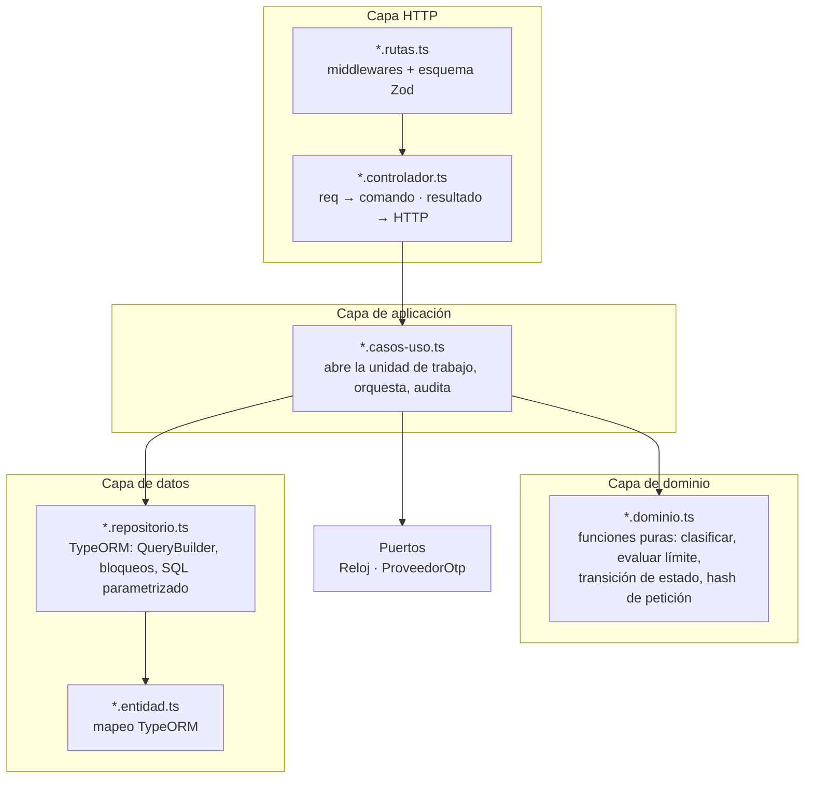
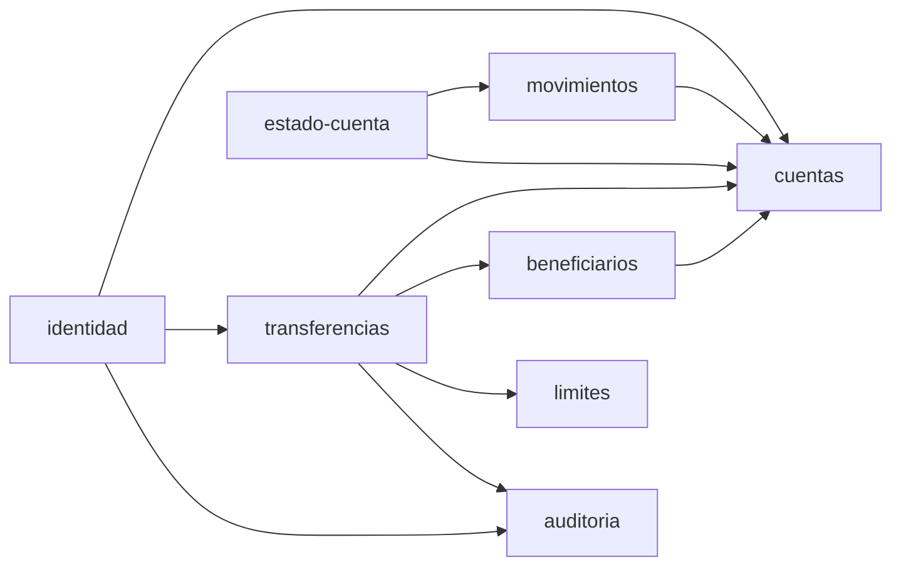
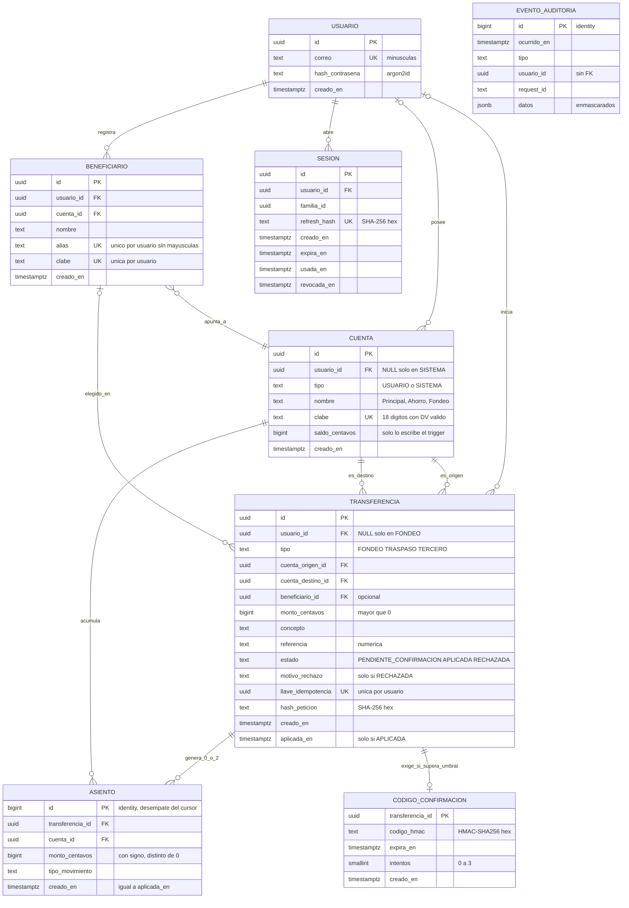

# Diseño — Billetera digital MXN

Fase 2 del flujo spec-driven (Requisitos → **Diseño** → Tareas). Insumos: `docs/enunciado.md`, `specs/requirements.md`, `specs/decisiones.md` (D-01 a D-20), `specs/esqueleto.md` y `GLOSSARY.md`.

Este documento dice **cómo** se cumplen los requisitos. El contrato HTTP completo vive en [`specs/openapi.yaml`](./openapi.yaml); aquí se resume y se justifica.

---

## 0. Convenciones

### 0.1 Identificadores

| Prefijo | Significado | Fuente |
|---|---|---|
| `R-x.y` | Criterio de aceptación | `requirements.md` |
| `RNF-nn` | Requisito no funcional | `requirements.md` |
| `CB-n` | Caso borde del enunciado | `requirements.md` §10 |
| `D-nn` | Decisión cerrada en el interrogatorio | `decisiones.md` |
| `DD-nn` | **Decisión de diseño nueva**, tomada en este documento | este documento, §16 |
| `§n.m` | Sección de este documento | — |

`tasks.md` y los mensajes de commit citan `R-`, `RNF-`, `D-` y `DD-`.

### 0.2 Decisiones nuevas

Toda decisión que no esté en `decisiones.md` se marca en el texto así:

> **DD-nn · Propuesta · Título**
> **Contexto:** … **Opciones:** … **Decisión:** … **Motivo:** …

Estados posibles: **Propuesta** (pendiente de aprobación), **Aprobada** o **Rechazada**. La §16 las consolida. Al aprobarse, cada una pasa a `decisiones.md` como `D-21` en adelante, y el `DD-nn` queda como alias.

Una precisión de una decisión existente que no cambia su sentido (por ejemplo, el nombre de una función) **no** se marca como `DD`; se cita la `D-nn` que precisa.

### 0.3 Reglas de redacción

- Todos los montos están en **centavos enteros** (D-18). Ningún ejemplo usa pesos con decimales, salvo la presentación.
- El vocabulario del dominio es el de `GLOSSARY.md`: _cuenta_, _saldo_, _asiento_, _movimiento_, _transferencia_, _traspaso_, _depósito_, _Fondeo_.
- Los identificadores de código (tablas, columnas, módulos, funciones) van en español, sin acentos ni `ñ` (`contrasena`, `codigo`). Los términos técnicos sin traducción natural se dejan en inglés (`middleware`, `request ID`, `hash`).
- Los diagramas usan Mermaid y deben dibujarse en GitHub.

---

## 1. Stack y estructura del monorepo

### 1.1 Stack

Las versiones mayores se fijan aquí; las exactas quedan en `package-lock.json`.

| Capa | Tecnología | Requisito | Notas |
|---|---|---|---|
| Runtime | Node.js **24 LTS** | RNF-16 (≥ 20) | Ver DD-01 |
| Lenguaje | TypeScript 5, `strict` + `noUncheckedIndexedAccess` | RNF-16 | `tsconfig.base.json` compartido |
| HTTP | Express **5** | RNF-16 | Propaga a `next` los errores de handlers `async` sin envoltorios |
| Base de datos | PostgreSQL **17** | RNF-16 (≥ 15) | En Docker Compose (§1.3) |
| Acceso a datos | TypeORM 0.3, driver `pg` | RNF-16 | `synchronize: false`, migraciones a mano (DD-05) |
| Validación | Zod 4 | RNF-01, RNF-18 | Esquemas en `packages/shared` |
| JWT | `jose` | RNF-02 | DD-02 |
| Contraseñas | `argon2` (argon2id) | RNF-03 | Parámetros en §5 |
| Logs | `pino` + `pino-http` | RNF-12 | DD-02 |
| Rate limit | `express-rate-limit` | RNF-04 | Store y umbrales en §11 |
| Seguridad HTTP | `helmet`, `cors`, `cookie-parser` | RNF-05 | |
| Docs OpenAPI | `swagger-ui-express` sirviendo `specs/openapi.yaml` | RNF-28 | §4.3 |
| Tipos del contrato | `openapi-typescript` | RNF-18 | §4.3 |
| Web | React **19** + Vite, React Router, TanStack Query 5, React Hook Form + `@hookform/resolvers/zod` | Enunciado Fase 3 | DD-03 |
| Móvil | Expo (SDK estable vigente, ≥ 54), React Navigation (native stack), `expo-secure-store`, `expo-crypto`, `@react-native-community/netinfo` | Enunciado Fase 3 | DD-03 |
| Pruebas | Vitest (`api`, `web`, `shared`), `jest-expo` (`mobile`), Supertest, Testing Library | RNF-22 a RNF-26 | DD-04 |
| Lint y formato | ESLint (flat config) + `typescript-eslint` + Prettier | RNF-09, RNF-29 | Reglas de dinero en §13.1 |
| CI | GitHub Actions | RNF-29 | §14 |

> **DD-01 · Aprobada · Versiones mayores del stack**
> **Contexto:** el enunciado fija mínimos (Node 20, PostgreSQL 15, React 18). Node 20 terminó su soporte en abril de 2026.
> **Opciones:** (1) los mínimos exactos; (2) las LTS y estables vigentes.
> **Decisión:** Node 24 LTS, PostgreSQL 17, Express 5, React 19. Web y móvil usan **la misma versión exacta de React** que fija Expo, para que npm workspaces no instale dos copias de React en la raíz.
> **Motivo:** cumplen los mínimos, tienen soporte durante la evaluación, y Express 5 elimina el envoltorio `asyncHandler`, que es una fuente común de errores no atrapados.

> **DD-02 · Aprobada · Librerías de la API**
> **Contexto:** el enunciado exige JWT, argon2 o bcrypt y logs JSON, pero no fija librerías.
> **Opciones:** `jsonwebtoken` o `jose` para JWT; `winston` o `pino` para logs; `bcrypt` o `argon2`.
> **Decisión:** `jose` (API basada en promesas, tipada, sin dependencias nativas), `pino` + `pino-http` (JSON nativo, `redact` por rutas para enmascarar, `genReqId` para el request ID) y `argon2` en modo argon2id (recomendación de OWASP).
> **Motivo:** cada una resuelve un requisito sin código adicional: `redact` cubre RNF-12 y `genReqId` el request ID.

> **DD-03 · Aprobada · Librerías de los clientes**
> **Contexto:** el enunciado fija React + Vite + TanStack Query y Expo, pero no el ruteo ni los formularios.
> **Opciones:** formularios con estado propio o con React Hook Form; en móvil, `expo-router` (rutas por archivos) o React Navigation.
> **Decisión:** React Hook Form con el resolver de Zod, para validar con **los mismos esquemas** de `packages/shared` (RNF-18). En móvil, React Navigation con *native stack* y stacks condicionales: el stack autenticado no se monta mientras haya un intento pendiente sin resolver (R-4.31).
> **Motivo:** el gating de R-4.31 se expresa directo como "qué stack se monta", sin redirecciones de rutas por archivo.

> **DD-04 · Aprobada · Ejecutores de pruebas**
> **Contexto:** hay que probar Node, React y React Native.
> **Opciones:** Jest en todo; Vitest en todo; mixto.
> **Decisión:** Vitest en `api`, `web` y `shared`; `jest-expo` en `mobile`.
> **Motivo:** Vitest comparte la configuración de Vite en web y corre TypeScript sin transpilación aparte. `jest-expo` es el preset que mantiene Expo; forzar Vitest sobre React Native añade riesgo sin beneficio.

### 1.2 Estructura del monorepo

npm workspaces con cuatro paquetes. `packages/shared` no depende de ningún otro; `api`, `web` y `mobile` dependen solo de `shared`.

```text
billetera/
├── package.json                # workspaces y scripts raíz (§1.3)
├── tsconfig.base.json          # strict, noUncheckedIndexedAccess
├── eslint.config.js            # reglas comunes y de dinero (§13.1)
├── docker-compose.yml          # PostgreSQL 17
├── docker/postgres/init.sql    # roles y base de pruebas (§3.4)
├── .github/workflows/ci.yml    # §14
├── GLOSSARY.md
├── README.md
├── docs/aws-deploy.md
├── specs/                      # requirements, design, tasks, ai-log, decisiones, esqueleto, openapi.yaml
├── packages/shared/
│   └── src/
│       ├── dinero/             # montoTextoACentavos, formatearMXN, centavosATextoDecimal
│       ├── clabe/              # validarClabe, digitoVerificador
│       ├── esquemas/           # Zod: auth, beneficiario, transferencia, historial
│       ├── api/openapi.ts      # tipos generados (§4.3), versionados
│       └── index.ts
├── api/
│   ├── src/
│   │   ├── main.ts             # config → base de datos → listen
│   │   ├── app.ts              # raíz de composición y middlewares (§2.2)
│   │   ├── config/             # esquema Zod del entorno (§2.4)
│   │   ├── plataforma/
│   │   │   ├── db/             # DataSource, parsers de pg, unidad de trabajo (§2.3)
│   │   │   ├── http/           # request ID, validar, autenticar, problem, rate limit
│   │   │   ├── logging/        # pino y enmascarado (§10)
│   │   │   ├── reloj/          # puerto Reloj (§2.1)
│   │   │   └── otp/            # puerto ProveedorOtp (§2.1)
│   │   ├── modulos/
│   │   │   ├── identidad/
│   │   │   ├── cuentas/
│   │   │   ├── beneficiarios/
│   │   │   ├── transferencias/
│   │   │   ├── limites/
│   │   │   ├── movimientos/
│   │   │   ├── estado-cuenta/
│   │   │   └── auditoria/
│   │   ├── migraciones/        # TypeORM, SQL a mano (§3.5)
│   │   └── scripts/            # migrar.ts, seed.ts
│   └── test/
│       ├── unit/
│       ├── integracion/
│       └── concurrencia/
├── web/
│   └── src/
│       ├── app/                # router, QueryClient, layout
│       ├── auth/               # access en memoria, refresh con Web Locks
│       ├── api/                # cliente fetch tipado
│       ├── transferencia/      # máquina del intento (§13.2)
│       ├── pantallas/
│       └── componentes/
└── mobile/
    └── src/
        ├── navegacion/
        ├── auth/               # SecureStore, una sola promesa de refresh
        ├── api/
        ├── transferencia/      # máquina del intento con reintentos (§13.3)
        ├── privacidad/         # ocultar en segundo plano (§13.3)
        └── pantallas/
```

> **DD-05 · Aprobada · Compilación del paquete compartido y ejecución de migraciones**
> **Contexto:** Vite, Metro y Node tienen que consumir `packages/shared`. Además, el CLI de TypeORM tiene fricciones conocidas con ESM y TypeScript, y `migration:generate` no produce triggers, funciones ni permisos.
> **Opciones:** (1) exportar el código TypeScript fuente de `shared` y que cada consumidor lo transpile; (2) compilar `shared` con `tsc` a `dist/` (ESM + `.d.ts`).
> **Decisión:**
> - `shared` se compila con `tsc -b` a `dist/`. Los scripts `predev`, `pretest` y `prebuild` de la raíz lo compilan primero.
> - Todo el monorepo es ESM.
> - Las migraciones **se escriben con TypeORM, a mano**: cada una es una clase que implementa `MigrationInterface` (`up` y `down` con `queryRunner.query(sql)`), sin `migration:generate`. Así se cumple "las migraciones se escriben con TypeORM" del enunciado.
> - El script propio `api/src/scripts/migrar.ts` **solo las ejecuta**: carga el `DataSource` con el rol dueño (§3.4) y llama a `dataSource.runMigrations({ transaction: 'each' })`. No sustituye a TypeORM, sustituye al CLI. El motivo (ESM) está en §3.5.
> **Motivo:** la API en producción corre JavaScript compilado y necesita `shared` compilado de todos modos. Un solo camino evita diferencias entre desarrollo y CI. Casi todo lo importante del esquema es SQL que TypeORM no genera (§3.5).

### 1.3 Entorno local

**Requisitos de la máquina:** Node 24, Docker y, para móvil, Expo Go en un teléfono de la misma red o un simulador.

**Servicios y puertos**

| Servicio | Cómo corre | Puerto |
|---|---|---|
| PostgreSQL 17 | `docker compose` | `5432` |
| API | `tsx watch` en el host | `3000`, rutas bajo `/api` |
| Web | Vite en el host; proxy de `/api` a `:3000` (D-06) | `5173` |
| Móvil | `expo start` | Metro en `8081` |

`docker/postgres/init.sql` se ejecuta una sola vez al crear el volumen. Crea las bases `billetera` y `billetera_test` y los roles de §3.4.

**Scripts de la raíz**

| Script | Qué hace |
|---|---|
| `npm run db:up` | `docker compose up -d --wait` |
| `npm run db:migrate` | Aplica las migraciones con el rol dueño (DD-05) |
| `npm run db:seed` | Seed de §3.7: usuarios demo y 100,000 movimientos o más |
| `npm run dev` | Compila `shared` y levanta API y web en paralelo (`concurrently`) |
| `npm run mobile` | `expo start` en `mobile` |
| `npm test` | Pruebas unitarias de los cuatro paquetes |
| `npm run test:integracion` | Integración y concurrencia contra `billetera_test` (§14) |
| `npm run lint` / `npm run typecheck` | En todos los workspaces |
| `npm run gen:tipos` | Regenera `packages/shared/src/api/openapi.ts` (§4.3) |
| `npm run docs` | Abre Swagger UI en `http://localhost:3000/api/docs` |

**Variables de entorno.** `api/.env.example` trae los valores de desarrollo de §2.4, incluido `FONDEO_BIENVENIDA_CENTAVOS=1000000` (D-20). La app móvil apunta a la API con `EXPO_PUBLIC_API_URL=http://<IP-de-la-LAN>:3000/api`. No usa el proxy de Vite ni cookies (D-06): manda el refresh en el cuerpo.

**Cookie `Secure` en local.** En desarrollo, la web se sirve en `http://localhost:5173`. Chrome, Edge y Firefox tratan `localhost` como contexto seguro y aceptan cookies `Secure` sin HTTPS. El README indica usar uno de esos navegadores. No se crea una bandera para desactivar `Secure`: sería un interruptor de seguridad que podría llegar a producción.

> **DD-06 · Aprobada · Base de datos local en Docker con base de pruebas separada**
> **Contexto:** RNF-23 exige integración contra un PostgreSQL real, y la prueba de concurrencia no debe ensuciar los datos demo.
> **Opciones:** (1) PostgreSQL instalado en el host; (2) Testcontainers; (3) Docker Compose con dos bases.
> **Decisión:** Docker Compose con las bases `billetera` (desarrollo y demo) y `billetera_test` (pruebas). Las pruebas de integración migran `billetera_test` al iniciar la suite y vacían las tablas entre archivos con el rol dueño. En CI se usa un *service container* de PostgreSQL 17 con el mismo `init.sql`.
> **Motivo:** el mismo `init.sql` crea los roles en local y en CI, de modo que las pruebas de permisos (RNF-11) se ejecutan igual en los dos lados. Testcontainers agrega arranque lento y una dependencia de Docker dentro de Node, sin beneficio sobre un service container.

---

## 2. Arquitectura de la API

### 2.1 Módulos y capas

La API es un **monolito modular**: un módulo por área del dominio (esqueleto §2), y cada módulo dividido en las mismas cuatro capas.



| Capa | Responsabilidad | No puede |
|---|---|---|
| Rutas | Declarar método y ruta, rate limit, `autenticar` y `validar(esquema)` | Contener lógica |
| Controlador | Convertir la petición validada en un comando; convertir el resultado en código HTTP y cuerpo | Importar repositorios, `EntityManager` ni `DataSource`; decidir reglas de negocio |
| Casos de uso | Abrir la unidad de trabajo (§2.3), tomar bloqueos en el orden de D-12, llamar al dominio, persistir y auditar | Importar `express` ni conocer códigos HTTP |
| Dominio | Reglas puras, sin E/S, con pruebas unitarias sin base de datos | Hacer E/S |
| Repositorio | Consultas con el `EntityManager` de la transacción que recibe | Abrir transacciones propias |

**La lógica financiera vive en casos de uso y dominio**, nunca en los handlers (RNF-16). Una regla de ESLint (`no-restricted-imports` por patrón de archivo) hace cumplir la columna "No puede".

**Módulos y dependencias**



| Módulo | Contenido | Requisitos |
|---|---|---|
| `identidad` | Registro (con cuentas y fondeo de bienvenida en la misma transacción), login, refresh, logout | HU-1 |
| `cuentas` | Consulta de cuentas propias, bloqueo de cuentas, generación de CLABE | HU-2, R-1.1 |
| `beneficiarios` | Alta y consulta, resolución de CLABE a cuenta | HU-3 |
| `transferencias` | Crear, confirmar y consultar; fondeo interno; respuesta reconstruida desde la fila | HU-4, HU-6 (código) |
| `limites` | Cálculo de lo consumido en el día y `GET /limites` | HU-6 (límite) |
| `movimientos` | Historial con cursor | HU-5 |
| `estado-cuenta` | CSV del mes | HU-B1 |
| `auditoria` | `registrarEvento(tx, evento)`, solo inserción | RNF-11 |

El grafo no tiene ciclos. El fondeo de bienvenida lo ejecuta `identidad` llamando a `transferencias.fondear(tx, …)` **dentro de su propia transacción** (R-1.2, R-1.3): las funciones de los casos de uso que se componen reciben la transacción abierta en vez de abrir otra.

**Rechazos de negocio como resultado, no como excepción.** `SALDO_INSUFICIENTE`, `LIMITE_DIARIO_EXCEDIDO`, `CODIGO_AGOTADO` y `CODIGO_EXPIRADO` no se lanzan como excepción: la transferencia se guarda `RECHAZADA` y la transacción **se confirma** (D-03). El caso de uso devuelve la fila. Una sola función pura, `respuestaDeTransferencia(fila)`, la traduce a `201`, `202` o `422`. La usa tanto la primera respuesta como la repetición con la misma llave, de modo que ambas son idénticas por construcción (R-4.14). Detalle en §6.2.

**Errores que sí son excepciones.** Las clases de `ErrorDominio` (`NoEncontrado`, `ValidacionFallida`, `LlaveReutilizada`, `Reintentable`, etc.) llevan su `type` del catálogo de §7. Solo el manejador central de errores las traduce a HTTP.

**Puertos**

```ts
// plataforma/reloj
interface Reloj {
  /** Instante actual como texto timestamptz en UTC, con microsegundos. Nunca Date. */
  ahora(tx: EntityManager): Promise<string>;
}
// RelojBaseDatos: SELECT now()   (inicio de la transacción, D-11/D-15)
// RelojFijo:      devuelve un valor fijado por la prueba (23:59:59.999999, 00:00:00)

// plataforma/otp
interface ProveedorOtp {
  enviar(usuarioId: string, codigo: string): Promise<{ codigoSimulado?: string }>;
}
// ProveedorOtpSimulado: solo se instancia con OTP_SIMULADO=true (D-07)
```

> **DD-07 · Aprobada · Las marcas de tiempo de negocio salen del Reloj y viajan como texto**
> **Contexto:** D-15 pide un reloj inyectable para probar la medianoche, y D-11 prohíbe pasar `creado_en` por `Date`, que solo tiene milisegundos. Si `aplicada_en` saliera del reloj y `creado_en` de `DEFAULT now()`, en las pruebas habría dos relojes distintos.
> **Decisión:**
> - Toda marca de negocio (`transferencia.creado_en`, `transferencia.aplicada_en`, `asiento.creado_en`, `codigo_confirmacion.expira_en`) se escribe con el valor de `Reloj.ahora(tx)`, leído una vez por transacción. Los `DEFAULT now()` quedan solo como red para tablas sin reglas de tiempo (sesión, auditoría).
> - La conexión fija `TimeZone=UTC`. Los parsers de `pg` devuelven `timestamptz` (OID 1184) como **texto**, nunca como `Date`; las columnas de las entidades se tipan como `string`.
> - El formato del texto en la API se define en §4.1.
> **Motivo:** un solo origen del tiempo por transacción. La prueba de medianoche controla `aplicada_en` y `creado_en` a la vez, y los microsegundos del cursor nunca se truncan.

> **DD-08 · Aprobada · Capas con regla de imports y composición manual**
> **Contexto:** el enunciado pide capas o módulos y la lógica financiera fuera de los handlers, pero no dice cómo hacerlo verificable.
> **Opciones:** contenedor de inyección de dependencias (`tsyringe`, `inversify`) o composición manual en `app.ts`.
> **Decisión:** composición manual. `crearApp(dependencias)` recibe `DataSource`, `Reloj`, `ProveedorOtp`, `Config` y `Logger`, y las pruebas pasan sus dobles. La separación de capas se verifica con `no-restricted-imports` en ESLint, que corre en CI.
> **Motivo:** son ocho módulos; un contenedor agrega decoradores y metadatos sin resolver nada que una función no resuelva. La regla de lint convierte "la lógica no vive en los handlers" en una verificación automática.

### 2.2 Ciclo de vida de una petición

Orden de los middlewares en `app.ts`:

| # | Middleware | Responsabilidad | Requisitos |
|---|---|---|---|
| 1 | `requestId` | Toma `X-Request-Id` entrante si es un UUID; si no, genera uno. Lo devuelve en el header de respuesta | RNF-12 |
| 2 | `pino-http` | Log JSON de entrada y salida con `reqId`, con `redact` (§10) | RNF-12 |
| 3 | `helmet` | Headers de seguridad | RNF-05 |
| 4 | `cors` | Solo `WEB_ORIGIN`, `credentials: true` | RNF-05 |
| 5 | `express.json({ limit: '16kb', strict: true })` | Cuerpos JSON acotados; un JSON mal formado responde `400` de validación (§7) | RNF-01 |
| 6 | `cookie-parser` | Lee la cookie de refresh | D-06 |
| 7 | `GET /api/health`, `/api/docs` | Sin autenticación | RNF-28 |
| 8 | `/api/auth/*` | Rate limit por ruta (§11) y `validar` | HU-1 |
| 9 | `autenticar` | Verifica el JWT y pone `req.usuarioId`; si falla, `401` | R-1.11 |
| 10 | Rutas de módulos | `validar({ params, query, body, headers })` → controlador | — |
| 11 | `demoLatencia` | Solo en `POST /transferencias` y `POST /transferencias/{id}/confirmar`, después del caso de uso y antes de responder; solo si `DEMO_LATENCIA_MS > 0` | D-17 |
| 12 | `noEncontrado` | Cualquier otra ruta → `404 not-found` | RNF-01 |
| 13 | `manejadorErrores` | Traduce a problem RFC 7807 (§7); registra la causa interna solo en el log | RNF-01 |

`validar` deja los datos ya transformados en `req.validado` y nunca deja pasar campos que el esquema no declara. Los esquemas de cuerpo usan `.strict()`.

> **DD-09 · Aprobada · El request ID viaja en el header, no en el cuerpo del problem**
> **Contexto:** es útil correlacionar un error con su línea de log, pero R-4.14 exige que la repetición con la misma llave devuelva **el mismo cuerpo** que la primera vez, incluidos los `422` de negocio.
> **Opciones:** (1) campo de extensión `requestId` en cada problem; (2) solo el header `X-Request-Id`.
> **Decisión:** el request ID va solo en el header `X-Request-Id` de todas las respuestas. Se acepta uno entrante con formato UUID para correlacionar con el cliente; si no tiene ese formato, se genera uno nuevo, para que el log no acepte texto arbitrario.
> **Motivo:** un `requestId` en el cuerpo haría distintos el primer `422` y su repetición, y rompería R-4.14.

### 2.3 Unidad de trabajo transaccional

Todo caso de uso que escribe corre dentro de `conTransaccion`, el único lugar de la API que abre transacciones:

```ts
conTransaccion<T>(
  trabajo: (tx: EntityManager) => Promise<T>,
  opciones?: { reintentosDeadlock?: number }, // por defecto 3 (D-12)
): Promise<T>
```

1. Toma un `QueryRunner` del pool (`DB_POOL_MAX`, por defecto 10; RNF-24).
2. `START TRANSACTION ISOLATION LEVEL READ COMMITTED` (D-12).
3. `SET LOCAL lock_timeout = '5s'` y `SET LOCAL statement_timeout = '10s'` (D-12).
4. Ejecuta `trabajo(tx)`. Los repositorios reciben `tx` y nunca usan el `DataSource` global.
5. `COMMIT`. Aquí se evalúa el *constraint trigger* diferido de suma cero (D-14). Si falla, el error llega en el `COMMIT` y se trata como error interno (`500`): indica un bug, nunca una entrada del usuario.
6. Ante cualquier error, `ROLLBACK` y clasificación por `SQLSTATE`:

| `SQLSTATE` | Significado | Acción |
|---|---|---|
| `40P01` | Deadlock | Reintenta toda la función `trabajo` hasta 3 veces, con espera aleatoria de 10 a 50 ms × intento, y log `warn` (D-12) |
| `55P03` | `lock_timeout` agotado | `Reintentable` → `503 retryable` (R-4.19) |
| `57014` | `statement_timeout` agotado | `Reintentable` → `503 retryable` (R-4.19) |
| `23505` | Violación de `UNIQUE` | Se propaga con el nombre de la restricción; el caso de uso decide (idempotencia en §6.2, duplicados en §7) |
| `23514`, `23503`, `P0001` | `CHECK`, FK o trigger | Se propaga. Si llega hasta el manejador sin traducirse, es un `500` y su detalle va solo al log |

`40P01` se reintenta porque la transacción completa no dejó efectos. `55P03` y `57014` no se reintentan en el servidor: el tiempo ya se gastó, y el cliente reintenta con la misma llave (D-12, D-16, D-17).

**Después de un `23505` la transacción está abortada.** Para leer la fila que ganó la carrera, el caso de uso abre **otra** `conTransaccion`. Así se resuelve R-4.16 (§6.2).

**Uso de TypeORM en los repositorios.** Los bloqueos usan `QueryBuilder` con `.setLock('pessimistic_write')` y `.orderBy('id', 'ASC')`, que TypeORM traduce a `SELECT … ORDER BY id FOR UPDATE`. Las consultas que TypeORM no expresa bien (comparación de tuplas del cursor, `AT TIME ZONE`, `SUM(...)::bigint`) usan `tx.query(sql, params)`, **siempre parametrizado**. Los nombres de columnas nunca se interpolan.

**Parsers de `pg`**, registrados una vez en `plataforma/db` (D-18, DD-07):

| OID | Tipo | Parser |
|---|---|---|
| 20 | `int8` | `Number` solo si `Number.isSafeInteger`; si no, lanza un error |
| 1700 | `numeric` | Igual que `int8`. `SUM(bigint)` devuelve `numeric`, pero las consultas lo convierten a `::bigint`; este parser es la red |
| 1184 | `timestamptz` | Texto sin transformar |

> **DD-10 · Aprobada · Timeouts de bloqueo y de sentencia responden 503 sin reintento en el servidor**
> **Contexto:** D-12 dice "si se agotan, `503 retryable`", pero no fija qué `SQLSTATE` corresponde a cada caso ni si el servidor reintenta.
> **Decisión:** `55P03` y `57014` se traducen a `503 retryable` con el header `Retry-After: 1`, sin reintento en el servidor. Solo `40P01` se reintenta en el servidor.
> **Motivo:** el servidor no debe pasar del presupuesto de 10 s que el cliente móvil supone (timeout de 15 s, D-17). Un deadlock se resuelve en milisegundos; un timeout ya consumió el presupuesto.

### 2.4 Configuración validada al arrancar

`config/index.ts` lee `process.env` con un esquema Zod. Si falla, `main.ts` registra **los nombres** de las variables inválidas (nunca sus valores) y termina con código 1 antes de abrir el puerto (RNF-15).

| Variable | Tipo y regla | Desarrollo | Fuente |
|---|---|---|---|
| `NODE_ENV` | `development` \| `test` \| `production` | `development` | — |
| `PORT` | entero | `3000` | — |
| `DATABASE_URL` | URL, rol `billetera_app` | — | §3.4 |
| `DATABASE_URL_MIGRACIONES` | URL, rol `billetera_owner`; solo la leen `migrar.ts` y `seed.ts` | — | §3.4 |
| `DB_POOL_MAX` | entero 1–50 | `10` | RNF-24 |
| `JWT_SECRETO` | texto de 32 bytes o más | aleatorio | §5 |
| `OTP_HMAC_SECRETO` | texto de 32 bytes o más, distinto de `JWT_SECRETO` | aleatorio | D-07 |
| `LIMITE_DIARIO_CENTAVOS` | entero positivo seguro | `5000000` | D-13 |
| `UMBRAL_CODIGO_CENTAVOS` | entero positivo seguro, **menor** que el límite | `1000000` | D-13 |
| `FONDEO_BIENVENIDA_CENTAVOS` | entero ≥ 0 seguro | `1000000` | D-20 |
| `OTP_SIMULADO` | booleano | `true` | D-07 |
| `DEMO_LATENCIA_MS` | entero 0–30000 | `0` | D-17 |
| `WEB_ORIGIN` | URL | `http://localhost:5173` | RNF-05 |
| `LOG_LEVEL` | nivel de `pino` | `info` | RNF-12 |
| `TRUST_PROXY` | entero ≥ 0 (saltos de proxy confiables) | `0` | §11 |

Reglas cruzadas con `superRefine`:

- `UMBRAL_CODIGO_CENTAVOS < LIMITE_DIARIO_CENTAVOS` (RNF-15).
- Si `NODE_ENV=production`: `OTP_SIMULADO=false`, `DEMO_LATENCIA_MS=0` y `FONDEO_BIENVENIDA_CENTAVOS=0` (RNF-15, R-6.17).
- `OTP_HMAC_SECRETO ≠ JWT_SECRETO`.

Los booleanos se leen como `'true'` o `'false'` exactos. Zod no convierte `'0'` ni `'no'`, para que un valor mal escrito no active el OTP simulado por accidente.

---

## 3. Modelo de datos

### 3.1 Diagrama ER

Claves: `PK` llave primaria, `FK` llave foránea, `UK` participa en una restricción única. Los `CHECK`, triggers y permisos no caben en la sintaxis de Mermaid; van en §3.2 a §3.4.



> **DD-11 · Aprobada · Convenciones de tipos y llaves**
> **Contexto:** hay que fijar los tipos de las llaves y de los catálogos.
> **Decisión:**
> - Las entidades que se exponen en la API (`usuario`, `cuenta`, `beneficiario`, `transferencia`, `sesion`) usan `uuid` generado con `gen_random_uuid()`. `asiento` y `evento_auditoria` usan `bigint GENERATED ALWAYS AS IDENTITY` (D-11).
> - Los catálogos (`tipo`, `estado`, `motivo_rechazo`, `tipo_movimiento`) son `text` con `CHECK (... IN (...))`, no `ENUM` de PostgreSQL.
> - Montos en `bigint`, marcas de tiempo en `timestamptz`, *hashes* en `text` hexadecimal con `CHECK` de formato.
> **Motivo:** un `uuid` no permite enumerar recursos ajenos, lo que complementa D-10. Un `bigint` secuencial es el desempate natural del cursor (D-11) y el `id` de la auditoría nunca sale de la API. Un `CHECK` se cambia en una migración con `DROP`/`ADD CONSTRAINT` dentro de una transacción; `ALTER TYPE ... ADD VALUE` no se puede usar en la misma transacción que lo introduce.

### 3.2 Tablas

Las columnas `NOT NULL` se asumen salvo que se indique lo contrario.

#### `usuario`

| Columna | Tipo | Restricciones |
|---|---|---|
| `id` | `uuid` | `PK DEFAULT gen_random_uuid()` |
| `correo` | `text` | `UNIQUE`; `CHECK (correo = lower(correo) AND length(correo) BETWEEN 3 AND 254)` |
| `hash_contrasena` | `text` | `CHECK (hash_contrasena LIKE '$argon2id$%')` |
| `creado_en` | `timestamptz` | `DEFAULT now()` |

El esquema Zod normaliza el correo (`trim` y minúsculas) antes de llegar a la base; el `CHECK` garantiza que nadie se salte esa normalización y que `UNIQUE (correo)` no deje pasar `Ana@x.mx` y `ana@x.mx` (R-1.4).

#### `cuenta`

| Columna | Tipo | Restricciones |
|---|---|---|
| `id` | `uuid` | `PK` |
| `usuario_id` | `uuid` | Admite `NULL`; `FK → usuario` |
| `tipo` | `text` | `CHECK (tipo IN ('USUARIO','SISTEMA'))` |
| `nombre` | `text` | `CHECK (nombre IN ('Principal','Ahorro','Fondeo'))` |
| `clabe` | `text` | `UNIQUE`; `CHECK (clabe_valida(clabe))` (§3.6) |
| `saldo_centavos` | `bigint` | `DEFAULT 0`; `CHECK (tipo = 'SISTEMA' OR saldo_centavos >= 0)` (D-01, D-02) |
| `creado_en` | `timestamptz` | `DEFAULT now()` |

Restricciones de tabla:

- `CHECK ((tipo = 'SISTEMA') = (usuario_id IS NULL))` (D-02).
- `CHECK ((tipo = 'SISTEMA') = (nombre = 'Fondeo'))`.
- `UNIQUE (usuario_id, nombre)`: cada usuario tiene una sola `Principal` y una sola `Ahorro` (D-20).
- Índice único parcial `ON cuenta ((true)) WHERE tipo = 'SISTEMA'`: existe a lo más una cuenta de sistema.

La fila de Fondeo se crea en la migración con `id = '00000000-0000-0000-0000-000000000001'` y la CLABE fija de §3.6.

#### `beneficiario`

| Columna | Tipo | Restricciones |
|---|---|---|
| `id` | `uuid` | `PK` |
| `usuario_id` | `uuid` | `FK → usuario` |
| `cuenta_id` | `uuid` | `FK → cuenta` (D-19) |
| `nombre` | `text` | Longitud y caracteres de DD-16 |
| `alias` | `text` | Longitud y caracteres de DD-16 |
| `clabe` | `text` | `CHECK (clabe_valida(clabe))` |
| `creado_en` | `timestamptz` | `DEFAULT now()` |

- `UNIQUE (usuario_id, clabe)` y un índice único `(usuario_id, lower(alias))` (D-19, R-3.7).
- Trigger `validar_beneficiario` (§3.3): la cuenta es de tipo `USUARIO` y su CLABE coincide con `beneficiario.clabe` (R-3.5, D-02).

#### `transferencia`

| Columna | Tipo | Restricciones |
|---|---|---|
| `id` | `uuid` | `PK` |
| `usuario_id` | `uuid` | Admite `NULL`; `FK → usuario` |
| `tipo` | `text` | `CHECK (tipo IN ('FONDEO','TRASPASO','TERCERO'))` |
| `cuenta_origen_id` | `uuid` | `FK → cuenta` |
| `cuenta_destino_id` | `uuid` | `FK → cuenta` |
| `beneficiario_id` | `uuid` | Admite `NULL`; `FK → beneficiario` |
| `monto_centavos` | `bigint` | `CHECK (monto_centavos > 0)` (D-13) |
| `concepto` | `text` | DD-16 |
| `referencia` | `text` | Admite `NULL`; `CHECK (referencia ~ '^[0-9]{1,7}$')` (DD-16) |
| `estado` | `text` | `CHECK (estado IN ('PENDIENTE_CONFIRMACION','APLICADA','RECHAZADA'))` |
| `motivo_rechazo` | `text` | Admite `NULL`; `CHECK (motivo_rechazo IN ('SALDO_INSUFICIENTE','LIMITE_DIARIO_EXCEDIDO','CODIGO_AGOTADO','CODIGO_EXPIRADO'))` |
| `llave_idempotencia` | `uuid` | Admite `NULL` |
| `hash_peticion` | `text` | Admite `NULL`; `CHECK (hash_peticion ~ '^[0-9a-f]{64}$')` |
| `creado_en` | `timestamptz` | Lo escribe el `Reloj` (DD-07) |
| `aplicada_en` | `timestamptz` | Admite `NULL`; lo escribe el `Reloj` |

Restricciones de tabla:

| Restricción | Garantiza | Fuente |
|---|---|---|
| `UNIQUE (usuario_id, llave_idempotencia)` | Una transferencia por llave y usuario | D-03, R-4.16, R-4.17 |
| `CHECK (cuenta_origen_id <> cuenta_destino_id)` | No hay transferencia a la misma cuenta | D-14, R-4.4 |
| `CHECK ((estado = 'RECHAZADA') = (motivo_rechazo IS NOT NULL))` | Motivo si y solo si está rechazada | D-14 |
| `CHECK ((estado = 'APLICADA') = (aplicada_en IS NOT NULL))` | Fecha de aplicación si y solo si está aplicada | D-15 |
| `CHECK (estado <> 'PENDIENTE_CONFIRMACION' OR tipo = 'TERCERO')` | Solo una transferencia a tercero espera código | D-13 |
| `CHECK ((tipo = 'FONDEO') = (usuario_id IS NULL))` | Fondeo no lo inicia un usuario | DD-12 |
| `CHECK ((tipo = 'FONDEO') = (llave_idempotencia IS NULL))` y lo mismo para `hash_peticion` y `referencia` | Toda transferencia de usuario trae llave, hash y referencia | DD-12, R-4.13 |
| `CHECK (tipo <> 'FONDEO' OR estado = 'APLICADA')` | Un fondeo nunca queda pendiente ni rechazado | D-02 |
| Trigger `validar_transferencia` | Clasificación y pertenencia (§3.3) | DD-17 |
| Índice parcial `(usuario_id, aplicada_en) WHERE estado = 'APLICADA' AND tipo = 'TERCERO'` | Suma del límite diario por rango | D-04, D-09 |

> **DD-12 · Aprobada · Columnas de la transferencia de fondeo**
> **Contexto:** D-02 define el fondeo como una transferencia normal, pero no la inicia ningún usuario, no viaja por HTTP y no tiene llave ni referencia capturada.
> **Opciones:** (1) usar como `usuario_id` al usuario que recibe y llenar llave y referencia con valores inventados; (2) dejarlas en `NULL` solo para `FONDEO`.
> **Decisión:** `usuario_id`, `llave_idempotencia`, `hash_peticion` y `referencia` son `NULL` si y solo si `tipo = 'FONDEO'`. El concepto de un fondeo es `"Depósito"` o `"Depósito de bienvenida"`. `beneficiario_id` es opcional en toda transferencia y solo se llena si el destino se eligió como beneficiario; sirve para el comprobante (§6.6).
> **Motivo:** un valor inventado sería un dato falso en un registro financiero. `UNIQUE (usuario_id, llave_idempotencia)` trata los `NULL` como distintos, así que los fondeos no chocan entre sí.

#### `asiento`

| Columna | Tipo | Restricciones |
|---|---|---|
| `id` | `bigint` | `PK GENERATED ALWAYS AS IDENTITY` |
| `transferencia_id` | `uuid` | `FK → transferencia` |
| `cuenta_id` | `uuid` | `FK → cuenta` |
| `monto_centavos` | `bigint` | `CHECK (monto_centavos <> 0)` |
| `tipo_movimiento` | `text` | `CHECK (tipo_movimiento IN ('DEPOSITO','ENVIO','RECEPCION','TRASPASO_SALIDA','TRASPASO_ENTRADA','FONDEO_SALIDA'))` |
| `creado_en` | `timestamptz` | Igual a `transferencia.aplicada_en` (verificado en §3.3) |

Restricciones:

- `CHECK ((tipo_movimiento IN ('DEPOSITO','RECEPCION','TRASPASO_ENTRADA')) = (monto_centavos > 0))` (D-09).
- `UNIQUE (transferencia_id, cuenta_id)`. Además de impedir dos asientos de una transferencia en la misma cuenta, su índice sirve a la verificación de suma cero.
- Índices del historial (D-11, §8.2): `(cuenta_id, creado_en DESC, id DESC)` y `(cuenta_id, tipo_movimiento, creado_en DESC, id DESC)`.

> **DD-13 · Aprobada · Tipo de movimiento `FONDEO_SALIDA`**
> **Contexto:** D-09 define cinco tipos de movimiento, y el único de un `FONDEO` es `DEPOSITO`, el abono. Al cargo en la cuenta Fondeo no le corresponde ninguno, y el `CHECK` de signo de D-09 lo exige. Es un hueco de D-09.
> **Opciones:** (1) reusar `ENVIO` para el cargo en Fondeo; (2) agregar un tipo propio.
> **Decisión:** agregar `FONDEO_SALIDA` (signo negativo), que solo aparece en la cuenta Fondeo. No se expone en la API: el filtro de R-5.6 sigue aceptando solo los cinco tipos de usuario, y Fondeo nunca es consultable (R-2.3).
> **Motivo:** reusar `ENVIO` mezclaría la emisión de dinero con los envíos a tercero en cualquier consulta contable.

#### `codigo_confirmacion`

| Columna | Tipo | Restricciones |
|---|---|---|
| `transferencia_id` | `uuid` | `PK`, `FK → transferencia` |
| `codigo_hmac` | `text` | `CHECK (codigo_hmac ~ '^[0-9a-f]{64}$')` |
| `expira_en` | `timestamptz` | Lo escribe el `Reloj` |
| `intentos` | `smallint` | `DEFAULT 0`; `CHECK (intentos BETWEEN 0 AND 3)` (D-07) |
| `creado_en` | `timestamptz` | `DEFAULT now()` |

> **DD-14 · Aprobada · El código usa `transferencia_id` como llave primaria y no tiene columna `usado`**
> **Contexto:** D-07 pide `UNIQUE (transferencia_id)`; el esqueleto tenía un `id` propio y una bandera `usado`.
> **Decisión:** `transferencia_id` es la `PK`, lo que da la misma unicidad sin otra columna. Que el código ya se usó se lee del estado de la transferencia (`APLICADA` o `RECHAZADA`).
> **Motivo:** una bandera `usado` sería un segundo dato que puede contradecir al estado.

#### `sesion`

| Columna | Tipo | Restricciones |
|---|---|---|
| `id` | `uuid` | `PK` |
| `usuario_id` | `uuid` | `FK → usuario` |
| `familia_id` | `uuid` | Índice |
| `refresh_hash` | `text` | `UNIQUE`; `CHECK (refresh_hash ~ '^[0-9a-f]{64}$')` |
| `creado_en` | `timestamptz` | `DEFAULT now()` |
| `expira_en` | `timestamptz` | `CHECK (expira_en > creado_en)` |
| `usada_en` | `timestamptz` | Admite `NULL` |
| `revocada_en` | `timestamptz` | Admite `NULL` |

#### `evento_auditoria`

| Columna | Tipo | Restricciones |
|---|---|---|
| `id` | `bigint` | `PK GENERATED ALWAYS AS IDENTITY` |
| `ocurrido_en` | `timestamptz` | `DEFAULT clock_timestamp()` |
| `tipo` | `text` | Catálogo de §10 |
| `usuario_id` | `uuid` | Admite `NULL`; **sin FK** |
| `request_id` | `text` | Admite `NULL` |
| `datos` | `jsonb` | `DEFAULT '{}'`; enmascarados (§10) |

> **DD-15 · Aprobada · La auditoría no tiene llaves foráneas**
> **Contexto:** RNF-06 exige FK en el modelo financiero; la auditoría es un registro aparte.
> **Opciones:** FK de `usuario_id` a `usuario`, o ninguna.
> **Decisión:** sin FK. `ocurrido_en` usa `clock_timestamp()` (hora real del `INSERT`), no `now()`.
> **Motivo:** la auditoría debe sobrevivir a cualquier cambio futuro del modelo, como una baja de usuario, y no debe poder bloquear ni hacer fallar una operación por una referencia. `clock_timestamp()` ordena los eventos de una misma transacción, por ejemplo un intento fallido de código seguido de su rechazo.

> **DD-16 · Aprobada · Longitudes y caracteres de los campos de texto (cierra el pendiente §12.3)**
> **Contexto:** R-3.1 y R-4.9 piden validar nombre, alias, concepto y referencia, y `requirements.md` §12.3 deja abiertas sus longitudes.
> **Decisión:**
>
> | Campo | Regla |
> |---|---|
> | `beneficiario.nombre` | 1 a 100 caracteres |
> | `beneficiario.alias` | 1 a 40 caracteres |
> | `transferencia.concepto` | 1 a 40 caracteres |
> | `transferencia.referencia` | 1 a 7 dígitos, guardada como texto para conservar ceros a la izquierda |
> | `usuario.correo` | 3 a 254 caracteres, en minúsculas |
>
> Todos los campos de texto: sin espacios al inicio ni al final (`campo = btrim(campo)`) y sin caracteres de control (`campo !~ '[[:cntrl:]]'`). Zod aplica las mismas reglas en `packages/shared` (`trim` antes de validar) y la base las repite como `CHECK`.
> **Motivo:** concepto de 40 caracteres y referencia numérica de 7 dígitos son los formatos de SPEI, lo que deja el modelo listo para una futura salida a SPEI. Prohibir caracteres de control cierra la inyección de saltos de línea en logs y en el CSV (R-B1.3).

### 3.3 Triggers y funciones

| Trigger | Tabla y momento | Hace | Fuente |
|---|---|---|---|
| `asiento_aplica_saldo` | `asiento`, `AFTER INSERT`, por fila | Suma `NEW.monto_centavos` al saldo de la cuenta. `SECURITY DEFINER` (§3.4) | D-01 |
| `asiento_inmutable` | `asiento`, `BEFORE UPDATE OR DELETE` | Lanza un error | D-01, RNF-06 |
| `cuenta_protegida` | `cuenta`, `BEFORE UPDATE OR DELETE` | Prohíbe borrar y cambiar `id`, `usuario_id`, `tipo`, `nombre`, `clabe` y `creado_en`; el saldo solo cambia desde otro trigger | D-01, D-02, DD-18 |
| `validar_beneficiario` | `beneficiario`, `BEFORE INSERT` | Cuenta de tipo `USUARIO` y CLABE igual a la de la cuenta | D-19, D-02 |
| `validar_transferencia` | `transferencia`, `BEFORE INSERT` | Clasificación y pertenencia (abajo) | DD-17 |
| `transferencia_transicion` | `transferencia`, `BEFORE UPDATE OR DELETE` | Solo `PENDIENTE_CONFIRMACION → APLICADA | RECHAZADA`; columnas de identidad inmutables; no se borra | D-14 |
| `transferencia_cuadra` | `transferencia`, `AFTER INSERT OR UPDATE`, `CONSTRAINT … DEFERRABLE INITIALLY DEFERRED` | `comprobar_transferencia(NEW.id)` al confirmar | D-14 |
| `asiento_cuadra` | `asiento`, `AFTER INSERT`, `CONSTRAINT … DEFERRABLE INITIALLY DEFERRED` | `comprobar_transferencia(NEW.transferencia_id)` al confirmar | D-14 |
| `codigo_protegido` | `codigo_confirmacion`, `BEFORE UPDATE OR DELETE` | Solo permite `intentos = OLD.intentos + 1`; lo demás es inmutable | D-07 |
| `auditoria_inmutable` | `evento_auditoria`, `BEFORE UPDATE OR DELETE` | Lanza un error | RNF-11 |

Los triggers de inmutabilidad protegen incluso del rol dueño. Los permisos de §3.4 son la primera barrera y los triggers la segunda. `TRUNCATE` no dispara triggers de fila; solo lo tiene el rol dueño, y solo lo usan las pruebas para limpiar `billetera_test`.

**Saldo por asiento**

```sql
CREATE FUNCTION aplicar_asiento() RETURNS trigger
LANGUAGE plpgsql SECURITY DEFINER SET search_path = pg_catalog, public, pg_temp AS $$
BEGIN
  UPDATE cuenta
     SET saldo_centavos = saldo_centavos + NEW.monto_centavos
   WHERE id = NEW.cuenta_id;   -- fila ya bloqueada por el caso de uso (D-01)
  RETURN NULL;                 -- si el saldo queda negativo, el CHECK lanza 23514
END $$;
```

**Protección de la cuenta.** El saldo solo puede cambiar cuando la actualización viene de otro trigger:

```sql
IF NEW.saldo_centavos <> OLD.saldo_centavos AND pg_trigger_depth() < 2 THEN
  RAISE EXCEPTION 'cuenta: el saldo solo cambia por asientos';
END IF;
```

Un `UPDATE cuenta SET saldo_centavos = …` directo corre con profundidad 1 y falla, incluso con el rol dueño. El que lanza `aplicar_asiento` corre con profundidad 2 y pasa. Así se cumple RNF-07 ("ningún camino escribe saldos directamente") en la base, no solo en el código.

**Clasificación y pertenencia (`validar_transferencia`)**

| `tipo` | Origen | Destino | Además |
|---|---|---|---|
| `FONDEO` | Cuenta `SISTEMA` | Cuenta `USUARIO` | — |
| `TRASPASO` | Cuenta del `usuario_id` | Cuenta del mismo `usuario_id` | — |
| `TERCERO` | Cuenta del `usuario_id` | Cuenta `USUARIO` de **otro** usuario | — |
| Cualquiera con `beneficiario_id` | — | `= beneficiario.cuenta_id` | `beneficiario.usuario_id = usuario_id` |

Las cuentas nunca cambian de dueño (`cuenta_protegida`), así que la clasificación hecha al crear la transferencia es la misma que al aplicarla, que es lo que pide D-04.

> **DD-17 · Aprobada · La base valida la clasificación y la coherencia completa de cada transferencia**
> **Contexto:** D-04 clasifica en código según el dueño real del destino, y D-14 pide en la base solo la suma cero. Un error de clasificación en el código haría que un envío a tercero se registrara como `TRASPASO` y escapara del límite diario, el mismo hueco que D-04 quería cerrar.
> **Decisión:**
> - `validar_transferencia` comprueba la tabla anterior al insertar.
> - `comprobar_transferencia(id)`, el trigger diferido, verifica más que la suma cero. Si está `APLICADA`, debe haber exactamente 2 asientos que suman 0: uno en la cuenta origen por `-monto` y otro en la cuenta destino por `+monto`; los tipos de movimiento deben corresponder al tipo de transferencia (`FONDEO` → `FONDEO_SALIDA`/`DEPOSITO`, `TERCERO` → `ENVIO`/`RECEPCION`, `TRASPASO` → `TRASPASO_SALIDA`/`TRASPASO_ENTRADA`), y el `creado_en` de ambos asientos debe ser igual a `aplicada_en`. En cualquier otro estado, debe haber 0 asientos.
> **Motivo:** "suman cero" por sí solo aceptaría dos asientos invertidos o en cuentas equivocadas. Con esta verificación, la base rechaza cualquier transferencia que no cuadre con su propia fila, y el `creado_en` compartido garantiza el desempate de D-11.
> **Pruebas de integración** (`api/test/integracion/integridad.test.ts`). Insertan con SQL directo como `billetera_app`, sin pasar por los casos de uso, y esperan el rechazo de la base. Después verifican que no quedó ninguna fila ni cambió ningún saldo:
>
> | Intento | Lo rechaza |
> |---|---|
> | `TRASPASO` hacia la cuenta de otro usuario | `validar_transferencia` |
> | `TERCERO` hacia una cuenta propia (clasificación que evade el límite al revés) | `validar_transferencia` |
> | Transferencia de usuario desde una cuenta ajena | `validar_transferencia` |
> | `FONDEO` hacia la cuenta Fondeo, o un origen de usuario con `tipo = 'FONDEO'` | `validar_transferencia` |
> | `beneficiario_id` de otro usuario, o que no apunta a la cuenta destino | `validar_transferencia` |
> | `APLICADA` sin asientos | `transferencia_cuadra`, al hacer `COMMIT` |
> | `APLICADA` con un solo asiento, o con dos que no suman cero | `asiento_cuadra`, al hacer `COMMIT` |
> | Dos asientos que suman cero pero invertidos (abono en origen, cargo en destino) | `asiento_cuadra` |
> | Asientos con tipo de movimiento equivocado (`ENVIO` en un `TRASPASO`) | `asiento_cuadra` |
> | Asientos con `creado_en` distinto de `aplicada_en` | `asiento_cuadra` |
> | Asientos en una transferencia `RECHAZADA` o `PENDIENTE_CONFIRMACION` | `asiento_cuadra` |

**Verificación diferida (resumen)**

```sql
CREATE FUNCTION comprobar_transferencia(p_id uuid) RETURNS void LANGUAGE plpgsql AS $$
DECLARE t transferencia%ROWTYPE; n int; suma bigint;
BEGIN
  SELECT * INTO t FROM transferencia WHERE id = p_id;
  SELECT count(*), coalesce(sum(monto_centavos), 0)::bigint INTO n, suma
    FROM asiento WHERE transferencia_id = p_id;

  IF t.estado <> 'APLICADA' THEN
    IF n <> 0 THEN RAISE EXCEPTION 'transferencia % no aplicada con asientos', p_id; END IF;
    RETURN;
  END IF;
  IF n <> 2 OR suma <> 0 THEN
    RAISE EXCEPTION 'transferencia % no cuadra (% asientos, suma %)', p_id, n, suma;
  END IF;
  -- cargo en origen por -monto y abono en destino por +monto,
  -- con el tipo de movimiento que corresponde a t.tipo y creado_en = t.aplicada_en
  PERFORM 1 FROM asiento a
   WHERE a.transferencia_id = p_id AND a.cuenta_id = t.cuenta_origen_id
     AND a.monto_centavos = -t.monto_centavos AND a.creado_en = t.aplicada_en
     AND a.tipo_movimiento = CASE t.tipo WHEN 'FONDEO'   THEN 'FONDEO_SALIDA'
                                         WHEN 'TERCERO'  THEN 'ENVIO'
                                         ELSE 'TRASPASO_SALIDA' END;
  IF NOT FOUND THEN RAISE EXCEPTION 'transferencia % sin cargo correcto', p_id; END IF;
  -- … simétrico para el abono en destino
END $$;
```

Cada tabla tiene su propia función de trigger, que llama a `comprobar_transferencia` con el `id` que le corresponde. Una sola función de trigger no puede leer `NEW.transferencia_id` en una tabla y `NEW.id` en la otra.

**Máquina de estados (`transferencia_transicion`)**

- `OLD.estado` debe ser `PENDIENTE_CONFIRMACION` y `NEW.estado` debe estar en `('APLICADA','RECHAZADA')`.
- `(id, usuario_id, tipo, cuenta_origen_id, cuenta_destino_id, beneficiario_id, monto_centavos, concepto, referencia, llave_idempotencia, hash_peticion, creado_en)` no puede cambiar (`IS DISTINCT FROM` sobre las dos filas).
- `DELETE` siempre falla.

**Invariantes de RNF-06 y quién las garantiza en la base**

| RNF-06 | Mecanismo |
|---|---|
| Saldo negativo en cuenta de usuario | `CHECK (tipo = 'SISTEMA' OR saldo_centavos >= 0)` |
| Llave repetida para el mismo usuario | `UNIQUE (usuario_id, llave_idempotencia)` |
| Aplicada sin exactamente dos asientos que suman cero, o no aplicada con asientos | `transferencia_cuadra` y `asiento_cuadra` (diferidos) |
| Transición distinta de `PENDIENTE_CONFIRMACION → APLICADA | RECHAZADA` | `transferencia_transicion` |
| Cambios en monto, origen, destino, tipo, llave o hash | `transferencia_transicion` |
| `UPDATE` o `DELETE` de asientos | Permisos (§3.4) y `asiento_inmutable` |
| Origen igual a destino | `CHECK (cuenta_origen_id <> cuenta_destino_id)` |
| Monto ≤ 0 | `CHECK (monto_centavos > 0)` en `transferencia`, `CHECK (<> 0)` en `asiento` |
| Signo contrario al tipo de movimiento | `CHECK` de signo en `asiento` |
| Referencias rotas | FK en `cuenta`, `beneficiario`, `transferencia`, `asiento`, `codigo_confirmacion` y `sesion` |
| Saldo escrito directamente (RNF-07) | Permisos por columna (§3.4) y `cuenta_protegida` |

Cada fila de esta tabla tiene una prueba de integración que intenta violarla con SQL directo y espera el error (§14).

### 3.4 Roles y permisos

| Rol | Uso | Puede |
|---|---|---|
| `billetera_owner` | Migraciones, seed y limpieza de pruebas | Es dueño del esquema y de todos los objetos |
| `billetera_app` | La API en tiempo de ejecución | Solo lo de la tabla siguiente |

`docker/postgres/init.sql` crea los dos roles con `LOGIN` y las bases `billetera` y `billetera_test`, con dueño `billetera_owner`. Las migraciones conceden los permisos tabla por tabla. `billetera_app` no tiene `CREATE` sobre el esquema, ni `DELETE` ni `TRUNCATE` sobre ninguna tabla.

| Tabla | `SELECT` | `INSERT` | `UPDATE` | Motivo del `UPDATE` |
|---|---|---|---|---|
| `usuario` | ✓ | ✓ | `(id)` | Solo para poder bloquear (abajo) |
| `cuenta` | ✓ | `(id, usuario_id, tipo, nombre, clabe)` | `(id)` | Solo para poder bloquear; **sin `saldo_centavos`** |
| `beneficiario` | ✓ | ✓ | — | |
| `transferencia` | ✓ | ✓ | `(estado, motivo_rechazo, aplicada_en)` | Transición de una pendiente |
| `asiento` | ✓ | ✓ | — | |
| `codigo_confirmacion` | ✓ | ✓ | `(intentos)` | Intento fallido |
| `sesion` | ✓ | ✓ | `(usada_en, revocada_en)` | Rotación y revocación |
| `evento_auditoria` | — | ✓ | — | Solo inserción (RNF-11) |

**Bloquear sin poder modificar.** PostgreSQL exige `UPDATE` sobre al menos una columna para `SELECT … FOR UPDATE`. A `usuario` y `cuenta` se les concede `UPDATE (id)`, que los triggers de protección hacen inútil para modificar: cambiar el `id` falla en `cuenta_protegida` y en las FK. En `cuenta` falta a propósito `saldo_centavos`, tanto en `INSERT` como en `UPDATE`: la API no puede crear una cuenta con saldo ni cambiarlo.

**`SECURITY DEFINER`.** `aplicar_asiento` es hoy la única función `SECURITY DEFINER` y la única que actualiza `cuenta.saldo_centavos`. Corre con los permisos de `billetera_owner`. Es una función de trigger, así que no se puede invocar directamente.

**Regla para toda función `SECURITY DEFINER`, presente o futura:** fija `SET search_path = pg_catalog, public, pg_temp` en su definición, para que nadie pueda suplantar una tabla, función u operador creando un objeto con el mismo nombre en otro esquema.

- `pg_catalog` va primero, para que las funciones y operadores del sistema no se puedan sombrear.
- `pg_temp` va **explícitamente al final**. Si no se lista, PostgreSQL busca las tablas en el esquema temporal de la sesión **antes** que en los demás, y una tabla temporal `cuenta` creada por quien invoca suplantaría a la real. Es la recomendación de la documentación de PostgreSQL para `SECURITY DEFINER`.
- `REVOKE EXECUTE … FROM PUBLIC` en cada una.
- Una prueba de integración recorre `pg_proc` y falla si alguna función con `prosecdef = true` no tiene ese `search_path` en `proconfig`.

> **DD-18 · Aprobada · El rol de la API no puede escribir saldos ni borrar nada**
> **Contexto:** D-01 dice que "la aplicación nunca escribe el saldo", y el enunciado pide permisos que impidan `UPDATE`/`DELETE` en la auditoría. Extender esa idea a los saldos la convierte de convención en garantía.
> **Opciones:** (1) `GRANT` amplios y confiar en el código; (2) permisos por columna, función `SECURITY DEFINER` para el saldo y triggers de protección.
> **Decisión:** la opción 2, con la tabla anterior. `pg_trigger_depth()` distingue al trigger de saldo de un `UPDATE` directo. Toda función `SECURITY DEFINER` fija `SET search_path = pg_catalog, public, pg_temp` (regla anterior).
> **Pruebas de integración** (`api/test/integracion/permisos.test.ts`). Cada una espera el error indicado y verifica después que los saldos y las filas no cambiaron:
>
> | Conexión | Intento | Error esperado |
> |---|---|---|
> | `billetera_app` | `UPDATE cuenta SET saldo_centavos = …` | `42501` (sin permiso) |
> | `billetera_app` | `INSERT INTO cuenta (…, saldo_centavos)` con saldo distinto de 0 | `42501` |
> | `billetera_owner` | `UPDATE cuenta SET saldo_centavos = …` directo | `P0001` de `cuenta_protegida` |
> | `billetera_app` | `UPDATE asiento …` y `DELETE FROM asiento …` | `42501` |
> | `billetera_owner` | `UPDATE asiento …` y `DELETE FROM asiento …` | `P0001` de `asiento_inmutable` |
> | `billetera_app` | `UPDATE evento_auditoria …` y `DELETE FROM evento_auditoria …` | `42501` |
> | `billetera_owner` | `UPDATE`/`DELETE` de `evento_auditoria` | `P0001` de `auditoria_inmutable` |
> | `billetera_app` | `DELETE` de cada tabla y `TRUNCATE` de cualquiera | `42501` |
> | `billetera_owner` | Función `SECURITY DEFINER` sin el `search_path` de la regla | Falla la revisión de `pg_proc` |
> **Motivo:** una inyección SQL o un bug en el código no puede crear dinero: el único camino que mueve saldos es insertar asientos, y esos asientos tienen que cuadrar con su transferencia (DD-17).
> **Costo:** las entidades de TypeORM no pueden usar `save()` para actualizar, porque `save()` escribe todas las columnas. Las actualizaciones se hacen con `update()` o `QueryBuilder` nombrando columnas (§3.5).

### 3.5 Lo que TypeORM no cubre y cómo se resolvió

**Migraciones (DD-05).** Cada migración es una clase TypeORM que implementa `MigrationInterface`, con `up` y `down` escritos a mano con `queryRunner.query(sql)`. El `DataSource` recibe las clases como una **lista explícita** importada desde `migraciones/index.ts`, no como un *glob*, y usa `migrationsTableName: 'migracion'` y `migrationsTransactionMode: 'each'`.

| # | Migración | Contenido |
|---|---|---|
| 1 | `Base` | `clabe_valida()`, `usuario`, `cuenta` con sus triggers, fila de Fondeo |
| 2 | `Beneficiario` | Tabla, índices y `validar_beneficiario` |
| 3 | `TransferenciaAsiento` | `transferencia`, `asiento`, `codigo_confirmacion`, funciones y triggers de §3.3, índices del historial y del límite |
| 4 | `Sesion` | `sesion` |
| 5 | `Auditoria` | `evento_auditoria` y su trigger |
| 6 | `Permisos` | Todos los `GRANT` de §3.4 y `REVOKE ALL … FROM PUBLIC` |

Los permisos van al final, en una sola migración, para que se puedan revisar juntos. Cada migración posterior que cree una tabla agrega sus propios `GRANT`.

**Por qué no se usa el CLI de TypeORM.** El CLI (`typeorm migration:run -d data-source.ts`) tiene que cargar un `DataSource` escrito en TypeScript. En un proyecto ESM, eso exige la variante `typeorm-ts-node-esm`, que depende del cargador ESM de `ts-node`; ese cargador tiene incompatibilidades conocidas con los *loader hooks* de las versiones recientes de Node. Además, los dos comandos que aportan algo, `migration:generate` y `schema:sync`, no sirven aquí: no generan triggers, funciones ni permisos, y `synchronize` está prohibido. El script `migrar.ts` corre con `tsx` (el mismo ejecutor que `npm run dev`) y llama a `dataSource.runMigrations()`, que es la misma API que usa el CLI por dentro. `npm run db:migrate:revertir` llama a `dataSource.undoLastMigration()`.

**Qué cubre TypeORM y qué no**

| Necesidad | ¿TypeORM? | Cómo se resolvió |
|---|---|---|
| Mapeo de tablas a entidades, relaciones, consultas simples | Sí | Entidades con decoradores |
| `synchronize: false` | Sí | Fijo en el `DataSource`; una prueba lo verifica |
| Migraciones versionadas | Sí | Clases `MigrationInterface` escritas a mano |
| `CHECK` con subconsultas o funciones (`clabe_valida`) | Parcial: `@Check` existe, pero la migración no se genera | SQL en la migración; `@Check` no se usa para no duplicar la fuente de verdad |
| Triggers, funciones `plpgsql`, `CONSTRAINT TRIGGER … DEFERRABLE` | No | SQL en las migraciones 1, 2, 3 y 5 |
| `SECURITY DEFINER`, `GRANT`/`REVOKE` por columna | No | SQL en las migraciones 1 y 6 |
| Índice sobre expresión `lower(alias)` | No | SQL; en la entidad se declara `@Index({ synchronize: false })` solo como documentación |
| Índice parcial | Sí (`@Index({ where })`) | Igual se escribe en SQL, para tener una sola fuente de verdad |
| `SELECT … ORDER BY id FOR UPDATE` | Sí | `QueryBuilder.setLock('pessimistic_write').orderBy('id')` |
| `SET LOCAL lock_timeout` / `statement_timeout` | No | `tx.query` al abrir la unidad de trabajo (§2.3) |
| Comparación de tuplas `(creado_en, id) < ($1, $2)` y `AT TIME ZONE` | No de forma idiomática | `tx.query` parametrizado (§8) |
| `int8` sin perder precisión | No (lo devuelve como `string`) | Parser global de `pg` (§2.3) |
| `timestamptz` con microsegundos | No (lo convierte a `Date`) | Parser global de `pg` a texto (DD-07) |
| `saldo_centavos` de solo lectura | Sí | `@Column({ insert: false, update: false })` |
| Actualizar solo ciertas columnas (permisos de §3.4) | Sí | `update()` o `QueryBuilder.update().set({...})`, nunca `save()` sobre entidades existentes |
| Traducir `SQLSTATE` a errores de dominio | No | `conTransaccion` (§2.3) y los casos de uso (§7) |

### 3.6 CLABE de la plataforma

Estructura de 18 dígitos: **banco (3) + plaza (3) + cuenta (11) + dígito verificador (1)**.

| Parte | Valor | Motivo |
|---|---|---|
| Banco | `999`, ficticio y fijo (D-19) | No coincide con ningún banco real del catálogo de Banxico |
| Plaza | `180` para cuentas de usuario; `000` para Fondeo | Separa a simple vista la cuenta de sistema |
| Cuenta | 11 dígitos de `crypto.randomInt` | DD-19 |
| Dígito verificador | `digitoVerificador()` de `packages/shared` | D-19, R-3.12 |

CLABE de Fondeo: `999000000000000001`. Los primeros 17 dígitos `99900000000000000`, con pesos 3, 7, 1, dan `7 + 3 + 9 = 19`, y el dígito es `(10 − 9) % 10 = 1`. Este valor entra como caso de prueba de `validarClabe`.

**En la base.** `clabe_valida(text) RETURNS boolean IMMUTABLE` implementa el mismo algoritmo en SQL y lo usan los `CHECK` de `cuenta` y `beneficiario`. Una prueba compara `clabe_valida` con `validarClabe` de `shared` sobre 10,000 CLABEs aleatorias y los casos borde (dígito 0, suma múltiplo de 10).

> **DD-19 · Aprobada · Generación de CLABE aleatoria y validación también en la base**
> **Contexto:** D-19 fija banco ficticio, plaza, cuenta y dígito verificador, pero no cómo se elige el número de cuenta.
> **Opciones:** (1) consecutivo desde una secuencia; (2) aleatorio con reintento.
> **Decisión:** los 11 dígitos son aleatorios. La cuenta se inserta con `INSERT … ON CONFLICT (clabe) DO NOTHING RETURNING id`; si no devuelve fila, se genera otra CLABE, hasta 5 veces. La base valida el dígito verificador con `CHECK (clabe_valida(clabe))`.
> **Motivo:** un consecutivo revela cuántas cuentas hay y hace adivinables las CLABEs vecinas, que es justo el oráculo que el rate limit de D-19 intenta frenar. `ON CONFLICT DO NOTHING` evita un `23505`, que abortaría la transacción del registro. Con 10¹¹ combinaciones, una colisión es improbable; el reintento cubre el caso sin costo.

### 3.7 Seed

`npm run db:seed` corre `api/src/scripts/seed.ts`. **Primero vacía** las tablas de datos con `TRUNCATE … CASCADE` como `billetera_owner`, conservando Fondeo, y después genera los datos con una semilla fija: dos corridas dan el mismo resultado.

**Fase 1: usuarios demo, por los casos de uso reales.** Se crean llamando a `registrar`, `fondear` y `crearBeneficiario` de la API con el `DataSource` de `billetera_app`: el mismo camino, los mismos triggers y la misma auditoría que en producción.

| Usuario | Saldo inicial (`Principal`) | Para demostrar en el video |
|---|---|---|
| `ana@demo.mx` | `8000000` ($80,000.00) | Transferencia normal (≤ $10,000), con código (> $10,000) y, después de esas dos, límite diario excedido. Necesita saldo mayor que el límite (D-13) |
| `beto@demo.mx` | `50000` ($500.00) | Saldo insuficiente |

- Cada uno tiene registrado al otro como beneficiario, para que la app móvil pueda transferir desde el primer momento (R-4.26).
- La contraseña demo cumple la política de §5 y va en el README.
- Los saldos llegan por transferencias `FONDEO` (D-13, D-20, RNF-27). `FONDEO_BIENVENIDA_CENTAVOS` se suma por el mismo camino.

**Fase 2: volumen, por SQL masivo.** Para el `EXPLAIN ANALYZE` (RNF-14):

- 200 usuarios sintéticos, con sus dos cuentas, y un usuario `carga@demo.mx`.
- Un fondeo inicial por cuenta, seguido de unas 60,000 transferencias `TERCERO` y `TRASPASO` entre esas cuentas, con montos pequeños frente a los fondeos para que ningún saldo quede negativo. Resultado: **120,000 asientos o más** en total.
- **Cuenta caliente:** la cuenta `Principal` de `carga@demo.mx` participa en **al menos 30,000** de esas transferencias, es decir, decenas de miles de movimientos en una sola cuenta, con los cinco tipos de movimiento. Es la cuenta que mide el `EXPLAIN ANALYZE` de §8.5. Sin ella, 120,000 asientos repartidos en 400 cuentas darían unos 300 por cuenta, y cualquier plan parecería rápido.
- Fechas repartidas en los últimos 180 días, con microsegundos aleatorios. Los dos asientos de cada transferencia comparten el instante (DD-17).
- Se inserta con `INSERT … SELECT … FROM generate_series(...)` en una sola transacción, **con todos los triggers activos**: los saldos los calcula `aplicar_asiento` y la suma cero se verifica al confirmar.
- Al final corre `ANALYZE` y verifica: las invariantes de RNF-07 (`saldo = SUM(asientos)` por cuenta y `SUM(saldo) = 0`), que hay 100,000 asientos o más en total y que la cuenta caliente tiene 30,000 o más. Si algo falla, el seed termina con error.

> **DD-20 · Aprobada · Seed en dos fases y datos de volumen fuera del límite diario**
> **Contexto:** RNF-27 pide usuarios demo y 100,000 movimientos o más. Generar el volumen por los casos de uso tomaría minutos (una transacción por transferencia). Además, la cuenta de carga recibe y envía decenas de transferencias por día.
> **Opciones:** (1) todo por los casos de uso; (2) todo por SQL; (3) demo por casos de uso y volumen por SQL.
> **Decisión:** la opción 3. El volumen se inserta con el rol dueño y respeta **todas las invariantes de la base** (saldo no negativo, suma cero, clasificación, tipos y fechas), pero **no** el límite diario, que es una regla de la aplicación (D-04) y no de la base. Los usuarios sintéticos solo existen para medir; ningún usuario demo recibe volumen. Al menos una cuenta, la caliente, acumula 30,000 movimientos o más, para que el `EXPLAIN ANALYZE` del historial de una cuenta sea representativo. El seed vacía y regenera en cada corrida, con semilla fija.
> **Motivo:** los usuarios del video pasan por el mismo camino que producción, y el volumen se genera en segundos sin saltarse ninguna garantía de la base. Que el volumen no respete el límite se declara aquí y en el README, en lugar de ocultarlo.

---
