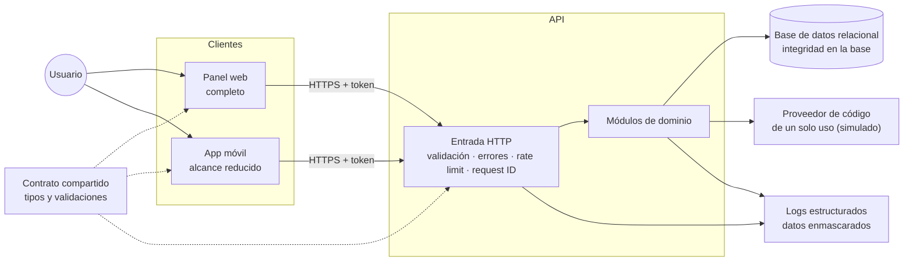
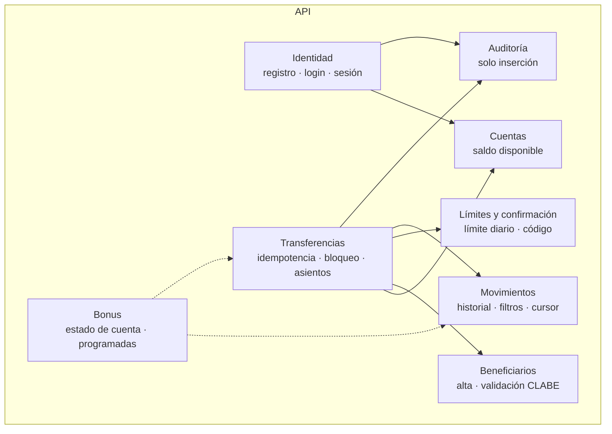
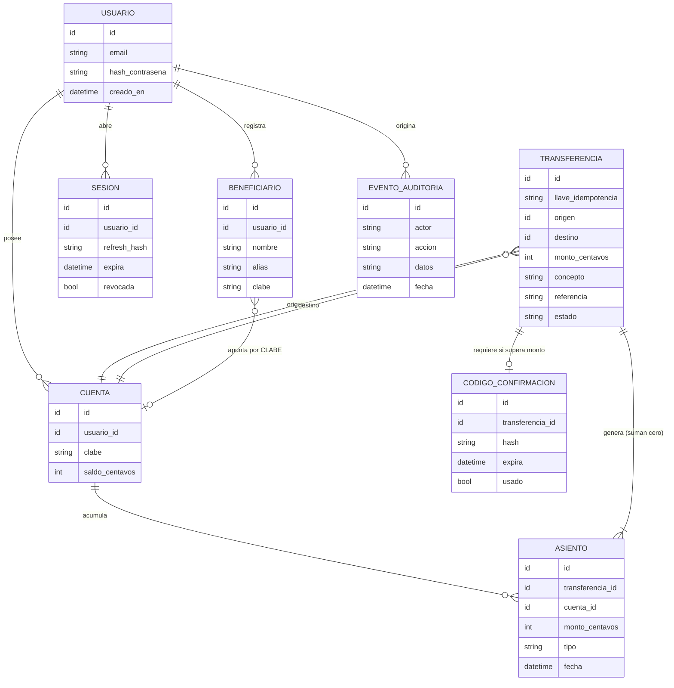
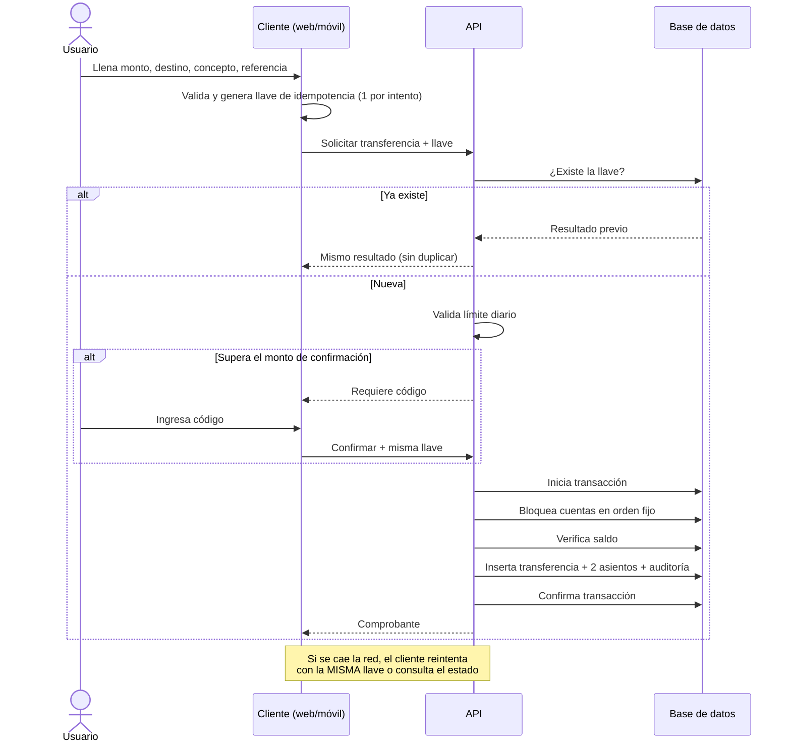
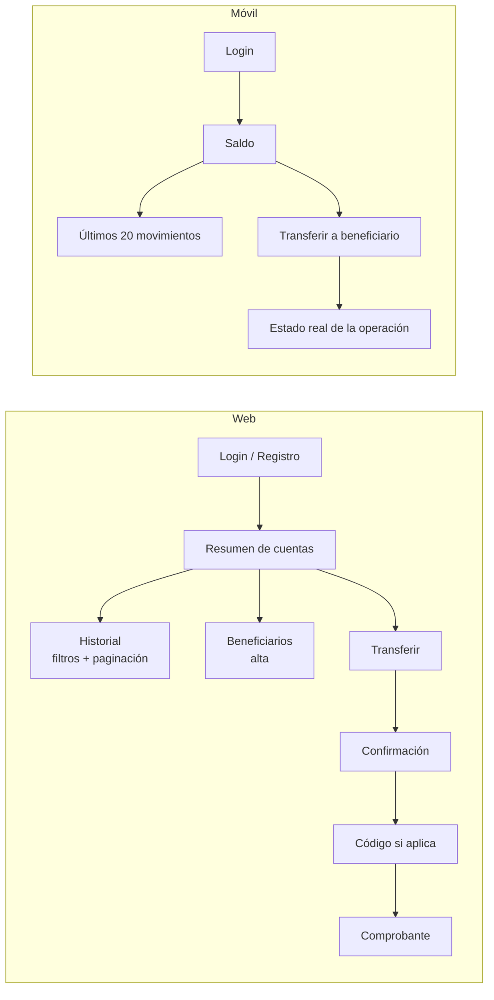

# Esqueleto general — Billetera digital MXN

Visión inicial del sistema, sin tecnologías concretas. Sirve como insumo para `requirements.md` y `design.md`.

## 1. Vista general del sistema

## 2. Módulos de dominio

| Historia | Módulo principal |
|---|---|
| HU-1. Registro e inicio de sesión | Identidad |
| HU-2. Ver cuentas y saldo | Cuentas |
| HU-3. Registrar beneficiario con CLABE | Beneficiarios |
| HU-4. Enviar transferencia | Transferencias |
| HU-5. Historial con filtros, paginado | Movimientos |
| HU-6. Límite diario y código | Límites y confirmación |
| HU-B1 / HU-B2. Bonus | Estado de cuenta / Programadas |

## 3. Modelo de datos conceptual

Reglas que la base de datos garantiza por sí sola, no solo el código:

- El saldo nunca es negativo.
- La llave de idempotencia es única.
- Los asientos de cada transferencia suman cero.
- La auditoría solo admite inserciones.

## 4. Flujo de una transferencia

## 5. Mapa de pantallas

Cada pantalla contempla los estados **cargando**, **vacío**, **error** y **éxito**.
