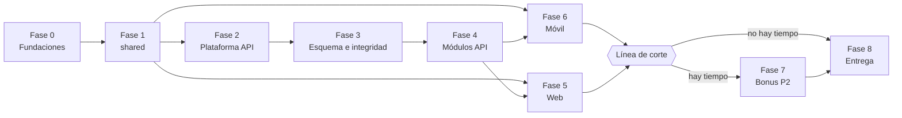

# Tareas — Billetera digital MXN

Fase 3 del flujo spec-driven (Requisitos → Diseño → Tareas). Insumos: `specs/requirements.md` (R-x.y, RNF-nn), `specs/design.md` (§, DD-nn), `specs/decisiones.md` (D-nn) y `docs/enunciado.md`.

Este documento dice **en qué orden y en qué pasos** se construye lo que `design.md` define. No agrega decisiones: si una tarea descubre un hueco, se corrige primero `design.md` (o `requirements.md`) en su propio commit y después se sigue con la tarea.

---

## 1. Convenciones

### 1.1 Identificadores y etiquetas

| Prefijo | Etiqueta | Alcance |
|---|---|---|
| `T-SHR-nn` | `shared` | Monorepo y `packages/shared` |
| `T-API-nn` | `api` | Backend, base de datos, migraciones, seed |
| `T-WEB-nn` | `web` | Panel React |
| `T-MOB-nn` | `mobile` | App Expo |
| `T-CI-nn` | `ci` | GitHub Actions |
| `T-DOC-nn` | `docs` | README, `docs/aws-deploy.md`, `design.md` §8.5, video, trazabilidad |

La numeración es por etiqueta y **no** indica el orden; el orden es el de las fases (§2).

### 1.2 Prioridad

- **P1:** imprescindible para que el dinero cuadre o para cumplir un entregable obligatorio del enunciado.
- **P2:** bonus o mejora. Si el tiempo no alcanza, se omite y pasa a "qué haría con más tiempo" del README (T-DOC-02).

Las tres tareas P2 (T-API-23, T-WEB-08 y T-MOB-07) están juntas en la Fase 7, después de la **línea de corte** (§2). Ninguna tarea P1 depende de una P2.

### 1.3 Ficha de cada tarea

| Campo | Contenido |
|---|---|
| **Prioridad** | P1 o P2 |
| **Depende de** | Tareas que deben estar cerradas antes |
| **Criterios** | IDs `R-` y `RNF-` de `requirements.md` que la tarea cumple (en todo o en la parte de su etiqueta) |
| **Implementa** | Decisiones `DD-` de `design.md` (y `D-` cuando no hay DD) |
| **Alcance** | Qué se construye, con la sección de `design.md` que lo detalla |
| **Verificación** | Pruebas o comandos que deben pasar para cerrar la tarea |
| **Commit** | Mensaje sugerido |

### 1.4 Reglas de cierre

1. **Las pruebas van dentro de la tarea.** Cada tarea escribe sus pruebas (TDD cuando aplica) y no se cierra con pruebas en rojo. La única tarea solo de pruebas es T-API-21 (concurrencia), que necesita los módulos terminados.
2. **Los IDs van en el nombre de la prueba** (DD-46, `design.md` §14.4): `it('R-4.14 repetición con la misma llave devuelve el mismo cuerpo', …)`. Así, `npm test -w api -- -t "R-4.14"` ejecuta las pruebas de un criterio. Vitest se corre siempre desde el script `test` del workspace, nunca con `npx vitest` desde la raíz: ahí no hay configuración de Vitest, y un `-w` escrito después de `vitest` se lee como `--watch`.
3. **Cada tarea cierra con uno o más commits** que citan su ID y sus criterios (RNF-33), con Conventional Commits:
   `feat(api): T-API-17 transferencia sin código con bloqueo [R-4.1, R-4.3]`. Si una tarea necesita varios commits, todos citan el mismo `T-` y cada uno los criterios que toca.
4. **`main` siempre en verde.** Antes de cada commit corren `npm run lint`, `npm run typecheck` y las pruebas del paquete tocado. El CI (T-CI-01 a T-CI-03) lo vuelve a correr.
5. **Al cerrar una tarea** se marca su casilla en §2.

---

## 2. Plan por fases

**Fase 0 · Fundaciones**

- [x] T-SHR-01 · `shared` · P1 · Esqueleto del monorepo
- [x] T-API-01 · `api` · P1 · PostgreSQL 17 en Docker con roles y base de pruebas
- [x] T-CI-01 · `ci` · P1 · CI inicial: `calidad` y `unitarias`

**Fase 1 · `packages/shared`**

- [x] T-SHR-02 · `shared` · P1 · Módulo `dinero`
- [x] T-SHR-03 · `shared` · P1 · Módulo `clabe`
- [x] T-SHR-04 · `shared` · P1 · Reglas de lint del dinero
- [x] T-SHR-05 · `shared` · P1 · Módulos `tiempo` y `problemas`
- [x] T-SHR-06 · `shared` · P1 · Tipos generados desde `openapi.yaml`
- [x] T-SHR-07 · `shared` · P1 · Esquemas Zod de entrada

**Fase 2 · Plataforma de la API**

- [x] T-API-02 · `api` · P1 · Configuración validada y arranque
- [x] T-API-03 · `api` · P1 · Middlewares, errores RFC 7807, logs y documentación navegable
- [x] T-API-04 · `api` · P1 · Acceso a datos y unidad de trabajo

**Fase 3 · Esquema e integridad**

- [x] T-API-05 · `api` · P1 · Migración 1 `Base`
- [x] T-API-06 · `api` · P1 · Migración 2 `Beneficiario`
- [x] T-API-07 · `api` · P1 · Migración 3 `TransferenciaAsiento`
- [x] T-API-08 · `api` · P1 · Migraciones 4 a 6: `Sesion`, `Auditoria`, `Permisos`
- [x] T-API-09 · `api` · P1 · Arnés de pruebas de integración
- [x] T-CI-02 · `ci` · P1 · Job `integracion`
- [x] T-API-10 · `api` · P1 · Pruebas de integridad y permisos con SQL directo

**Fase 4 · Módulos de la API**

- [x] T-API-11 · `api` · P1 · Auditoría y fondeo interno
- [x] T-API-12 · `api` · P1 · Registro
- [x] T-API-13 · `api` · P1 · Sesión: login, refresh, reúso y logout
- [x] T-API-14 · `api` · P1 · Rate limit
- [x] T-API-15 · `api` · P1 · Consulta de cuentas
- [x] T-API-16 · `api` · P1 · Beneficiarios
- [x] T-API-17 · `api` · P1 · Transferencia sin código
- [x] T-API-18 · `api` · P1 · Idempotencia
- [x] T-API-19 · `api` · P1 · Límite diario y medianoche
- [x] T-API-20 · `api` · P1 · Código de un solo uso
- [x] T-API-21 · `api` · P1 · Pruebas de concurrencia
- [x] T-API-22 · `api` · P1 · Historial de movimientos
- [x] T-API-24 · `api` · P1 · Latencia de demostración y prueba de fugas en logs
- [x] T-API-25 · `api` · P1 · Seed, fase 1: usuarios demo
- [x] T-API-26 · `api` · P1 · Seed, fase 2: volumen
- [x] T-DOC-01 · `docs` · P1 · `EXPLAIN ANALYZE` en `design.md` §8.5

**Fase 5 · Web**

- [x] T-WEB-01 · `web` · P1 · Esqueleto de la web
- [x] T-WEB-02 · `web` · P1 · Cliente tipado, sesión, login y registro
- [x] T-WEB-03 · `web` · P1 · Resumen de cuentas y límite
- [x] T-WEB-04 · `web` · P1 · Historial
- [x] T-WEB-05 · `web` · P1 · Beneficiarios
- [x] T-WEB-06 · `web` · P1 · Transferencia: máquina del intento
- [x] T-WEB-07 · `web` · P1 · Código, reanudación y verificación del estado
- [x] T-WEB-09 · `web` · P1 · Pase de accesibilidad

**Fase 6 · Móvil**

- [x] T-MOB-01 · `mobile` · P1 · Esqueleto Expo y conexión a la API local
- [x] T-MOB-02 · `mobile` · P1 · Sesión y login
- [x] T-CI-03 · `ci` · P1 · Job `movil` y jobs obligatorios
- [x] T-MOB-03 · `mobile` · P1 · Saldo y últimos 20 movimientos
- [x] T-MOB-04 · `mobile` · P1 · Transferencia con intento y reintentos
- [x] T-MOB-05 · `mobile` · P1 · Reanudación, código y fase de confirmación
- [ ] T-MOB-06 · `mobile` · P1 · Ocultar contenido en segundo plano

> ### ✂ Línea de corte
>
> **Punto de decisión al terminar la Fase 6.** Si el tiempo no alcanza, se salta directo a la Fase 8. Las tareas P2 de la Fase 7 se omiten y T-DOC-02 las lista en "qué haría con más tiempo" del README. La Fase 8 se ejecuta siempre.

**Fase 7 · Bonus (P2)**

- [ ] T-API-23 · `api` · P2 · Estado de cuenta CSV
- [ ] T-WEB-08 · `web` · P2 · Botón de descarga del estado de cuenta
- [ ] T-MOB-07 · `mobile` · P2 · Desbloqueo biométrico

**Fase 8 · Entrega**

- [ ] T-DOC-02 · `docs` · P1 · `README.md`
- [ ] T-DOC-03 · `docs` · P1 · `docs/aws-deploy.md`
- [ ] T-DOC-04 · `docs` · P1 · Revisión de trazabilidad y cierre de `ai-log.md`
- [ ] T-DOC-05 · `docs` · P1 · Video de la entrega

---

## 3. Fase 0 · Fundaciones

### T-SHR-01 · Esqueleto del monorepo · `shared` · P1

- **Depende de:** —
- **Criterios:** RNF-16 (TypeScript estricto), RNF-18 (paquete compartido)
- **Implementa:** DD-01, DD-04, DD-05
- **Alcance** (§1.1, §1.2):
  - `package.json` raíz con npm workspaces (`packages/shared`, `api`, `web`, `mobile`), `"type": "module"` y `engines.node >= 24`.
  - `tsconfig.base.json` con `strict` y `noUncheckedIndexedAccess`.
  - `eslint.config.js` (flat config, `typescript-eslint`) y Prettier.
  - `packages/shared` vacío que compila con `tsc -b` a `dist/` (ESM y `.d.ts`), con Vitest.
  - Scripts de la raíz: `lint`, `typecheck`, `test`, y `predev`, `pretest` y `prebuild` que compilan `shared`.
  - `.gitignore`, `.nvmrc` con `24`, `.editorconfig`.
- **Verificación:** `npm ci`, `npm run lint`, `npm run typecheck` y `npm test` terminan en 0 con una prueba de humo en `shared`.
- **Commit:** `chore(shared): T-SHR-01 esqueleto del monorepo [RNF-16, RNF-18]`

### T-API-01 · PostgreSQL 17 en Docker con roles y base de pruebas · `api` · P1

- **Depende de:** T-SHR-01
- **Criterios:** RNF-16 (PostgreSQL ≥ 15), RNF-11 (rol sin `UPDATE`/`DELETE`), RNF-27 (entorno local)
- **Implementa:** DD-06
- **Alcance** (§1.3, §3.4):
  - `docker-compose.yml` con `postgres:17`, volumen con nombre y `healthcheck`.
  - `docker/postgres/init.sql`: roles `billetera_owner` y `billetera_app` con `LOGIN`; bases `billetera` y `billetera_test` con dueño `billetera_owner`; `billetera_app` sin `CREATE` en el esquema.
  - Script `npm run db:up` (`docker compose up -d --wait`).
  - `api/.env.example` con `DATABASE_URL` (rol `billetera_app`) y `DATABASE_URL_MIGRACIONES` (rol `billetera_owner`).
- **Verificación:** `npm run db:up` deja el contenedor `healthy`; `psql` con cada rol se conecta a las dos bases; `billetera_app` no puede `CREATE TABLE`.
- **Commit:** `chore(api): T-API-01 PostgreSQL 17 en Docker con roles [RNF-16, RNF-11]`

### T-CI-01 · CI inicial: `calidad` y `unitarias` · `ci` · P1

- **Depende de:** T-SHR-01
- **Criterios:** RNF-29
- **Implementa:** DD-46 (parcial: primeros dos jobs)
- **Alcance** (§14.5): `.github/workflows/ci.yml` con Node 24 y caché de npm, en cada `push` y pull request a `main`.
  - `calidad`: `npm ci`, compilar `shared`, `npm run lint`, `npm run lint:verificar-reglas` (agregado después de T-SHR-04, RNF-09), `npm run typecheck`.
  - `unitarias`: `npm test`.
  - Los pasos de `redocly lint` y del diff de tipos se agregan en T-SHR-06; `integracion` en T-CI-02; `movil` en T-CI-03.
- **Verificación:** el workflow corre en verde en `main` después del push.
- **Commit:** `ci: T-CI-01 jobs de calidad y unitarias [RNF-29]`

---

## 4. Fase 1 · `packages/shared`

### T-SHR-02 · Módulo `dinero` · `shared` · P1

- **Depende de:** T-SHR-01
- **Criterios:** R-2.5, R-4.33, R-4.34, R-4.35, R-B1.2, RNF-09, RNF-22
- **Implementa:** D-18 (sin DD propia)
- **Alcance** (§13.1): `montoTextoACentavos`, `formatearMXN`, `centavosATextoDecimal` y `TOPE_CENTAVOS`, procesando texto, sin aritmética de punto flotante ni redondeo.
- **Verificación:** `npm test -w packages/shared -- dinero`. Casos obligatorios:
  - Las tablas de R-2.5 y R-4.33.
  - Los extra de §13.1: `"1.005"` → error, `"00.50"` → `50`, `"1,000.5"` → `100050`, `"$1,000,000.00"` → `100000000`, `"1000000000.01"` → error por tope.
  - `centavosATextoDecimal`: `-5` → `-0.05`, `0` → `0.00`, `123456` → `1234.56`.
- **Commit:** `feat(shared): T-SHR-02 dinero sin redondeo [R-2.5, R-4.33, R-4.34]`

### T-SHR-03 · Módulo `clabe` · `shared` · P1

- **Depende de:** T-SHR-01
- **Criterios:** R-3.2, R-3.3, R-3.4, R-3.12, RNF-22
- **Implementa:** D-19, DD-19 (algoritmo compartido)
- **Alcance** (§3.6, §13.1): `digitoVerificador(17 dígitos)` y `validarClabe(texto)`, que devuelve el primer fallo en el orden de R-3.2 (longitud, dígito).
- **Verificación:** `npm test -w packages/shared -- clabe`. Incluye una CLABE cuya suma ponderada termina en 0 (dígito `0`, no `10`), la CLABE de Fondeo `999000000000000001`, textos con letras, 17 y 19 dígitos.
- **Commit:** `feat(shared): T-SHR-03 validación de CLABE [R-3.2, R-3.4, R-3.12]`

### T-SHR-04 · Reglas de lint del dinero · `shared` · P1

- **Depende de:** T-SHR-01
- **Criterios:** RNF-09, R-4.35, RNF-20
- **Implementa:** DD-42 (incluida la regla de `AsyncStorage`, activa desde antes de que exista `mobile/`)
- **Alcance** (§13.1): en `eslint.config.js`, para `packages/shared`, `web` y `mobile`, prohibir `parseFloat`, `Number.parseFloat`, `Math.round`, `Math.floor`, `Math.ceil`, `x / 100` y `.toFixed(...)`; solo para `mobile`, prohibir importar `@react-native-async-storage/async-storage`.
- **Verificación:** archivos de prueba (`eslint-pruebas/dinero.invalido.ts` y `eslint-pruebas/almacenamiento.invalido.ts`, excluidos de la compilación y de `npm run lint`) con cada patrón prohibido; un script `npm run lint:verificar-reglas` los revisa con ESLint como si vivieran en `packages/shared`, `web` y `mobile`, y falla si **no** reporta cada regla en las rutas donde aplica. `npm run lint` sigue en verde sobre el código real.
- **Commit:** `chore(shared): T-SHR-04 lint contra redondeo de montos [RNF-09, RNF-20]`

### T-SHR-05 · Módulos `tiempo` y `problemas` · `shared` · P1

- **Depende de:** T-SHR-01
- **Criterios:** RNF-10, R-4.12 (textos del rechazo)
- **Implementa:** DD-22, DD-23
- **Alcance** (§4.1, §7.2, §13.1):
  - `ZONA_HORARIA = 'America/Mexico_City'` e `instanteIso(textoPg)`, que opera sobre el texto, completa la fracción a 6 dígitos y lanza un error si el sufijo no es `+00`.
  - `TipoProblema` (catálogo de §7.2) y `mensajeDeProblema(type)` con los textos en español que muestran web y móvil.
- **Verificación:** `npm test -w packages/shared -- tiempo problemas`. `instanteIso` con fracción vacía, de 3 y de 6 dígitos, y con otro desfase (error). Cada `type` del catálogo tiene texto (prueba exhaustiva sobre el tipo).
- **Commit:** `feat(shared): T-SHR-05 instantes ISO y catálogo de problemas [RNF-10, R-4.12]`

### T-SHR-06 · Tipos generados desde `openapi.yaml` · `shared` · P1

- **Depende de:** T-SHR-01, T-CI-01
- **Criterios:** RNF-18, RNF-28 (contrato válido)
- **Implementa:** DD-21, DD-27 (diff de tipos y `redocly lint`)
- **Alcance** (§4.3):
  - `npm run gen:tipos` con `openapi-typescript` → `packages/shared/src/api/openapi.ts`, versionado.
  - Alias legibles (`Cuenta`, `Comprobante`, `Movimiento`, …) reexportados desde `shared`.
  - En el job `calidad`: `redocly lint specs/openapi.yaml`, `npm run gen:tipos` y `git diff --exit-code`.
- **Verificación:** `npx redocly lint specs/openapi.yaml` sin errores; `npm run gen:tipos && git diff --exit-code` limpio; CI en verde.
- **Commit:** `feat(shared): T-SHR-06 tipos generados desde OpenAPI [RNF-18]`

### T-SHR-07 · Esquemas Zod de entrada · `shared` · P1

- **Depende de:** T-SHR-02, T-SHR-03, T-SHR-06
- **Criterios:** RNF-01, RNF-18, R-1.5, R-3.3, R-3.4, R-4.8, R-4.9, R-4.13, R-5.2, R-5.5 (`desde` ≤ `hasta`), R-5.7 (forma del cursor), R-B1.5
- **Implementa:** DD-16, DD-26, DD-28 (política de contraseña), DD-27 (prueba de tipos)
- **Alcance** (§13.1, §3.2, §5.1, §6.7): esquemas `.strict()` de registro, login, refresh, beneficiario, transferencia (con `destino` discriminado), confirmación, filtros del historial y mes; `normalizarTexto` (`trim` + NFC); encabezado `Idempotency-Key` como UUID; lista de contraseñas comunes generada por `scripts/generar-contrasenas-comunes.mjs` (§5.1).
- **Verificación:** `npm test -w packages/shared -- esquemas`:
  - Casos válidos e inválidos por campo (longitudes de DD-16 en code points, referencia no numérica, monto no entero, fuera de 1 a `100000000000`, campo desconocido).
  - Invariantes de la lista: exactamente 1,000 entradas, todas de 12 o más code points, distintas y ya normalizadas (NFC y minúsculas).
  - `expectTypeOf` verifica que `z.input` y `z.output` de cada cuerpo y el tipo generado se extienden en los dos sentidos; en la query del historial, solo que `z.output` extiende al tipo generado (§4.3).
  - `npm run typecheck -w packages/shared`, porque `expectTypeOf` no falla en `vitest run`.
- **Commit:** `feat(shared): T-SHR-07 esquemas Zod alineados al contrato [RNF-01, RNF-18, R-4.8]`

---

## 5. Fase 2 · Plataforma de la API

### T-API-02 · Configuración validada y arranque · `api` · P1

- **Depende de:** T-SHR-07
- **Criterios:** RNF-15, R-6.17 (no arrancar con OTP simulado en producción)
- **Implementa:** DD-08 (composición manual), §2.4
- **Alcance:** `config/index.ts` con el esquema Zod de §2.4 y sus reglas cruzadas; `main.ts` (configuración → base de datos → `listen`); `crearApp(dependencias)` sin rutas de negocio todavía. Registra **los nombres** de las variables inválidas, nunca sus valores.
- **Verificación:** `npm test -w api -- -t "RNF-15"`: umbral ≥ límite, valores no enteros, `OTP_SIMULADO=true`, `DEMO_LATENCIA_MS > 0` o `FONDEO_BIENVENIDA_CENTAVOS > 0` con `NODE_ENV=production`, `OTP_HMAC_SECRETO = JWT_SECRETO`, booleano `'1'` rechazado; el mensaje no contiene valores.
- **Commit:** `feat(api): T-API-02 configuración validada al arrancar [RNF-15, R-6.17]`

### T-API-03 · Middlewares, errores RFC 7807, logs y documentación navegable · `api` · P1

- **Depende de:** T-API-02
- **Criterios:** RNF-01, RNF-05, RNF-12, RNF-16, RNF-28
- **Implementa:** DD-08 (regla de capas en ESLint), DD-09, DD-35, DD-39 (enmascarado y `AsyncLocalStorage`), DD-27 (Swagger fuera de producción)
- **Alcance** (§2.2, §7, §10.1, §4.3):
  - Middlewares 1 a 7, 12 y 13 de §2.2: `requestId`, `pino-http` con `redact`, `helmet`, `cors` con `WEB_ORIGIN`, `express.json` de 16 KB, `cookie-parser`, `GET /api/health`, `noEncontrado` y `manejadorErrores`.
  - Jerarquía `ErrorDominio` y traducción a `application/problem+json` sin detalles internos.
  - `validar({ params, query, body, headers })`.
  - `GET /api/docs` (Swagger UI) y `GET /api/openapi.yaml`, solo si `NODE_ENV !== 'production'`.
  - Regla `no-restricted-imports` por capa (§2.1).
- **Verificación:** pruebas con Supertest sin base de datos:
  - JSON mal formado → `400` problem;
  - ruta inexistente → `404 not-found`;
  - un error interno da `500` sin traza ni SQL;
  - `X-Request-Id` presente y reutilizado solo si es UUID;
  - `/api/docs` responde en `test` y no existe en `production`.
  - Prueba de lint: un controlador que importa un repositorio falla `npm run lint`.
- **Commit:** `feat(api): T-API-03 middlewares, problemas RFC 7807 y Swagger UI [RNF-01, RNF-12, RNF-28]`

### T-API-04 · Acceso a datos y unidad de trabajo · `api` · P1

- **Depende de:** T-API-01, T-API-02
- **Criterios:** RNF-08, RNF-09, RNF-10, RNF-16, R-4.19
- **Implementa:** DD-07, DD-10, §2.3, §3.5
- **Alcance:**
  - `DataSource` con `synchronize: false`, lista explícita de migraciones, `migrationsTableName: 'migracion'`, `TimeZone=UTC`.
  - Parsers de `pg`: `int8` y `numeric` a `Number` solo si es entero seguro; `timestamptz` como texto.
  - `conTransaccion` con `READ COMMITTED`, `SET LOCAL lock_timeout = '5s'` y `statement_timeout = '10s'`, reintento ante `40P01` (3 veces, `warn`), `55P03` y `57014` → `Reintentable` (`503`, `Retry-After: 1`).
  - Puerto `Reloj` (`RelojBaseDatos` con `clock_timestamp()`, `RelojFijo`) y puerto `ProveedorOtp`.
  - `api/src/scripts/migrar.ts` (`runMigrations({ transaction: 'each' })`) y `npm run db:migrate`, `db:migrate:revertir`.
- **Verificación:** pruebas de integración contra `billetera_test`:
  - el parser lanza con `2^53`;
  - un `timestamptz` conserva los microsegundos;
  - un `SELECT pg_sleep(11)` da `Reintentable`;
  - un deadlock provocado entre dos transacciones se reintenta y se registra como `warn`;
  - `synchronize` es `false`.
  - `npm run db:migrate` corre sin migraciones y termina en 0.
- **Commit:** `feat(api): T-API-04 unidad de trabajo y parsers sin pérdida [RNF-08, RNF-09, R-4.19]`

---

## 6. Fase 3 · Esquema e integridad

### T-API-05 · Migración 1 `Base` · `api` · P1

- **Depende de:** T-API-04, T-SHR-03
- **Criterios:** R-2.3, R-3.12, RNF-06, RNF-07
- **Implementa:** DD-11, DD-18 (`cuenta_protegida`), DD-19 (`clabe_valida`)
- **Alcance** (§3.2, §3.3, §3.6): función `clabe_valida(text)`; tablas `usuario` y `cuenta` con sus `CHECK` (tipo y usuario, saldo no negativo salvo `SISTEMA`, `clabe_valida`); trigger `cuenta_protegida`; fila de Fondeo con CLABE `999000000000000001`; entidades TypeORM con `saldo_centavos` de solo lectura.
- **Verificación:** `npm run db:migrate` y `db:migrate:revertir` funcionan; prueba de integración que compara `clabe_valida` con `validarClabe` sobre 10,000 CLABEs aleatorias y los casos borde.
- **Commit:** `feat(api): T-API-05 migración Base con CLABE validada en la base [R-3.12, RNF-06]`

### T-API-06 · Migración 2 `Beneficiario` · `api` · P1

- **Depende de:** T-API-05
- **Criterios:** R-3.5, R-3.7, RNF-06
- **Implementa:** DD-16 (longitudes)
- **Alcance** (§3.2, §3.3): tabla `beneficiario` con FK `cuenta_id NOT NULL`, `UNIQUE (usuario_id, clabe)`, índice único `(usuario_id, lower(alias))`, `CHECK` de longitudes y trigger `validar_beneficiario` (cuenta `USUARIO` y CLABE igual a la de la cuenta).
- **Verificación:** migración de ida y vuelta; las pruebas de violación con SQL directo quedan en T-API-10.
- **Commit:** `feat(api): T-API-06 migración Beneficiario [R-3.7, RNF-06]`

### T-API-07 · Migración 3 `TransferenciaAsiento` · `api` · P1

- **Depende de:** T-API-06
- **Criterios:** R-2.2, R-4.4, R-5.8, RNF-06, RNF-07
- **Implementa:** DD-12, DD-13, DD-14, DD-17, D-11 (índices), D-04 (índice parcial)
- **Alcance** (§3.2, §3.3):
  - Tablas `transferencia`, `asiento` y `codigo_confirmacion`.
  - Funciones y triggers: `aplicar_asiento` (`SECURITY DEFINER` con `search_path` fijo), `asiento_inmutable`, `validar_transferencia`, `transferencia_transicion`, `comprobar_transferencia` con `transferencia_cuadra` y `asiento_cuadra` diferidos, `codigo_protegido`.
  - Índices del historial `(cuenta_id, creado_en DESC, id DESC)` y `(cuenta_id, tipo_movimiento, creado_en DESC, id DESC)`, y el parcial del límite.
- **Verificación:** migración de ida y vuelta; prueba de humo que inserta con el rol dueño un `FONDEO` correcto y verifica saldo y suma cero. Las violaciones van en T-API-10.
- **Commit:** `feat(api): T-API-07 transferencias y asientos con suma cero diferida [RNF-06, RNF-07]`

### T-API-08 · Migraciones 4 a 6: `Sesion`, `Auditoria`, `Permisos` · `api` · P1

- **Depende de:** T-API-07
- **Criterios:** RNF-02 (refresh como SHA-256), RNF-06, RNF-11
- **Implementa:** DD-15, DD-18
- **Alcance** (§3.2, §3.3, §3.4): tabla `sesion`; tabla `evento_auditoria` sin FK y con `auditoria_inmutable`; migración `Permisos` con los `GRANT` por tabla y por columna de §3.4 y `REVOKE ALL … FROM PUBLIC`.
- **Verificación:** `npm run db:migrate` en una base vacía aplica las seis migraciones; `\dp` muestra los permisos de §3.4. Las pruebas de permisos van en T-API-10.
- **Commit:** `feat(api): T-API-08 sesión, auditoría y permisos por columna [RNF-11, RNF-06]`

### T-API-09 · Arnés de pruebas de integración · `api` · P1

- **Depende de:** T-API-08
- **Criterios:** RNF-01 (respuestas contra el contrato), RNF-07, RNF-23
- **Implementa:** DD-06, DD-27 (Ajv), DD-46
- **Alcance** (§14.2):
  - `npm run test:integracion` con su propia configuración de Vitest.
  - `globalSetup` que migra `billetera_test` con el rol dueño.
  - Utilidad que vacía las tablas por archivo (`TRUNCATE … CASCADE`, conservando Fondeo).
  - `afterEach` global con las invariantes: `saldo = SUM(asientos)` por cuenta, `SUM(saldo) = 0` y ninguna transferencia incoherente.
  - Validador Ajv (JSON Schema 2020-12) que comprueba cada respuesta de Supertest contra `openapi.yaml`.
  - Fábricas de datos de prueba que fondean con `FONDEO`.
- **Verificación:** una prueba que rompe a propósito cada invariante con el rol dueño hace fallar el `afterEach`; `npm run test:integracion` en verde. Corre en `billetera_test` y la vacía después, porque `billetera_owner` no tiene `CREATEDB` e `init.sql` crea solo dos bases.
- **Commit:** `test(api): T-API-09 arnés de integración con invariantes [RNF-23, RNF-07]`

### T-CI-02 · Job `integracion` · `ci` · P1

- **Depende de:** T-API-09
- **Criterios:** RNF-23, RNF-29
- **Implementa:** DD-06 (service container), DD-46
- **Alcance** (§14.5): job con *service container* `postgres:17`, `init.sql` montado y `npm run test:integracion`.
- **Verificación:** el job corre en verde en `main`.
- **Commit:** `ci: T-CI-02 pruebas de integración contra PostgreSQL 17 [RNF-23, RNF-29]`

### T-API-10 · Pruebas de integridad y permisos con SQL directo · `api` · P1

- **Depende de:** T-API-09
- **Criterios:** R-2.2, R-4.4, RNF-06, RNF-07, RNF-11, RNF-23
- **Implementa:** DD-17, DD-18
- **Alcance:** `api/test/integracion/integridad.test.ts` con cada fila de la tabla de DD-17 y de la tabla de RNF-06 de §3.3; `permisos.test.ts` con cada fila de la tabla de DD-18, incluida la revisión de `pg_proc` para el `search_path` de las funciones `SECURITY DEFINER`.
- **Verificación:** `npm run test:integracion -w api -- -t "RNF-06|RNF-11|DD-17|DD-18"`. Cada caso espera el `SQLSTATE` indicado y verifica después que no cambió ninguna fila ni saldo.
- **Commit:** `test(api): T-API-10 la base rechaza dinero incoherente y escrituras prohibidas [RNF-06, RNF-11]`

---

## 7. Fase 4 · Módulos de la API

### T-API-11 · Auditoría y fondeo interno · `api` · P1

- **Depende de:** T-API-10
- **Criterios:** R-1.2 (camino del fondeo), R-5.9, RNF-07, RNF-11
- **Implementa:** DD-12, DD-40 (auditoría dentro de la transacción), D-02, D-12 (orden de bloqueo)
- **Alcance** (§2.1, §10.2): módulo `auditoria` con `registrarEvento(tx, evento)`; `transferencias.fondear(tx, cuentaDestinoId, monto)`, que bloquea al usuario y después las cuentas por `id` ascendente (incluida Fondeo), inserta la transferencia `FONDEO` y sus asientos `FONDEO_SALIDA` y `DEPOSITO`, y audita.
- **Verificación:** integración: un fondeo deja el saldo, dos asientos, la transferencia `APLICADA` y un evento de auditoría; el movimiento es de tipo `DEPOSITO`.
- **Commit:** `feat(api): T-API-11 fondeo interno con auditoría [R-1.2, RNF-11]`

### T-API-12 · Registro · `api` · P1

- **Depende de:** T-API-11
- **Criterios:** R-1.1, R-1.2, R-1.3, R-1.4, R-1.5, RNF-03
- **Implementa:** DD-19 (CLABE aleatoria con `ON CONFLICT`), DD-23 (`409`), DD-24 (el registro no abre sesión), DD-28 (argon2id)
- **Alcance** (§5.1, §12.1): `POST /api/auth/registro`, que en una sola transacción crea el usuario, `Principal` y `Ahorro` con CLABE válida y, si `FONDEO_BIENVENIDA_CENTAVOS > 0`, llama a `fondear`. Responde `201 { id, correo }`.
- **Verificación:** `-t "R-1.1|R-1.2|R-1.3|R-1.4|R-1.5"`:
  - registro completo con dos CLABEs válidas y fondeo;
  - un fallo forzado dentro de la transacción no deja nada;
  - correo duplicado → `409 correo-ya-registrado`;
  - contraseña fuera de la política → `400` con el campo;
  - la contraseña se guarda como hash argon2id.
- **Commit:** `feat(api): T-API-12 registro atómico con cuentas y fondeo [R-1.1, R-1.2, R-1.3]`

### T-API-13 · Sesión: login, refresh, reúso y logout · `api` · P1

- **Depende de:** T-API-12
- **Criterios:** R-1.6 a R-1.13, R-1.16, RNF-02, RNF-05
- **Implementa:** DD-24, DD-29 (HS256), DD-30 (vencimiento absoluto de la familia)
- **Alcance** (§5.2 a §5.4, §12.2): `POST /api/auth/login` con `cliente: web | movil`, `refresh` y `logout`; middleware `autenticar` con `Cache-Control: no-store`; cookie `billetera_refresh` `HttpOnly; Secure; SameSite=Strict; Path=/api/auth`; `X-Requested-With` obligatorio con cookie; reúso → revoca la familia y audita `refresh-reuse-detected`.
- **Verificación:** `-t "R-1.6|R-1.7|R-1.8|R-1.9|R-1.10|R-1.11|R-1.12|R-1.13|R-1.16"`:
  - login fallido responde `401 credenciales-invalidas` (no `unauthorized`), con el mismo problem para correo inexistente y contraseña incorrecta;
  - rotación;
  - reúso que revoca la familia y audita;
  - familia vencida;
  - atributos de la cookie y ausencia del refresh en el cuerpo para la web;
  - refresh con cookie sin `X-Requested-With` → rechazo;
  - logout `204` aun con refresh inválido.
- **Commit:** `feat(api): T-API-13 sesión con refresh rotativo y familias [R-1.6, R-1.9, R-1.13]`

### T-API-14 · Rate limit · `api` · P1

- **Depende de:** T-API-13
- **Criterios:** R-1.18, R-3.9, RNF-04
- **Implementa:** DD-41
- **Alcance** (§11): `express-rate-limit` con los umbrales y ventanas de §11 en login, registro y alta de beneficiarios (por usuario autenticado), con almacén en memoria y respuesta `429` problem; `TRUST_PROXY`.
- **Verificación:** `-t "R-1.18|R-3.9|RNF-04"`: al exceder el umbral responde `429` problem y no procesa la petición (no crea usuario).
- **Commit:** `feat(api): T-API-14 rate limit de login, registro y beneficiarios [R-1.18, RNF-04]`

### T-API-15 · Consulta de cuentas · `api` · P1

- **Depende de:** T-API-13
- **Criterios:** R-2.1, R-2.2, R-2.3, R-2.4
- **Implementa:** D-10
- **Alcance:** `GET /api/cuentas` y `GET /api/cuentas/{cuentaId}`.
- **Verificación:** `-t "R-2.1|R-2.3|R-2.4"`: solo las propias; Fondeo nunca aparece; ajena e inexistente dan el mismo `404 not-found`.
- **Commit:** `feat(api): T-API-15 consulta de cuentas propias [R-2.1, R-2.4]`

### T-API-16 · Beneficiarios · `api` · P1

- **Depende de:** T-API-14, T-API-15
- **Criterios:** R-3.1 a R-3.11
- **Implementa:** D-19, DD-23 (`409 beneficiario-duplicado`), DD-26 (`esCuentaPropia`)
- **Alcance:** `POST /api/beneficiarios`, `GET /api/beneficiarios` y `GET /api/beneficiarios/{id}`; validación en el orden de R-3.2; resolución de la CLABE a `cuenta_id`; la respuesta no revela al titular.
- **Verificación:** `-t "R-3."`:
  - los tres pasos en orden;
  - CLABE de Fondeo y CLABE inexistente → `422 clabe-not-found`;
  - CLABE o alias (sin distinguir mayúsculas) duplicados → `409`;
  - CLABE propia permitida, con `esCuentaPropia: true`;
  - beneficiario ajeno → `404`.
- **Commit:** `feat(api): T-API-16 alta y consulta de beneficiarios [R-3.1, R-3.2, R-3.5]`

### T-API-17 · Transferencia sin código · `api` · P1

- **Depende de:** T-API-16
- **Criterios:** R-2.2, R-4.1 a R-4.10, R-4.35
- **Implementa:** DD-17 (clasificación por el dueño real), DD-31 (orden de validación), DD-34 (comprobante), DD-36 (`aplicada_en` después de bloquear), D-12
- **Alcance** (§6.1, §6.6): `POST /api/transferencias` y `GET /api/transferencias/{id}`:
  - dominio puro: clasificar y evaluar saldo;
  - caso de uso que bloquea usuario → cuentas por `id` ascendente;
  - rechazo `SALDO_INSUFICIENTE` guardado y confirmado;
  - `respuestaDeTransferencia(fila)` → `201` o `422`.
  - En esta tarea, todas las transferencias quedan por debajo del umbral. La llave se guarda, pero la repetición completa es T-API-18.
- **Verificación:** `-t "R-4.1|R-4.2|R-4.3|R-4.4|R-4.5|R-4.6|R-4.7|R-4.8|R-4.9|R-4.10"`:
  - `201` con saldos y asientos;
  - `422 saldo-insuficiente` con `transferenciaId` y fila sin asientos;
  - origen = destino → `422` sin fila;
  - destino ajeno o inexistente → `404`;
  - traspaso con tipos `TRASPASO_SALIDA` y `TRASPASO_ENTRADA`;
  - beneficiario con CLABE propia → `TRASPASO`.
  - Unitarias del dominio con `-w api -- dominio`.
- **Commit:** `feat(api): T-API-17 transferencia con bloqueo y clasificación [R-4.1, R-4.2, R-4.3]`

### T-API-18 · Idempotencia · `api` · P1

- **Depende de:** T-API-17
- **Criterios:** R-4.13 a R-4.17, R-4.19
- **Implementa:** DD-25, DD-32, D-03
- **Alcance** (§6.2): hash SHA-256 del cuerpo normalizado; misma llave y hash → misma respuesta reconstruida desde la fila; hash distinto → `422 idempotency-key-reused`; `23505` atrapado y lectura del ganador en otra `conTransaccion`.
- **Verificación:** `-t "R-4.13|R-4.14|R-4.15|R-4.16|R-4.17|R-4.19"`:
  - sin llave o llave no UUID → `400`;
  - repetición de `201` y de `422` con el mismo código y cuerpo;
  - cuerpo distinto → `422`;
  - misma llave con dos usuarios → dos transferencias;
  - dos peticiones simultáneas → una fila;
  - reintento tras un `503` provocado (`lock_timeout`) completa una sola vez.
- **Commit:** `feat(api): T-API-18 idempotencia por usuario con hash de petición [R-4.14, R-4.15, R-4.16]`

### T-API-19 · Límite diario y medianoche · `api` · P1

- **Depende de:** T-API-18
- **Criterios:** R-6.1 a R-6.7, RNF-10
- **Implementa:** DD-36, D-04, D-13, D-15
- **Alcance** (§6.4): cálculo de lo consumido con el índice parcial y la ventana `[00:00, 24:00)` en `America/Mexico_City`; rechazo `LIMITE_DIARIO_EXCEDIDO`; `GET /api/limites`.
- **Verificación:** `-t "R-6.1|R-6.2|R-6.3|R-6.5|R-6.6|R-6.7"`:
  - exactamente en el límite se aplica;
  - un centavo más → `422 limite-diario-excedido`;
  - traspasos, depósitos y rechazadas no cuentan;
  - tres de los cuatro escenarios de medianoche de §6.4 con `RelojFijo` (23:59:59.999999 y 00:00:00): agotar al final del día, día siguiente y exactamente en el límite. El de la pendiente que cruza la medianoche necesita el código y va en T-API-20.
- **Commit:** `feat(api): T-API-19 límite diario en hora de México [R-6.1, R-6.5, R-6.6]`

### T-API-20 · Código de un solo uso · `api` · P1

- **Depende de:** T-API-19
- **Criterios:** R-6.8 a R-6.17
- **Implementa:** DD-14, DD-25, DD-31, DD-33, D-07
- **Alcance** (§6.5): pendiente `202` para un tercero por encima del umbral, con HMAC del código (incluye el id de la transferencia) y `ProveedorOtpSimulado`; `POST /api/transferencias/{id}/confirmar` con el orden usuario → transferencia/código → cuentas; intento fallido confirmado en su propia transacción y auditado; `CODIGO_AGOTADO` al tercer fallo; expiración perezosa al confirmar y al consultar; confirmación idempotente.
- **Verificación:** `-t "R-6.6|R-6.8|R-6.9|R-6.10|R-6.11|R-6.12|R-6.13|R-6.14|R-6.15|R-6.16|R-6.17"`:
  - `1000000` exacto no pide código;
  - pendiente creada a las 23:58 y confirmada a las 00:01: cuenta en el día nuevo (R-6.6, cuarto escenario de §6.4);
  - `202` sin mover dinero, con `codigoSimulado`;
  - repetición del `202` sin `codigoSimulado` (DD-25);
  - código correcto con saldo o límite insuficiente al confirmar → `422`;
  - el fallo se cuenta aunque la respuesta sea `422`, con `intentosRestantes`;
  - vencido → `CODIGO_EXPIRADO` también por `GET`;
  - confirmar una aplicada repite el `201`;
  - el código no aparece en la base en claro.
- **Commit:** `feat(api): T-API-20 código de un solo uso con HMAC y expiración perezosa [R-6.8, R-6.11, R-6.12]`

### T-API-21 · Pruebas de concurrencia · `api` · P1

- **Depende de:** T-API-20
- **Criterios:** R-4.16, R-4.18, R-5.4 (cursor con escrituras, se activa al cerrar T-API-22), R-6.4, RNF-08, RNF-24
- **Implementa:** D-12, DD-36
- **Alcance** (§14.3): `api/test/concurrencia/` con los cinco escenarios de §14.3 y un pool de 10 conexiones.
- **Verificación:** `npm run test:integracion -w api -- concurrencia` (desde la raíz; el script vive en el workspace `api`):
  - 100 simultáneas: `aplicadas × monto + saldo final = saldo inicial`, aplicadas + rechazadas = 100;
  - cruzadas A↔B;
  - límite con dos cuentas;
  - 10 peticiones con la misma llave;
  - **cero** `warn` por `40P01` en el log capturado.
  - El escenario del cursor queda `it.todo` hasta T-API-22 y se activa en el commit de esa tarea.
- **Commit:** `test(api): T-API-21 100 transferencias simultáneas cuadran al centavo [RNF-24, R-4.18, R-6.4]`

### T-API-22 · Historial de movimientos · `api` · P1

- **Depende de:** T-API-17
- **Criterios:** R-5.1 a R-5.10, RNF-13
- **Implementa:** DD-36, DD-37, D-11
- **Alcance** (§8.1 a §8.4): `GET /api/cuentas/{id}/movimientos` con orden `creado_en DESC, id DESC`, `LIMIT n + 1`, cursor base64url `{creado_en, id, filtros_hash}`, filtros de fecha en hora local y de tipo con fragmentos SQL fijos, y contraparte sin datos del titular.
- **Verificación:** `-t "R-5."`:
  - orden y tamaño de página (por defecto 20, máximo 100, fuera de rango → `400`);
  - `siguienteCursor` nulo al final;
  - 25 movimientos con el mismo instante recorridos sin huecos ni repetidos;
  - filtro de fechas en el borde de la medianoche local;
  - filtro por tipo;
  - `cursor=` (vacío) → `400 validation-error`;
  - cursor basura de 20 caracteres → `400 invalid-cursor`;
  - cursor de otros filtros o de otra cuenta → `400 invalid-cursor`;
  - rechazadas y pendientes no aparecen;
  - ningún `OFFSET` en el SQL (prueba unitaria del constructor).
  - Activa el escenario de cursor de T-API-21.
- **Commit:** `feat(api): T-API-22 historial con cursor opaco y filtros [R-5.1, R-5.4, RNF-13]`

### T-API-24 · Latencia de demostración y prueba de fugas en logs · `api` · P1

- **Depende de:** T-API-20
- **Criterios:** RNF-12, RNF-15 (`DEMO_LATENCIA_MS`), R-6.16 (el código nunca en logs)
- **Implementa:** DD-39, DD-40, D-17 (latencia de demostración)
- **Alcance** (§2.2 middleware 11, §10.1, §10.2): middleware `demoLatencia` después del caso de uso y antes de responder; prueba de fugas que recorre los flujos de registro, login, refresh, transferencia con código y confirmación capturando el log; revisión del catálogo de auditoría de §10.2 contra los eventos emitidos.
- **Verificación:** `-t "RNF-12|RNF-11|R-6.16"`:
  - el log capturado no contiene contraseña, tokens, cookie, `Authorization`, el código ni la CLABE completa;
  - el correo completo no aparece en el log; la API no lo registra, y donde sí queda, en el evento `login-fallido`, aparece enmascarado (`a***@dominio`);
  - cada línea de una petición trae `reqId`;
  - cada flujo de §10.2 deja su evento;
  - con `DEMO_LATENCIA_MS=200`, la transferencia queda confirmada en la base antes de que llegue la respuesta.
- **Commit:** `test(api): T-API-24 logs sin datos sensibles y latencia de demostración [RNF-12, R-6.16]`

### T-API-25 · Seed, fase 1: usuarios demo · `api` · P1

- **Depende de:** T-API-20
- **Criterios:** RNF-27, R-4.26 (beneficiario ya registrado para el móvil)
- **Implementa:** DD-20
- **Alcance** (§3.7): `api/src/scripts/seed.ts` y `npm run db:seed`. Vacía las tablas con el rol dueño y crea `ana@demo.mx` y `beto@demo.mx` llamando a `registrar`, `fondear` y `crearBeneficiario` con el `DataSource` de `billetera_app`; cada uno es beneficiario del otro.
- **Verificación:** `npm run db:seed` dos veces seguidas da el mismo resultado; con la API levantada se demuestran por `curl` los cuatro casos de D-13 (normal, con código, saldo insuficiente con `beto`, límite excedido con `ana`).
- **Commit:** `feat(api): T-API-25 seed de usuarios demo por los casos de uso [RNF-27]`

### T-API-26 · Seed, fase 2: volumen · `api` · P1

- **Depende de:** T-API-25
- **Criterios:** RNF-07, RNF-14, RNF-27
- **Implementa:** DD-20
- **Alcance** (§3.7): 200 usuarios sintéticos y `carga@demo.mx`; fondeos y unas 60,000 transferencias `TERCERO` y `TRASPASO` con `generate_series`, con semilla fija, todos los triggers activos y fechas en 180 días con microsegundos; la cuenta caliente participa en 30,000 o más; `ANALYZE` al final.
- **Verificación:** `npm run db:seed` termina en 0 y su verificación final reporta `asientos ≥ 100,000`, `cuenta caliente ≥ 30,000`, `saldo = SUM(asientos)` por cuenta y `SUM(saldo) = 0`; anotar el tiempo de la corrida.
- **Commit:** `feat(api): T-API-26 seed de volumen con cuenta caliente [RNF-14, RNF-27]`

### T-DOC-01 · `EXPLAIN ANALYZE` en `design.md` §8.5 · `docs` · P1

- **Depende de:** T-API-22, T-API-26
- **Criterios:** RNF-14
- **Implementa:** DD-37, D-11 (índices medidos)
- **Alcance:** ejecutar sobre la cuenta caliente la consulta real del historial (primera página, página intermedia con cursor, con filtro de tipo y con rango de fechas) con `EXPLAIN (ANALYZE, BUFFERS)`, pegar los planes en §8.5, interpretar cada uno (índice usado, filas leídas, tiempo) y cambiar el estado de la sección de `⏳ PENDIENTE` a cerrada.
- **Verificación:** cada plan muestra `Index Scan` (o `Index Only Scan`) sobre el índice esperado, sin `Seq Scan` ni `Sort` sobre `asiento`.
- **Commit:** `docs(specs): T-DOC-01 EXPLAIN ANALYZE del historial con 100k movimientos [RNF-14]`

---

## 8. Fase 5 · Web

### T-WEB-01 · Esqueleto de la web · `web` · P1

- **Depende de:** T-SHR-07
- **Criterios:** RNF-17, RNF-19 (base: tokens de contraste AA)
- **Implementa:** DD-03, DD-43 (`axe` en pruebas)
- **Alcance** (§13.2): Vite + React 19 + React Router + TanStack Query 5 (`staleTime` de 30 s, sin reintento en 4xx ni en mutaciones); proxy de `/api` a `:3000`; layout con encabezado `h1` por pantalla; tokens de color AA; Vitest con jsdom, Testing Library y `vitest-axe`; `npm run dev` levanta API y web con `concurrently`.
- **Verificación:** `npm test -w web` con una prueba de humo y `axe` sin violaciones; `npm run dev` sirve la web en `5173` y el proxy responde `GET /api/health`.
- **Commit:** `feat(web): T-WEB-01 esqueleto con Vite, router y TanStack Query [RNF-17]`

### T-WEB-02 · Cliente tipado, sesión, login y registro · `web` · P1

- **Depende de:** T-WEB-01, T-API-13
- **Criterios:** R-1.12 (parte web), R-1.13, R-1.14, R-1.15, R-1.16, RNF-05, RNF-17
- **Implementa:** DD-24, DD-43
- **Alcance** (§13.2 "Sesión"): cliente `fetch` tipado con `paths` y `AbortController` de 15 s; access en una variable de módulo; refresh dentro de `navigator.locks.request('billetera-refresh', …)` con revisión previa; un refresh y una repetición tras `401`; ruta protegida que espera al refresh al cargar; pantallas de login y registro (el registro redirige al login); logout que borra el access, el intento de `sessionStorage` y la caché.
- **Verificación:** `npm test -w web -- sesion`:
  - el access nunca se escribe en `localStorage` ni en `sessionStorage` (espía sobre `Storage`);
  - dos peticiones de la misma pestaña que reciben `401` a la vez producen **un** refresh (revisión previa dentro del lock);
  - dos pestañas simuladas (dos instancias del módulo con un lock falso compartido y un servidor que rota la cookie y detecta el reúso) refrescan **sin solaparse** y **sin reúso** (§13.2, R-1.15);
  - `401` → refresh → repetición única;
  - recarga sin cookie válida → login;
  - logout borra el intento guardado;
  - estados cargando y error de login y registro.
- **Commit:** `feat(web): T-WEB-02 sesión con refresh coordinado por Web Locks [R-1.14, R-1.15]`

### T-WEB-03 · Resumen de cuentas y límite · `web` · P1

- **Depende de:** T-WEB-02, T-API-15, T-API-19
- **Criterios:** R-2.5, R-2.6, R-6.7, RNF-17
- **Implementa:** §13.2
- **Alcance:** ruta `/` con las tarjetas de cuentas (`formatearMXN`) y el límite del día (`GET /limites`), con estados cargando, error con "Reintentar" y éxito.
- **Verificación:** `npm test -w web -- resumen`: los tres estados; los montos se muestran como en la tabla de R-2.5; `axe` sin violaciones.
- **Commit:** `feat(web): T-WEB-03 resumen de cuentas con saldo y límite [R-2.6, R-6.7]`

### T-WEB-04 · Historial · `web` · P1

- **Depende de:** T-WEB-03, T-API-22
- **Criterios:** R-5.9, R-5.11, RNF-17
- **Implementa:** §13.2 (`useInfiniteQuery`)
- **Alcance:** ruta `/cuentas/:cuentaId` con filtros de fecha y tipo, tabla, "Cargar más" mientras haya `siguienteCursor`; los depósitos se muestran como "Depósito"; fechas con `Intl.DateTimeFormat` en `America/Mexico_City`.
- **Verificación:** `npm test -w web -- historial`: cargando, vacío sin filtros ("Sin movimientos"), vacío con filtros ("Sin resultados para estos filtros"), error y paginación con un servidor simulado (MSW); un `DEPOSITO` nunca dice "transferencia".
- **Commit:** `feat(web): T-WEB-04 historial con filtros y paginación [R-5.11, R-5.9]`

### T-WEB-05 · Beneficiarios · `web` · P1

- **Depende de:** T-WEB-03, T-API-16
- **Criterios:** R-3.1, R-3.8 (indicador de cuenta propia), R-3.10, RNF-17, RNF-18
- **Implementa:** DD-03 (React Hook Form con el resolver de Zod), DD-26 (`esCuentaPropia`)
- **Alcance:** ruta `/beneficiarios` con lista y formulario de alta; valida longitud y dígito verificador con el esquema de `shared` antes de enviar; errores del servidor (`409`, `422 clabe-not-found`, `429`) junto a su campo.
- **Verificación:** `npm test -w web -- beneficiarios`: una CLABE con dígito incorrecto no dispara la petición; el `409` se muestra en el campo; estados vacío, cargando y error.
- **Commit:** `feat(web): T-WEB-05 alta de beneficiarios con validación compartida [R-3.10, RNF-18]`

### T-WEB-06 · Transferencia: máquina del intento · `web` · P1

- **Depende de:** T-WEB-05, T-API-18
- **Criterios:** R-4.11, R-4.12, R-4.20 a R-4.24, R-4.33, RNF-25
- **Implementa:** DD-34 (comprobante), DD-43 (sin `useMutation`, bandera en `useRef`, una sola ruta)
- **Alcance** (§13.2 "Máquina del intento"): ruta `/transferir` con los estados `Editando`, `Confirmando`, `Enviando`, `Comprobante`, `Rechazado` y `ErrorReintentable`; llave con `crypto.randomUUID()` al pasar a confirmación; datos congelados; "Enviar" como `submit` con `aria-busy`; reintento con la misma llave; invalidación de `['cuentas']`, `['movimientos']` y `['limites']` al terminar.
- **Verificación:** `npm test -w web -- transferencia` con MSW (RNF-25):
  - éxito con comprobante;
  - `422 saldo-insuficiente` muestra el motivo y ningún comprobante;
  - doble clic y doble Enter → **una** petición;
  - error de red → "Reintentar" con la misma llave;
  - editar un dato descarta la llave;
  - "Nueva transferencia" genera otra llave.
- **Commit:** `feat(web): T-WEB-06 transferencia con llave por intento y bloqueo de doble envío [R-4.20, R-4.21, R-4.12]`

### T-WEB-07 · Código, reanudación y verificación del estado · `web` · P1

- **Depende de:** T-WEB-06, T-API-20
- **Criterios:** R-1.12 (borrado del intento), R-4.25, R-6.15, R-6.18, RNF-25
- **Implementa:** DD-25, DD-32
- **Alcance:** estados `CapturandoCodigo`, `ConfirmandoCodigo`, `ErrorConfirmacion`, `VerificandoEstado` y `VerificandoAnterior`; intento en `sessionStorage` con fase y `codigoSimulado` (marcado "Modo de prueba"); `202` de reintento o reanudación → `GET /transferencias/{id}` antes de pedir el código; intentos restantes en `aria-live`.
- **Verificación:** `npm test -w web -- reanudacion codigo`:
  - recarga con intento en fase `creacion` → "Verificando operación anterior…" y reenvío con la misma llave;
  - recarga en fase `confirmacion` → reintenta la confirmación, nunca la creación;
  - recarga en la pantalla del código recupera el `codigoSimulado` guardado;
  - código incorrecto vuelve a la captura con los intentos restantes;
  - `CODIGO_AGOTADO` exige un intento nuevo.
- **Commit:** `feat(web): T-WEB-07 captura del código y reanudación tras recarga [R-4.25, R-6.18]`

### T-WEB-09 · Pase de accesibilidad · `web` · P1

- **Depende de:** T-WEB-07
- **Criterios:** RNF-19
- **Implementa:** DD-43 (`axe`)
- **Alcance** (§13.2 "Accesibilidad"): revisar todas las pantallas y fases: `<label>` asociado, `aria-describedby` y `aria-invalid` en errores, foco al primer error y al `h1` al cambiar de fase, foco visible, flujos completos solo con teclado.
- **Verificación:** `axe` sin violaciones en login, resumen, historial, beneficiarios y cada fase de la transferencia; una prueba que recorre la transferencia completa solo con `userEvent.keyboard`; revisión manual con teclado anotada en el commit.
- **Commit:** `fix(web): T-WEB-09 navegación con teclado y anuncios accesibles [RNF-19]`

---

## 9. Fase 6 · Móvil

### T-MOB-01 · Esqueleto Expo y conexión a la API local · `mobile` · P1

- **Depende de:** T-SHR-07
- **Criterios:** R-2.5 (verificación en Hermes), RNF-20 (lint), RNF-32
- **Implementa:** DD-03, D-18 (Hermes); hereda la regla de `AsyncStorage` de DD-42, activada en T-SHR-04
- **Alcance** (§1.3, §13.3):
  - App Expo con TypeScript, React Navigation (native stack) y `jest-expo`, consumiendo `shared` compilado; misma versión exacta de React que la web (DD-01).
  - **La URL de la API se lee de `EXPO_PUBLIC_API_URL`.** `mobile/.env.example` trae `EXPO_PUBLIC_API_URL=http://<IP-de-la-LAN>:3000/api` y `EXPO_PUBLIC_BLOQUEAR_CAPTURAS=false`. Con Expo Go en un teléfono físico, el valor debe ser **la IP de la computadora en la red local** (por ejemplo `http://192.168.1.50:3000/api`), nunca `localhost` ni `127.0.0.1`, que en el teléfono apuntan al propio teléfono. Si la variable falta, la app muestra un error de configuración en lugar de intentar `localhost`.
  - La API escucha en todas las interfaces (`0.0.0.0`) para aceptar conexiones de la red local.
  - La regla de lint que prohíbe importar `@react-native-async-storage/async-storage` ya existe desde T-SHR-04; aquí solo se comprueba que aplica al código real de `mobile/`.
  - Verificar que Hermes soporta `Intl.NumberFormat.prototype.formatToParts`; si no, implementar el formateo manual de miles de D-18 con los mismos casos.
- **Verificación:**
  - `npm test -w mobile`: `formatearMXN` da los resultados de R-2.5 bajo `jest-expo`; la configuración rechaza una URL ausente.
  - `npm run lint:verificar-reglas` sigue en verde y `npm run lint` pasa sobre el código real de `mobile/`.
  - **Prueba manual:** con `npm run mobile`, Expo Go en un teléfono de la misma red y `EXPO_PUBLIC_API_URL` con la IP de la LAN, la app muestra el resultado de `GET /api/health`. Se repite con `localhost` para confirmar que **falla** en el teléfono. Si Windows bloquea la conexión, se abre el puerto 3000 en el firewall para redes privadas (se documenta en T-DOC-02).
- **Commit:** `feat(mobile): T-MOB-01 esqueleto Expo con URL de API por EXPO_PUBLIC_API_URL [RNF-32, RNF-20]`

### T-MOB-02 · Sesión y login · `mobile` · P1

- **Depende de:** T-MOB-01, T-API-13
- **Criterios:** R-1.12 (parte móvil), R-1.17, RNF-20
- **Implementa:** DD-24 (`cliente: "movil"`), DD-45 (refresh escrito antes de usar el access)
- **Alcance** (§13.3 "Sesión"): login con `cliente: "movil"`; refresh en `expo-secure-store` (`billetera.refresh`) y access en memoria; una sola promesa de refresh en vuelo; logout que borra el refresh y el intento; stacks condicionales sin sesión / con sesión.
- **Verificación:** `npm test -w mobile -- sesion`:
  - tres peticiones con `401` simultáneas producen **un** refresh;
  - el refresh nuevo se escribe en SecureStore antes de repetir la petición;
  - logout borra `billetera.refresh` y `billetera.intento`.
- **Commit:** `feat(mobile): T-MOB-02 sesión con SecureStore y una sola promesa de refresh [R-1.17, RNF-20]`

### T-CI-03 · Job `movil` y jobs obligatorios · `ci` · P1

- **Depende de:** T-MOB-02, T-CI-02
- **Criterios:** RNF-29
- **Implementa:** DD-46 (cuatro jobs obligatorios)
- **Alcance** (§14.5): job `movil` con `jest-expo`; `unitarias` incluye `web`; protección de `main` que exige los cuatro jobs.
- **Verificación:** los cuatro jobs en verde en `main`; un pull request de prueba con una prueba rota queda bloqueado.
- **Commit:** `ci: T-CI-03 job móvil y cuatro jobs obligatorios [RNF-29]`

### T-MOB-03 · Saldo y últimos 20 movimientos · `mobile` · P1

- **Depende de:** T-MOB-02, T-API-22
- **Criterios:** R-2.5, R-2.6, R-5.9, R-5.12, RNF-17
- **Implementa:** §13.3 (pantallas y estados)
- **Alcance:** pantalla Saldo (cuentas y límite disponible) y Movimientos (`limite = 20`, sin paginar) de la cuenta elegida, con sus estados.
- **Verificación:** `npm test -w mobile -- saldo movimientos`: cargando, vacío, error con "Reintentar" y éxito; la petición pide `limite=20`; los montos coinciden con la tabla de R-2.5.
- **Commit:** `feat(mobile): T-MOB-03 saldo y últimos 20 movimientos [R-2.6, R-5.12]`

### T-MOB-04 · Transferencia con intento y reintentos · `mobile` · P1

- **Depende de:** T-MOB-03, T-API-18
- **Criterios:** R-4.11, R-4.12, R-4.26 a R-4.30, R-4.33, RNF-26
- **Implementa:** DD-45, D-17
- **Alcance** (§13.3 "Motor de reintentos"): pantallas Transferir (solo beneficiarios registrados) y Confirmar; intento `{ usuarioId, llave, cuerpo, fase }` en `billetera.intento` con `Crypto.randomUUID()`; timeout de 15 s; reintentos a 1, 2, 4, 8 y 16 s; reintento inmediato con `NetInfo`; `401` refresca sin consumir turno; "Verificando estado de tu transferencia…" y "Estado desconocido" con "Verificar de nuevo".
- **Verificación:** `npm test -w mobile -- transferencia` con temporizadores falsos:
  - **RNF-26:** `fetch` simulado que falla dos veces y responde `201` a la tercera → las tres peticiones llevan la misma `Idempotency-Key` y se muestra el comprobante;
  - nunca aparece el texto "falló";
  - agotados los reintentos → "Estado desconocido";
  - `401` a mitad → refresh y misma llave;
  - `422` muestra el motivo sin comprobante;
  - sin beneficiarios → "Registra un beneficiario en la web".
- **Commit:** `feat(mobile): T-MOB-04 transferencia con reintentos y misma llave [R-4.28, R-4.30, RNF-26]`

### T-MOB-05 · Reanudación, código y fase de confirmación · `mobile` · P1

- **Depende de:** T-MOB-04, T-API-20
- **Criterios:** R-4.29, R-4.31, R-4.32, R-6.15, R-6.18
- **Implementa:** DD-25, DD-32, DD-03 (stack de resolución)
- **Alcance:** raíz que monta "Resolviendo transferencia" mientras haya un intento del usuario autenticado; captura del código con `codigoSimulado` guardado; fase `confirmacion` que reintenta la confirmación; `202` de reintento → `GET /transferencias/{id}`; borrado del intento al resolver.
- **Verificación:** `npm test -w mobile -- reanudacion codigo`:
  - al abrir con un intento pendiente, se resuelve antes de mostrar el saldo;
  - el intento de otro usuario no se envía;
  - en fase `confirmacion` nunca se reenvía la creación;
  - `202` de reintento consulta el estado real;
  - el `codigoSimulado` se recupera del intento guardado.
- **Commit:** `feat(mobile): T-MOB-05 reanudación al abrir y confirmación del código [R-4.31, R-4.32, R-6.18]`

### T-MOB-06 · Ocultar contenido en segundo plano · `mobile` · P1

- **Depende de:** T-MOB-03
- **Criterios:** RNF-21
- **Implementa:** DD-44
- **Alcance** (§13.3): capa opaca en la raíz por `AppState` (`inactive` y `background`), que además oculta el contenido para la accesibilidad; `expo-screen-capture` con `FLAG_SECURE` en Android según `EXPO_PUBLIC_BLOQUEAR_CAPTURAS` (`true` si falta).
- **Verificación:** `npm test -w mobile -- privacidad`: al cambiar `AppState` a `inactive` se pinta la capa y los saldos no son accesibles; con la variable ausente se llama a `preventScreenCaptureAsync`. Prueba manual en el teléfono: el selector de apps no muestra saldos.
- **Commit:** `feat(mobile): T-MOB-06 ocultar saldos en segundo plano [RNF-21]`

---

## 10. ✂ Línea de corte

**Punto de decisión al terminar la Fase 6.** Todo lo anterior es P1. Si el tiempo no alcanza:

1. Se salta directo a la Fase 8 (Entrega), que se ejecuta siempre.
2. Las tareas de la Fase 7 quedan sin marcar en §2.
3. T-DOC-02 lista cada una en "qué haría con más tiempo" del README, con su ID y los criterios que quedan sin cubrir (R-B1.1 a R-B1.6 si se omite el CSV).
4. `ai-log.md` registra la decisión de corte (T-DOC-04).

---

## 11. Fase 7 · Bonus (P2)

### T-API-23 · Estado de cuenta CSV · `api` · P2

- **Depende de:** T-API-22
- **Criterios:** R-B1.1 a R-B1.5
- **Implementa:** DD-38, D-08
- **Alcance** (§9): `GET /api/cuentas/{id}/estado-cuenta?mes=AAAA-MM`, UTF-8 con BOM, mes en `America/Mexico_City`, montos con `centavosATextoDecimal`, saldo acumulado, apóstrofo en campos de texto que empiezan con `=`, `+`, `-`, `@`, tabulador o retorno de carro, `Content-Disposition` y sin caché.
- **Verificación:** `-t "R-B1."`: BOM presente; `-5` → `-0.05`; concepto `=SUMA(A1)` → `'=SUMA(A1)`; los montos negativos no llevan apóstrofo; mes vacío según DD-38; mes inválido → `400`; cuenta ajena → `404`.
- **Commit:** `feat(api): T-API-23 estado de cuenta CSV con protección contra fórmulas [R-B1.1, R-B1.3]`

### T-WEB-08 · Botón de descarga del estado de cuenta · `web` · P2

- **Depende de:** T-API-23, T-WEB-04
- **Criterios:** R-B1.6
- **Implementa:** §13.2 "Estado de cuenta"
- **Alcance:** selector de mes y botón "Descargar CSV" en el historial; `fetch` con `Authorization`, `Blob` y nombre del archivo desde `Content-Disposition`.
- **Verificación:** `npm test -w web -- estado-cuenta`: el botón dispara una petición con el mes elegido y crea el enlace de descarga; error mostrado si la API falla.
- **Commit:** `feat(web): T-WEB-08 descarga del estado de cuenta [R-B1.6]`

### T-MOB-07 · Desbloqueo biométrico · `mobile` · P2

- **Depende de:** T-MOB-06
- **Criterios:** — (bonus del enunciado; fuera de alcance en `requirements.md` §11)
- **Implementa:** D-08
- **Alcance:** `expo-local-authentication` para quitar la capa de privacidad al volver a primer plano, si el dispositivo tiene biometría registrada; sin biometría, la app se comporta como en T-MOB-06.
- **Verificación:** `npm test -w mobile -- biometria` con el módulo simulado (éxito, cancelación, sin hardware); prueba manual en el teléfono.
- **Commit:** `feat(mobile): T-MOB-07 desbloqueo biométrico opcional`

---

## 12. Fase 8 · Entrega

### T-DOC-02 · `README.md` · `docs` · P1

- **Depende de:** T-MOB-06 (y T-MOB-07, T-WEB-08 si se hicieron)
- **Criterios:** RNF-27, RNF-31, RNF-32
- **Implementa:** §1.3, §15.2, `requirements.md` §11
- **Alcance:**
  - **Requisitos previos:** Node 24 (con `.nvmrc`); Docker Desktop, que **en Windows requiere el backend WSL2**; Expo Go en el teléfono (o un simulador de iOS o emulador de Android); Chrome, Edge o Firefox para la cookie `Secure` en `localhost`.
  - **Correr en local:** `npm ci`, copiar `api/.env.example`, `npm run db:up`, `npm run db:migrate`, `npm run db:seed`, `npm run dev`; usuarios demo y su contraseña; Swagger UI en `http://localhost:3000/api/docs`.
  - **App móvil:** copiar `mobile/.env.example` y fijar `EXPO_PUBLIC_API_URL` con **la IP de la computadora en la red local** (cómo obtenerla con `ipconfig` en Windows o `ipconfig getifaddr en0` en macOS), nunca `localhost` en un teléfono físico; teléfono y computadora en la misma red; regla del firewall de Windows para el puerto 3000; `npm run mobile` y escanear el QR con Expo Go; en el emulador de Android, `10.0.2.2` en lugar de la IP de la LAN.
  - **Pruebas:** `npm test`, `npm run test:integracion` (requiere `db:up`) y cómo filtrar por ID (`-t "R-4.14"`).
  - **Qué haría con más tiempo:** cada elemento de `requirements.md` §11 y de `design.md` §15.2, y las tareas P2 que se omitieron en la línea de corte.
  - Nota de que el volumen del seed no respeta el límite diario (DD-20).
- **Verificación:** en un clon limpio, seguir el README al pie de la letra levanta API, base con seed y web, y la app móvil en Expo Go se conecta a la API local.
- **Commit:** `docs: T-DOC-02 README con entorno local, pruebas y app móvil [RNF-31, RNF-32]`

### T-DOC-03 · `docs/aws-deploy.md` · `docs` · P1

- **Depende de:** T-API-26
- **Criterios:** RNF-30
- **Implementa:** §15.3, D-20 (punto caliente de Fondeo)
- **Alcance:** diagrama Mermaid y cada tema de RNF-30: cómputo de la API (y por qué se descartan las otras opciones), base de datos (Multi-AZ, PITR, RPO y RTO), web, distribución móvil y conexión segura, observabilidad y auditoría (destino y retención), CI/CD con OIDC y tres ambientes; respuestas escritas sobre conexiones al escalar (pool y RDS Proxy), volumen ×100 (incluido Fondeo) e infraestructura como código; los puntos de `design.md` §15.3.
- **Verificación:** lista de RNF-30 marcada punto por punto al final del documento; el diagrama renderiza en GitHub.
- **Commit:** `docs: T-DOC-03 propuesta de despliegue en AWS [RNF-30]`

### T-DOC-04 · Revisión de trazabilidad y cierre de `ai-log.md` · `docs` · P1

- **Depende de:** T-DOC-02
- **Criterios:** RNF-33
- **Implementa:** DD-46
- **Alcance:**
  - Script `npm run trazabilidad` que, para cada `R-` y `RNF-` de `requirements.md`, busca al menos una prueba con ese ID en el nombre (salvo los criterios de documentación) y al menos un commit que lo cite; falla con la lista de faltantes.
  - Marcar en §2 las tareas cerradas y anotar las omitidas.
  - Cerrar `ai-log.md` con la bitácora de la implementación: propuestas rechazadas, correcciones y la decisión de corte.
- **Verificación:** `npm run trazabilidad` termina en 0 o reporta solo los criterios P2 omitidos, que coinciden con el README.
- **Commit:** `docs(specs): T-DOC-04 trazabilidad verificada y cierre del ai-log [RNF-33]`

### T-DOC-05 · Video de la entrega · `docs` · P1

- **Depende de:** T-DOC-02
- **Criterios:** R-4.12, RNF-27 (entregable del video)
- **Implementa:** D-13 (casos demo), D-17 (`DEMO_LATENCIA_MS`), DD-44 (`EXPO_PUBLIC_BLOQUEAR_CAPTURAS=false` para grabar)
- **Alcance:** guion en `docs/video.md` de 5 minutos como máximo: web (login, resumen, beneficiario, transferencia normal, con código, **saldo insuficiente con `beto`**, límite excedido, historial con filtros) y móvil (login, saldo, movimientos, transferencia con modo avión durante `DEMO_LATENCIA_MS` y recuperación con la misma llave, ocultamiento en segundo plano). Grabar y enlazar el video desde el README.
- **Verificación:** duración ≤ 5:00; el video muestra el rechazo por saldo insuficiente en web y en móvil.
- **Commit:** `docs: T-DOC-05 guion y enlace del video [R-4.12]`

---

## 13. Matriz de cobertura

Cada criterio de `requirements.md` aparece en al menos una tarea. Las tareas en **cursiva** son P2: si se omiten, el criterio queda en "qué haría con más tiempo".

### 13.1 HU-1 · Registro e inicio de sesión

| Criterio | Tareas |
|---|---|
| R-1.1 | T-API-12 |
| R-1.2 | T-API-11, T-API-12 |
| R-1.3 | T-API-12 |
| R-1.4 | T-API-12 |
| R-1.5 | T-SHR-07, T-API-12 |
| R-1.6 | T-API-13 |
| R-1.7 | T-API-13 |
| R-1.8 | T-API-13 |
| R-1.9 | T-API-13 |
| R-1.10 | T-API-13 |
| R-1.11 | T-API-13 |
| R-1.12 | T-API-13, T-WEB-02, T-WEB-07, T-MOB-02 |
| R-1.13 | T-API-13, T-WEB-02 |
| R-1.14 | T-WEB-02 |
| R-1.15 | T-WEB-02 |
| R-1.16 | T-API-13, T-WEB-02 |
| R-1.17 | T-MOB-02 |
| R-1.18 | T-API-14 |

### 13.2 HU-2 · Cuentas y saldo

| Criterio | Tareas |
|---|---|
| R-2.1 | T-API-15 |
| R-2.2 | T-API-07, T-API-10, T-API-15, T-API-17 |
| R-2.3 | T-API-05, T-API-15 |
| R-2.4 | T-API-15 |
| R-2.5 | T-SHR-02, T-WEB-03, T-MOB-01, T-MOB-03 |
| R-2.6 | T-WEB-03, T-MOB-03 |

### 13.3 HU-3 · Beneficiario con CLABE

| Criterio | Tareas |
|---|---|
| R-3.1 | T-API-16, T-WEB-05 |
| R-3.2 | T-SHR-03, T-API-16 |
| R-3.3 | T-SHR-03, T-SHR-07, T-API-16 |
| R-3.4 | T-SHR-03, T-SHR-07, T-API-16 |
| R-3.5 | T-API-06, T-API-16 |
| R-3.6 | T-API-16 |
| R-3.7 | T-API-06, T-API-16 |
| R-3.8 | T-API-16, T-WEB-05 |
| R-3.9 | T-API-14, T-API-16 |
| R-3.10 | T-WEB-05 |
| R-3.11 | T-API-16 |
| R-3.12 | T-SHR-03, T-API-05 |

### 13.4 HU-4 · Transferencia

| Criterio | Tareas |
|---|---|
| R-4.1 | T-API-17 |
| R-4.2 | T-API-17 |
| R-4.3 | T-API-17 |
| R-4.4 | T-API-07, T-API-10, T-API-17 |
| R-4.5 | T-API-17 |
| R-4.6 | T-API-17 |
| R-4.7 | T-API-17 |
| R-4.8 | T-SHR-07, T-API-17 |
| R-4.9 | T-SHR-07, T-API-17 |
| R-4.10 | T-API-17 |
| R-4.11 | T-WEB-06, T-MOB-04 |
| R-4.12 | T-SHR-05, T-WEB-06, T-MOB-04, T-DOC-05 |
| R-4.13 | T-SHR-07, T-API-18 |
| R-4.14 | T-API-18 |
| R-4.15 | T-API-18 |
| R-4.16 | T-API-18, T-API-21 |
| R-4.17 | T-API-18 |
| R-4.18 | T-API-21 |
| R-4.19 | T-API-04, T-API-18 |
| R-4.20 | T-WEB-06 |
| R-4.21 | T-WEB-06 |
| R-4.22 | T-WEB-06 |
| R-4.23 | T-WEB-06 |
| R-4.24 | T-WEB-06 |
| R-4.25 | T-WEB-07 |
| R-4.26 | T-API-25, T-MOB-04 |
| R-4.27 | T-MOB-04 |
| R-4.28 | T-MOB-04 |
| R-4.29 | T-MOB-04, T-MOB-05 |
| R-4.30 | T-MOB-04 |
| R-4.31 | T-MOB-05 |
| R-4.32 | T-MOB-05 |
| R-4.33 | T-SHR-02, T-WEB-06, T-MOB-04 |
| R-4.34 | T-SHR-02 |
| R-4.35 | T-SHR-02, T-SHR-04, T-API-17 |

### 13.5 HU-5 · Historial

| Criterio | Tareas |
|---|---|
| R-5.1 | T-API-22 |
| R-5.2 | T-SHR-07, T-API-22 |
| R-5.3 | T-API-22 |
| R-5.4 | T-API-21, T-API-22 |
| R-5.5 | T-SHR-07, T-API-22 |
| R-5.6 | T-API-22 |
| R-5.7 | T-SHR-07, T-API-22 |
| R-5.8 | T-API-07, T-API-22 |
| R-5.9 | T-API-11, T-WEB-04, T-MOB-03 |
| R-5.10 | T-API-22 |
| R-5.11 | T-WEB-04 |
| R-5.12 | T-MOB-03 |

### 13.6 HU-6 · Límite diario y código

| Criterio | Tareas |
|---|---|
| R-6.1 | T-API-19 |
| R-6.2 | T-API-19 |
| R-6.3 | T-API-19 |
| R-6.4 | T-API-21 |
| R-6.5 | T-API-19 |
| R-6.6 | T-API-19 |
| R-6.7 | T-API-19, T-WEB-03 |
| R-6.8 | T-API-20 |
| R-6.9 | T-API-20 |
| R-6.10 | T-API-20 |
| R-6.11 | T-API-20 |
| R-6.12 | T-API-20 |
| R-6.13 | T-API-20 |
| R-6.14 | T-API-20 |
| R-6.15 | T-API-20, T-WEB-07, T-MOB-05 |
| R-6.16 | T-API-20, T-API-24 |
| R-6.17 | T-API-02, T-API-20 |
| R-6.18 | T-WEB-07, T-MOB-05 |

### 13.7 HU-B1 · Estado de cuenta CSV (bonus)

| Criterio | Tareas |
|---|---|
| R-B1.1 | *T-API-23* |
| R-B1.2 | T-SHR-02, *T-API-23* |
| R-B1.3 | *T-API-23* |
| R-B1.4 | *T-API-23* |
| R-B1.5 | T-SHR-07, *T-API-23* |
| R-B1.6 | *T-WEB-08* |

### 13.8 Requisitos no funcionales

| Criterio | Tareas |
|---|---|
| RNF-01 | T-SHR-07, T-API-03, T-API-09 |
| RNF-02 | T-API-08, T-API-13 |
| RNF-03 | T-API-12 |
| RNF-04 | T-API-14 |
| RNF-05 | T-API-03, T-API-13, T-WEB-02 |
| RNF-06 | T-API-05, T-API-06, T-API-07, T-API-08, T-API-10 |
| RNF-07 | T-API-05, T-API-07, T-API-09, T-API-10, T-API-11, T-API-26 |
| RNF-08 | T-API-04, T-API-21 |
| RNF-09 | T-SHR-02, T-SHR-04, T-API-04 |
| RNF-10 | T-SHR-05, T-API-04, T-API-19 |
| RNF-11 | T-API-01, T-API-08, T-API-10, T-API-11, T-API-24 |
| RNF-12 | T-API-03, T-API-24 |
| RNF-13 | T-API-22 |
| RNF-14 | T-API-26, T-DOC-01 |
| RNF-15 | T-API-02, T-API-24 |
| RNF-16 | T-SHR-01, T-API-01, T-API-03, T-API-04 |
| RNF-17 | T-WEB-01 a T-WEB-05, T-MOB-03 |
| RNF-18 | T-SHR-01, T-SHR-06, T-SHR-07, T-WEB-05 |
| RNF-19 | T-WEB-01, T-WEB-09 |
| RNF-20 | T-SHR-04, T-MOB-01, T-MOB-02 |
| RNF-21 | T-MOB-06 |
| RNF-22 | T-SHR-02, T-SHR-03 |
| RNF-23 | T-API-09, T-CI-02, T-API-10 |
| RNF-24 | T-API-21 |
| RNF-25 | T-WEB-06, T-WEB-07 |
| RNF-26 | T-MOB-04 |
| RNF-27 | T-API-01, T-API-25, T-API-26, T-DOC-02, T-DOC-05 |
| RNF-28 | T-SHR-06, T-API-03 |
| RNF-29 | T-CI-01, T-CI-02, T-CI-03 |
| RNF-30 | T-DOC-03 |
| RNF-31 | T-DOC-02 |
| RNF-32 | T-MOB-01, T-DOC-02 |
| RNF-33 | T-DOC-04 (y la regla de commits de §1.4) |

### 13.9 Decisiones de diseño → tareas

| DD | Tareas | DD | Tareas |
|---|---|---|---|
| DD-01 | T-SHR-01, T-MOB-01 | DD-24 | T-API-12, T-API-13, T-WEB-02, T-MOB-02 |
| DD-02 | T-API-03, T-API-12, T-API-13 | DD-25 | T-API-18, T-API-20, T-WEB-07, T-MOB-05 |
| DD-03 | T-WEB-01, T-WEB-05, T-MOB-01, T-MOB-05 | DD-26 | T-SHR-07, T-API-16 |
| DD-04 | T-SHR-01 | DD-27 | T-SHR-06, T-SHR-07, T-API-03, T-API-09 |
| DD-05 | T-SHR-01, T-API-04 | DD-28 | T-SHR-07, T-API-12 |
| DD-06 | T-API-01, T-API-09, T-CI-02 | DD-29 | T-API-13 |
| DD-07 | T-API-04 | DD-30 | T-API-13 |
| DD-08 | T-API-02, T-API-03 | DD-31 | T-API-17, T-API-20 |
| DD-09 | T-API-03 | DD-32 | T-API-18, T-WEB-07, T-MOB-05 |
| DD-10 | T-API-04 | DD-33 | T-API-20 |
| DD-11 | T-API-05 | DD-34 | T-API-17, T-WEB-06 |
| DD-12 | T-API-07, T-API-11 | DD-35 | T-API-03 |
| DD-13 | T-API-07 | DD-36 | T-API-17, T-API-19, T-API-21, T-API-22 |
| DD-14 | T-API-07, T-API-20 | DD-37 | T-API-22, T-DOC-01 |
| DD-15 | T-API-08 | DD-38 | *T-API-23* |
| DD-16 | T-SHR-07, T-API-06 | DD-39 | T-API-03, T-API-24 |
| DD-17 | T-API-07, T-API-10, T-API-17 | DD-40 | T-API-11, T-API-24 |
| DD-18 | T-API-05, T-API-08, T-API-10 | DD-41 | T-API-14 |
| DD-19 | T-SHR-03, T-API-05, T-API-12 | DD-42 | T-SHR-04, T-MOB-01 |
| DD-20 | T-API-25, T-API-26 | DD-43 | T-WEB-01, T-WEB-02, T-WEB-06, T-WEB-09 |
| DD-21 | T-SHR-06 | DD-44 | T-MOB-06, T-DOC-05 |
| DD-22 | T-SHR-05 | DD-45 | T-MOB-02, T-MOB-04 |
| DD-23 | T-SHR-05, T-API-12, T-API-16 | DD-46 | T-CI-01, T-API-09, T-CI-02, T-CI-03, T-DOC-04 |

### 13.10 Casos borde del enunciado → tareas

| Caso borde | Tareas |
|---|---|
| CB-1 Doble clic en "Enviar" | T-WEB-06, T-WEB-07, T-API-18, T-API-20 (doble "Confirmar") |
| CB-2 Red perdida en móvil | T-MOB-04, T-MOB-05, T-API-18, T-API-24 (latencia para el video) |
| CB-3 Redondeo | T-SHR-02, T-SHR-04, T-API-04 |
| CB-4 Límite que cruza medianoche | T-API-19, T-API-22 (filtro de fechas) |
| CB-5 Transferencia a la propia cuenta | T-API-07, T-API-10, T-API-16, T-API-17 |
